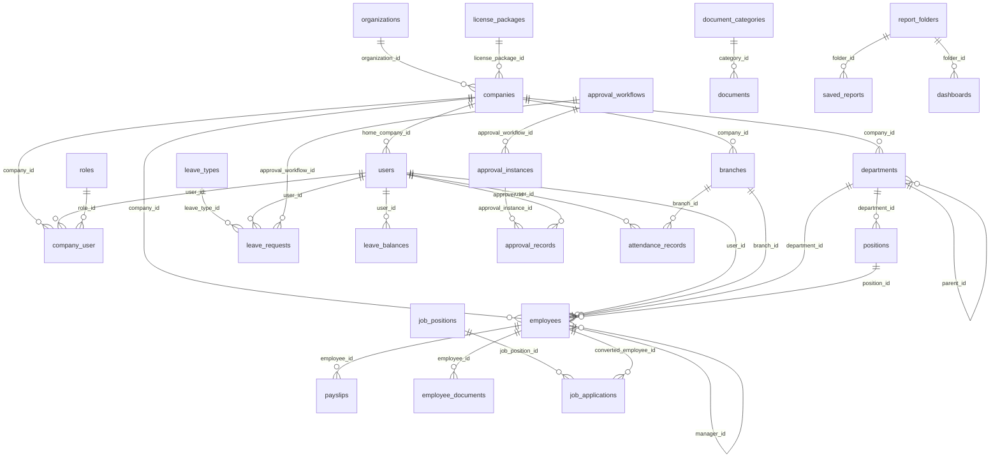

# Dobedan HR — Kapsamlı Proje Durum Değerlendirmesi (Cursor, salt-okunur denetim)

**Tarih:** 13 Ekim 2026 · **Branch:** `faz4-form-engine` · **HEAD:** `f006f93` (2026-08-06)
**Yöntem:** Yalnızca okuma. Kod/yapılandırma/migration/DB kaydı değiştirilmedi. DB'de yalnızca `SELECT` + `information_schema`/`pg_catalog` kullanıldı. Yazılan tek dosya bu rapordur.
**Not:** Kullanıcı izniyle frontend `pnpm lint` / `pnpm build` / `pnpm audit` / `pnpm outdated` çalıştırıldı (build, git-ignore'lu `dist/` klasörlerini üretir; kaynak kod değişmedi). `phpunit` çalıştırıldı ama test DB'si yok (bkz. §8).

**Etiketler:** **DOĞRULANDI** = komut/dosya ile kanıtlandı · **VARSAYIM** = statik çıkarım, çalıştırılarak kanıtlanmadı · **BİLİNMİYOR** = kanıt yok.
**Gizlilik:** `.env` değerleri yazılmadı. Yalnızca anahtarların tanımlı/boş/eksik olduğu belirtildi.

---

## 0. Yönetici Özeti

**Genel sağlık notu: 4 / 10**

Gerekçe: Mimari kapsamlı ve disiplinli (666 korumalı API rotası, 155 tablo, Spatie RBAC, tenancy, CI). Frontend lint ve build temiz. Ancak birkaç **üretimi doğrudan kıran** sorun var: 2FA atlatma açığı, tanımsız `private` disk, PostgreSQL'de çalışmayan MySQL'e özgü SQL. Ek olarak test paketi bu makinede koşturulamıyor ve bağımlılıklarda çok sayıda bilinen açık var.

1. **DOĞRULANDI** — Sistem bu makinede ayakta: 7 Docker servisi çalışıyor (`docker compose ps`), PostgreSQL 16.15, canlı şema = squash dump + 3 migration (sapma yok).
2. **DOĞRULANDI** — Frontend: `pnpm lint` exit 0, `pnpm build` exit 0 (3 app). TS'de `any` 0, `@ts-ignore` 0.
3. **DOĞRULANDI** — Backend test paketi bu makinede **koşmuyor**: 771 test, 732 error. Sebep `dobedan_hr_testing` veritabanının olmaması (`pg_database` sorgusu = 0). Son yeşil log: 725 passed (5 Ağu 2026).
4. **DOĞRULANDI (statik)** — **2FA atlatma:** `deny.2fa.challenge` middleware'i yalnız panel grubunda. **Portal (77 rota)** ve **süper admin (31 rota)** grupları 2FA "challenge" token'ını kabul ediyor.
5. **DOĞRULANDI (runtime config)** — `Storage::disk('private')` **tanımsız** (`InvalidArgumentException`). Bu yüzden personel belgesi yükle/indir, bordro yükle/indir, portal belge/bordro indirme ve KVKK toplayıcılarının dosya kısmı çalışmıyor (16 kullanım, 8 dosya).
6. **DOĞRULANDI (psql)** — PostgreSQL'de çalışmayan MySQL'e özgü SQL var: `YEAR()`, `DATE_FORMAT`, `TIMESTAMPDIFF`, `CURDATE`, çift tırnaklı string. Etkilenenler: çalışan rapor/pano tarih ve yaş kırılımları ile işe alım `trends` (UI'dan çağrılıyor); `employees/stats` ile doküman `widget-data`/`kpi-data` (UI'dan çağrılmıyor).
7. **DOĞRULANDI** — Bağımlılık açıkları: composer 46 advisory (14 high); pnpm 137 (2 critical `jspdf`, 66 high).
8. **DOĞRULANDI** — Güvenlik yapılandırması: Telescope varsayılan açık (62.229 kayıt). Sanctum token süresi `null` (2/2 token süresiz). `auth/register` herkese açık self-signup.
9. **DOĞRULANDI** — Kurallara uyum açığı: React Query 0 kullanım, react-hook-form 0, FormRequest 16'ya karşı inline validate 242, API Resource 1, `docs/help/` 0 dosya. localStorage'da kişisel veri (user/employee) tutuluyor.
10. **DOĞRULANDI** — Dokümanlar kodun gerisinde: README 2026-07-11, ROADMAP/BURADAN_BASLA "633 test" diyor (gerçek 771). `.cursorrules` `ROADMAP.md`'yi kökte arıyor (gerçek konum `docs/`).

**En kritik 5 sorun**

| # | Sorun | Etiket | Kanıt |
|---|---|---|---|
| 1 | Portal (77) ve süper admin (31) rotalarında 2FA challenge token kabul ediliyor → şifreyi bilen, 2FA kodu olmadan erişir | DOĞRULANDI (statik) | `backend/routes/api.php:35` (yalnız panel grubu), `backend/app/Http/Middleware/PortalAccess.php`, `SuperAdminOnly.php`, `AuthController.php:87-92`; route:list analizi |
| 2 | `private` disk tanımsız → personel belgeleri, bordrolar, portal belge/bordro indirme 500 | DOĞRULANDI | `backend/config/filesystems.php` (yalnız local/public/s3), tinker: `Disk [private] does not have a configured driver` |
| 3 | MySQL'e özgü SQL PostgreSQL'de hata veriyor (rapor/pano/istatistik uçları) | DOĞRULANDI | `EmployeeController.php:1187`, `EmployeeReportController.php:266-336`, `EmployeeDashboardController.php:350-357`, `Documents/ReportController.php:220-244`, `Recruitment/ReportController.php:190`; psql `function year(...) does not exist` |
| 4 | Test paketi koşturulamıyor (test DB yok); dokümandaki test sayısı yanlış | DOĞRULANDI | `phpunit`: Tests 771, Errors 732; `select count(*) from pg_database where datname='dobedan_hr_testing'` = 0 |
| 5 | Bağımlılık açıkları: jsPDF critical (2), axios 35 advisory, league/commonmark 14, guzzle 9 | DOĞRULANDI | `pnpm audit --json`, `composer audit --format=json` |

---

## 1. Envanter

| Metrik | Değer | Nasıl sayıldı |
|---|---|---|
| Git: aktif branch | `faz4-form-engine` | `git branch --show-current` |
| Git: son commit | `f006f93` · 2026-08-06 14:54 · fix(export): DataScope birligi, chunk/stream ve export registry | `git log -1` |
| Git: toplam commit | 233 (ilk: 2026-07-10, tek yazar) | `git rev-list --count HEAD`, `git shortlog -sn` |
| Git: commit'lenmemiş değişiklik | 0 değişmiş izlenen dosya; 52 izlenmeyen dosya (`-uall`; dizin bazında 27 giriş) | `git status --porcelain -uall` |
| Git: stash | 0 | `git stash list` |
| Git: remote farkı | 0 önde / 0 geride | `git rev-list --left-right --count HEAD...@{u}` |
| Git: main ile fark | faz4 175 commit önde, 0 geride | `git rev-list --count main..faz4-form-engine` |
| Backend | Laravel 12.43.1, PHP 8.2.34, Sanctum 4, Spatie Permission 6, Telescope 5, Google2FA | `composer.json`, container `php -v` / `artisan --version` |
| PHP | 8.2.34 (Docker `php:8.2-fpm-bookworm`) | `backend/Dockerfile`, `docker compose exec app php -v` |
| Frontend | React 19, React Router 7, Vite 7.3.0, TS 5.9.3, pnpm monorepo (3 app + `@dobedan/shared`) | `frontend/**/package.json`, build çıktısı |
| PostgreSQL | 16.15 (alpine) | `select version()` |
| Docker servisleri | 7: app, nginx, mysql, postgres, redis, queue, scheduler (hepsi running) | `docker compose ps` |
| Migration dosyası | 3 + squash şema `backend/database/schema/pgsql-schema.sql` (13.901 satır, 107 migration kaydı) | `git ls-files backend/database/migrations`, `ReadAllLines` |
| Tablo (kod / canlı) | 155 / 155 | `^CREATE TABLE` regex / `information_schema.tables` |
| FK (kod / canlı) | 431 / 431 (232 CASCADE, 199 SET NULL, 0 RESTRICT/NO ACTION) | regex / `pg_constraint contype='f'` |
| Index | dump'ta 189 `CREATE INDEX`; canlıda 406 (PK dahil), 251 (PK hariç) | regex / `pg_indexes` |
| View / function / trigger | 0 / 0 / 0 | regex (dump) |
| Kolon (canlı) | 2.149; jsonb 80, json 0; GIN index 2; soft-delete'li tablo 56; `company_id` içeren tablo 105 | `information_schema.columns`, `pg_indexes` |
| Model | 116 (fillable'lı 115, `guarded=[]` 0) | `git ls-files backend/app/Models/*.php` |
| Controller | 114 | `git ls-files backend/app/Http/Controllers/*.php` |
| Service sınıfı | 122 | `git ls-files backend/app/Services/*.php` |
| Middleware / Policy / FormRequest / Resource | 8 / 9 / 16 / 1 | `git ls-files` |
| Enum / Job / Mail / Notification / Command | 81 / 5 / 4 / 4 (+1 kanal sınıfı) / 22 | `git ls-files` |
| Seeder / Factory | 13 / 9 | `git ls-files` |
| API route | 666 (`api/v1/*`); toplam 714 (Telescope 46 + `/`, `up`, `sanctum/csrf-cookie`, `storage/{path}`) | `php artisan route:list --json` |
| Web route | `routes/web.php` 7 satır | `ReadAllLines` |
| Frontend route satırı (superadmin / company / portal) | 11 / 124 / 24 (redirect: 2 / 23 / 1) | `App.tsx` ayrıştırıcı (bkz. §6) |
| Frontend sayfa dosyası (company / portal / superadmin) | 105 / 20 / 9 | `git ls-files frontend/apps/<app>/src/pages/*.tsx` |
| TSX dosyası (toplam) | 233 | `git ls-files 'frontend/apps/*.tsx' 'frontend/packages/*.tsx'` |
| Backend test dosyası | 117 (111 Feature + 6 Unit) | `git ls-files backend/tests/*Test.php` |
| Test metodu | 657 `function test_` (+ data provider ile 771 test vakası) | `git grep 'function test_'`, phpunit çıktısı |
| Son tam yeşil suite | 725 passed / 3.180 assertion (5 Ağu, 5 rastgele sıra koşusu) | `docs/uzun-kosu-suite-summary.txt`, `backend-tur8-suite.log` |
| Bu makinede suite | 771 test, 732 error, 104 assertion, 59 PHPUnit deprecation | `docker compose exec app php vendor/bin/phpunit` |
| Frontend test dosyası | 0 | `git ls-files 'frontend/*.test.ts*' 'frontend/*.spec.ts*'` |
| TODO / FIXME / HACK | 0 / 0 / 0 (`XXX` 3 adet; hepsi telefon formatı yer tutucusu) | `git grep -w -E "TODO\|FIXME\|HACK\|XXX"` |
| Modül (ModuleSeeder) | 14 (canlı `modules` = 14) | seeder grep + `SELECT count(*)` |
| İzin / rol (canlı) | 444 permission / 7 rol / 686 rol-izin | `SELECT count(*)` |
| Toplam satır (canlı) | 97.567 (Telescope hariç 3.203); 93 tablo boş | `rowcounts` (her tabloya `SELECT count(*)`) |
| 500+ satırlık dosya | Backend 12, Frontend 36 | `ReadAllLines` (boş satırlar dahil) |

---

## 2. Git

- **DOĞRULANDI** — Remote: `origin https://github.com/alataxbilisim/alatax-hr`. Local 5 branch: `faz1-postgresql`, `faz2-rbac-audit`, `faz3-tasarim`, `faz4-form-engine`, `main`. Hepsi upstream ile eşleşik; remote'ta 5 branch + `origin/HEAD -> origin/main`. Son fetch: 13.10.2026 15:18 (`.git/FETCH_HEAD`).
- **DOĞRULANDI** — `main` 588dd49'da duruyor ("docs(faz2): ROADMAP — Faz 2 KAPANDI"). Faz 3, 4, 5, G ve temizlik işleri (175 commit) **main'e merge edilmemiş**. Üretim dalı tanımı belirsiz (bkz. §14).
- **DOĞRULANDI** — Son 100 commit'in 99'u Conventional Commits formatında. Son commit tarihi 2026-08-06; o tarihten bu yana (≈2 ay) commit yok.
- **DOĞRULANDI** — `734ee66` commit mesajının başında UTF-8 BOM var (`chore(faz6-prep)…`).
- **DOĞRULANDI** — İzlenmeyen 52 dosya: `backend/scripts/uzun-kosu/*` (benchmark betikleri + JSON), `backend/scripts/*.php` (5 yardımcı betik), `docs/*.json` (benchmark çıktıları), `docs/DOCS_ANALIZ.md`, `docs/UZUN_KOSU_RAPORU.md`, `docs/DURUM_RAPORU_CLAUDE.md`, `scripts/tmp-*`, `scripts/ubuntu-fix-migrate.sh`. Bunlar commit'lenmeli ya da silinmeli (karar kullanıcıda).
- **DOĞRULANDI** — Depo hijyeni:
  - İzlenen gereksiz dosyalar: `frontend/_e_lint_*.txt` (3), `frontend/_e_tsc_*.txt` (3), `frontend/apps/*/vite.config.js` + `vite.config.d.ts` (6; `tsc -b` çıktısı — VARSAYIM), `frontend/package-lock.json` (pnpm reposunda npm kilidi).
  - `git ls-files -i -c --exclude-standard` = **44** dosya hem izleniyor hem ignore'da (`docs/qa/e2e/*` 42 PNG dahil).
  - Kökte izlenmeyen 3 suite log'u var: `backend-gorsel-suite.log`, `backend-tur2-suite.log`, `backend-tur8-suite.log`.
- **DOĞRULANDI** — Satır sonu: `.gitattributes` `eol=lf` ama `core.autocrlf=true` olduğu için 330 izlenen dosya çalışma kopyasında CRLF (`git ls-files --eol` → `w/crlf`). Index'te CRLF 0.

---

## 3. Ortam / Altyapı

**Servisler (`docker-compose.yml`, `docker compose ps`)** — DOĞRULANDI

| Servis | İmaj / build | Port | Healthcheck | Durum |
|---|---|---|---|---|
| app | `backend/Dockerfile` (php:8.2-fpm-bookworm) | — | **yok** | Up |
| queue | aynı imaj, `queue:work` | — | **yok** | Up |
| scheduler | aynı imaj, `schedule:work` | — | **yok** | Up |
| nginx | nginx | `${APP_HTTP_PORT:-8000}:80` | `wget /up` | healthy |
| postgres | postgres:16-alpine | 5432 | `pg_isready` | healthy |
| mysql (legacy) | mysql:8.0 | `${MYSQL_HOST_PORT:-3306}` (root `.env`: 3307) | var | healthy |
| redis | redis:7-alpine | 6379 | var | healthy |

**Çalışma anı yapılandırması (container içinde config okundu; değer değil durum)** — DOĞRULANDI
- `env=local`, `debug=true`, `tz=Europe/Istanbul`, `locale=tr`.
- `db.default=pgsql` (host `postgres`, db `dobedan_hr`); cache/queue/session `redis`; mail `log`.
- `telescope.enabled=true`. Config ve route cache yok.
- CORS: `config/cors.php` varsayılan listesi (localhost/127.0.0.1 :3001–3003), `supports_credentials=true`.
- Sanctum: `expiration=NULL`.

**`.env` anahtar durumu (değerler yazılmadı)** — DOĞRULANDI

| Dosya | Var mı | Anahtar | Boş | Not |
|---|---|---|---|---|
| `.env` (kök, compose) | evet | 34 | 0 | `DB_CONNECTION=pgsql`. `DB_HOST/DB_DATABASE/DB_USERNAME/DB_PASSWORD` **yok** (compose `environment` ile veriliyor). `CORS_ALLOWED_ORIGINS`, `FRONTEND_URL*`, `TELESCOPE_ENABLED`, `APP_TIMEZONE`, `LOG_*`, `SESSION_*` (lifetime/encrypt/domain) **yok** (kod varsayılanları devrede). Karışık satır sonu (önceki oturumda tespit). |
| `.env.example` (kök) | **yok** | — | — | Kök compose `.env` için örnek dosya yok. |
| `backend/.env` | evet | 49 | 4 | **Bayat XAMPP/MySQL yapılandırması** (`DB_CONNECTION=mysql`, `127.0.0.1:3306`, cache/queue/session `database`, `APP_LOCALE=en`). Container'da compose env bunu eziyor; host'ta `php artisan` çalıştırılırsa yanlış DB'ye gider (VARSAYIM). |
| `backend/.env.example` | evet | 54 | 4 | Kök `.env`'de olmayan 31 anahtar içeriyor (`FRONTEND_URL_*`, `CORS_ALLOWED_ORIGINS`, `SESSION_*`, `LOG_*`, `AWS_*` …). |
| `frontend/apps/*/.env` | yok | — | — | `VITE_API_URL` tanımsız; `api.ts:7` `http://localhost:8000/api/v1`'e düşüyor. |

**Diğer bulgular**
- **DOĞRULANDI** — Araç sürümü uyumsuzluğu: CI `pnpm 10 / Node 20` (`.github/workflows/ci.yml`), bu makinede `pnpm 9.15.9 / Node 22`.
- **DOĞRULANDI** — `public/storage` symlink'i container'da **yok** (`ls -la public/`). `public` diske yazılan avatar/logo/CV/belge URL'leri 404 verir. Belge indirme controller üzerinden olduğu için etkilenmez.
- **DOĞRULANDI** — Scheduler'da 9 zamanlanmış komut var (`backend/routes/console.php`): izin hakediş (aylık), devir (yıllık), belge süre uyarısı, onay eskalasyonu, puantaj eksik işaretleme, rapor erişim logu temizliği, zamanlanmış raporlar (her dakika), KVKK bakım, KVKK saklama taraması. `jobs`=0, `failed_jobs`=0 (DOĞRULANDI).
- **DOĞRULANDI** — Kuyruk: 5 Job, 4 Mailable ve 2 Notification `ShouldQueue`. Mail gönderimleri `Mail::to()->queue()`. Mail sürücüsü `log`, yani gerçek SMTP doğrulanmadı (ROADMAP:113 açık borç).
- **DOĞRULANDI** — Harici entegrasyon: yalnız `SmsService` (`Http::` 4 çağrı). Webhook altyapısı var (`webhooks`/`webhook_logs` tabloları boş).
- **DOĞRULANDI** — MySQL geri dönüş yolu fiilen kırık: `backend/database/schema/` altında yalnız `pgsql-schema.sql` var. MySQL'de `migrate` yalnız 3 migration'ı çalıştırır, şema kurulamaz. `.cursorrules` "mysql'e geri dönüş yolu açık kalsın" diyor.

---

## 4. Backend Mimarisi

**Katmanlar** — DOĞRULANDI
- Controller'lar `BaseController` (`app/Http/Controllers/Api/V1/BaseController.php`) üzerinden `ApiResponse` trait'ini kullanıyor (1.049 helper çağrısı). Ham `response()->json(` 38 adet; çoğu Public controller'lar, `EmployeeDashboardController` (9) ve middleware'ler (`PortalAccess` 3, `CompanyAdminOnly` 2). Bunlar standart `{success,message,data,errors,timestamp}` formatını tam vermiyor.
- **Validasyon:** FormRequest **16**; controller içinde `$request->validate(` / `Validator::make(` **242** adet → `.cursorrules` "Validasyon her zaman FormRequest" kuralı büyük ölçüde ihlal.
- **API Resource:** 1 (`EmployeeResource`; maaş/TCKN alan izni burada). Diğer modeller doğrudan serialize ediliyor (VARSAYIM: `$hidden` dışındaki tüm alanlar döner).
- **Servisler:** 122 sınıf (rapor motoru, KVKK, ayarlar, onay akışı, bordro…). Büyük controller'lar iş mantığı taşıyor: `EmployeeController.php` 1.298, `UserController.php` 1.183, `AuthController.php` 863 satır.
- **Sorgular:** controller'larda `paginate(` 70, eager loading (`with(`) 157.
  - Ham SQL kullanımı (`DB::raw`/`*Raw`/`DB::statement`/`DB::select`): `backend/app` içinde **101** adet. Rapor motoru (`ReportQueryBuilder` 21, `ReportPivotService` 7) whitelist'li olduğu için kural istisnası.
  - **Rapor motoru dışında** ham SQL: `Documents/ReportController` 13, `EmployeeReportController` 13, `Recruitment/ReportController` 9, `EmployeeDashboardController` 8, `CvPoolController` 5, `EmployeeController` 5 ve diğerleri.
  - `EmployeeReportController.php:266-271` `$groupField`'ı string birleştirmeyle SQL'e koyuyor. Whitelist kontrolü olup olmadığı **VARSAYIM** (incelenmedi).
- **PostgreSQL uyumsuz SQL** — DOĞRULANDI (psql'de `YEAR()` ve çift tırnaklı literal hata verdi; sürücü dalı yok):

| Dosya:satır | İfade | Etkilenen rota |
|---|---|---|
| `EmployeeController.php:1187,1211` | `COALESCE(x, "Departman Atanmamış")` (çift tırnak = identifier) | `GET employees/stats` (FE'de çağıran yok — ölü uç) |
| `EmployeeReportController.php:266-271, 327-330` | `YEAR()`, `DATE_FORMAT`, `TIMESTAMPDIFF`, `CURDATE()` | `POST employees/reports/data`, `export/excel` (tarih/yaş kırılımları) |
| `EmployeeDashboardController.php:350-357` | `YEAR(hire_date)`, `YEAR(birth_date)` | `POST employees/dashboards/widget-data` (`hire_year`/`birth_year` boyutları) |
| `Documents/ReportController.php:220-244` | `YEAR(created_at)`, `MONTH(created_at)` | `POST documents/reports/widget-data`, `kpi-data` (`api.ts:601-604`'te tanımlı, hiçbir sayfa çağırmıyor) |
| `Recruitment/ReportController.php:190` | `DATE_FORMAT(created_at, …)` | `GET recruitment/reports/trends` (`RecruitmentReportsPage`) |

**Middleware ve tenancy** — DOĞRULANDI
- `bootstrap/app.php` içeriği: alias'lar; `throttleApi('api')`; `CompanyContext`/`BranchContext` SubstituteBindings'ten önce; `api/*` için JSON exception render.
- Rate limit (`AppServiceProvider`): auth 10/dk (IP), api 120/dk, exports 20, public 20.
- `Gate::before`: SuperAdmin her şeye `true` döner, ardından `HierarchicalPermission::matches` (wildcard).
- Rotalardaki middleware dağılımı (666 içinde):

| Middleware | Rota sayısı |
|---|---|
| `Authenticate` | 652 |
| `ResolveCompanyContext` / `EnsureCompanyIsActive` | 620 |
| `ResolveBranchContext` / `DenyTwoFactorChallengeToken` | 543 |
| `PermissionMiddleware` | 515 |
| `CheckModuleAccess` | 233 |
| `CompanyAdminOnly` | 216 |
| `PortalAccess` | 77 |
| `SuperAdminOnly` | 31 |
| `ThrottleRequests` | 27 |

- **Koruma özeti:** 515 permission + 31 süper admin + 106 "auth var, permission yok" + 14 public = 666.
  - 106'nın dağılımı: portal self-servis 77, onay işlemleri 10 (Policy/WorkflowService ile korunduğu VARSAYIM), auth/2FA self 11, bağlam 2, dashboard 1, lookups 2, bildirim 3.
- **2FA açığı (DOĞRULANDI, statik):** `deny.2fa.challenge` yalnızca `routes/api.php:35` grubunda.
  - `PortalAccess` yalnız employee/aktiflik kontrol ediyor; `SuperAdminOnly` yalnız `type` kontrol ediyor. Token adı ya da ability kontrol edilmiyor.
  - `AuthController.php:89-92` 2FA'lı kullanıcıya 5 dakikalık challenge token veriyor. Bu token 77 portal ve 31 admin rotasında geçerli.
  - Testlerde `2fa-challenge` geçen dosya 0.
- **Tenancy:** `BelongsToCompany` kullanan model 59.
  - `company_id`'ye referans verip trait kullanmayan model 5: `ApprovalStep`, `CompanyLedger`, `CompanyUser` (pivot), `Holiday`, `Timesheet` (kullanılmıyor). Kasıtlı olup olmadıkları VARSAYIM.
  - `$user->company_id` okuma 0 (kolon `home_company_id` olarak yeniden adlandırılmış).
  - `company_id` client input'tan okunmuyor; 4 yerde `$validated['company_id'] = $this->getCompanyId()` ile sunucu tarafında atanıyor.
- **Audit:** `Auditable` kullanan model 28 / 116. **PersonalDataCollector:** 15 sınıf.
- **Hata yönetimi:** `Log::` 345 çağrı. Controller'larda istisna mesajını (`$e->getMessage()`) yanıt metnine ekleyen **46 satır / 22 dosya** var (örn. `BranchController.php:133`). Bir kısmı kasıtlı domain exception olabilir (VARSAYIM); SQL hata metni sızdırma riski var.

**API rotaları:** Tam tablo aşağıda (666 satır, `route:list --json` kaynaklı). "Koruma" kolonu: `perm:<izin>` / `superadmin` / `portal` / `auth` (yalnız kimlik doğrulama) / `PUBLIC`.

Tüm API rotaları (666)

| # | Method | URI (`/api/v1` sonrası) | Controller@action | Koruma | Ek |
|---|---|---|---|---|---|
| 1 | GET | `/activity-logs` | `ActivityLogController@index` | perm:management.audit_logs.view |  |
| 2 | GET | `/activity-logs/{id}` | `ActivityLogController@show` | perm:management.audit_logs.view |  |
| 3 | GET | `/activity-logs/export` | `ActivityLogController@export` | perm:management.audit_logs.export | throttle |
| 4 | GET | `/admin/available-modules` | `Admin\LicensePackageController@availableModules` | superadmin | 2FA-challenge-açık |
| 5 | GET | `/admin/companies` | `Admin\CompanyController@index` | superadmin | 2FA-challenge-açık |
| 6 | POST | `/admin/companies` | `Admin\CompanyController@store` | superadmin | 2FA-challenge-açık |
| 7 | DELETE | `/admin/companies/{company}` | `Admin\CompanyController@destroy` | superadmin | 2FA-challenge-açık |
| 8 | GET | `/admin/companies/{company}` | `Admin\CompanyController@show` | superadmin | 2FA-challenge-açık |
| 9 | PUT|PATCH | `/admin/companies/{company}` | `Admin\CompanyController@update` | superadmin | 2FA-challenge-açık |
| 10 | POST | `/admin/companies/{company}/assign-package` | `Admin\CompanyController@assignPackage` | superadmin | 2FA-challenge-açık |
| 11 | POST | `/admin/companies/{company}/extend-license` | `Admin\CompanyController@extendLicense` | superadmin | 2FA-challenge-açık |
| 12 | GET | `/admin/companies/{company}/ledger` | `Admin\CompanyLedgerController@index` | superadmin | 2FA-challenge-açık |
| 13 | GET | `/admin/companies/{company}/ledger/{transaction}` | `Admin\CompanyLedgerController@showTransaction` | superadmin | 2FA-challenge-açık |
| 14 | POST | `/admin/companies/{company}/ledger/credit` | `Admin\CompanyLedgerController@addCredit` | superadmin | 2FA-challenge-açık |
| 15 | POST | `/admin/companies/{company}/ledger/debit` | `Admin\CompanyLedgerController@addDebit` | superadmin | 2FA-challenge-açık |
| 16 | POST | `/admin/companies/{company}/modules` | `Admin\CompanyController@syncModules` | superadmin | 2FA-challenge-açık |
| 17 | POST | `/admin/companies/{company}/toggle-status` | `Admin\CompanyController@toggleStatus` | superadmin | 2FA-challenge-açık |
| 18 | GET | `/admin/dashboard` | `Admin\DashboardController@index` | superadmin | 2FA-challenge-açık |
| 19 | GET | `/admin/ledger/summary` | `Admin\CompanyLedgerController@summary` | superadmin | 2FA-challenge-açık |
| 20 | GET | `/admin/license-packages` | `Admin\LicensePackageController@index` | superadmin | 2FA-challenge-açık |
| 21 | POST | `/admin/license-packages` | `Admin\LicensePackageController@store` | superadmin | 2FA-challenge-açık |
| 22 | DELETE | `/admin/license-packages/{license_package}` | `Admin\LicensePackageController@destroy` | superadmin | 2FA-challenge-açık |
| 23 | GET | `/admin/license-packages/{license_package}` | `Admin\LicensePackageController@show` | superadmin | 2FA-challenge-açık |
| 24 | PUT|PATCH | `/admin/license-packages/{license_package}` | `Admin\LicensePackageController@update` | superadmin | 2FA-challenge-açık |
| 25 | POST | `/admin/license-packages/{package}/duplicate` | `Admin\LicensePackageController@duplicate` | superadmin | 2FA-challenge-açık |
| 26 | POST | `/admin/license-packages/{package}/modules` | `Admin\LicensePackageController@syncModules` | superadmin | 2FA-challenge-açık |
| 27 | GET | `/admin/logs` | `Admin\LogController@index` | superadmin | 2FA-challenge-açık |
| 28 | GET | `/admin/modules` | `Admin\ModuleController@index` | superadmin | 2FA-challenge-açık |
| 29 | POST | `/admin/modules` | `Admin\ModuleController@store` | superadmin | 2FA-challenge-açık |
| 30 | DELETE | `/admin/modules/{module}` | `Admin\ModuleController@destroy` | superadmin | 2FA-challenge-açık |
| 31 | GET | `/admin/modules/{module}` | `Admin\ModuleController@show` | superadmin | 2FA-challenge-açık |
| 32 | PUT|PATCH | `/admin/modules/{module}` | `Admin\ModuleController@update` | superadmin | 2FA-challenge-açık |
| 33 | GET | `/admin/users` | `Admin\UserController@index` | superadmin | 2FA-challenge-açık |
| 34 | GET | `/admin/users/{user}` | `Admin\UserController@show` | superadmin | 2FA-challenge-açık |
| 35 | GET | `/announcements` | `Announcements\AnnouncementController@index` | perm:announcements.list.view |  |
| 36 | POST | `/announcements` | `Announcements\AnnouncementController@store` | perm:announcements.list.create |  |
| 37 | DELETE | `/announcements/{id}` | `Announcements\AnnouncementController@destroy` | perm:announcements.list.delete |  |
| 38 | GET | `/announcements/{id}` | `Announcements\AnnouncementController@show` | perm:announcements.list.view |  |
| 39 | PUT | `/announcements/{id}` | `Announcements\AnnouncementController@update` | perm:announcements.list.edit |  |
| 40 | POST | `/announcements/{id}/publish` | `Announcements\AnnouncementController@publish` | perm:announcements.list.edit |  |
| 41 | POST | `/announcements/{id}/unpublish` | `Announcements\AnnouncementController@unpublish` | perm:announcements.list.edit |  |
| 42 | GET | `/api-keys` | `ApiKeyController@index` | perm:management.api_keys.view | company-admin |
| 43 | POST | `/api-keys` | `ApiKeyController@store` | perm:management.api_keys.create | company-admin |
| 44 | DELETE | `/api-keys/{id}` | `ApiKeyController@destroy` | perm:management.api_keys.delete | company-admin |
| 45 | GET | `/api-keys/{id}` | `ApiKeyController@show` | perm:management.api_keys.view | company-admin |
| 46 | PUT | `/api-keys/{id}` | `ApiKeyController@update` | perm:management.api_keys.edit | company-admin |
| 47 | POST | `/api-keys/{id}/regenerate` | `ApiKeyController@regenerate` | perm:management.api_keys.edit | company-admin |
| 48 | POST | `/approvals/{id}/approve` | `Workflow\ApprovalController@approve` | auth |  |
| 49 | POST | `/approvals/{id}/reject` | `Workflow\ApprovalController@reject` | auth |  |
| 50 | POST | `/approvals/{id}/skip` | `Workflow\ApprovalController@skip` | auth |  |
| 51 | GET | `/approvals/delegations` | `Workflow\ApprovalController@delegations` | auth |  |
| 52 | POST | `/approvals/delegations` | `Workflow\ApprovalController@createDelegation` | auth |  |
| 53 | POST | `/approvals/delegations/{id}/cancel` | `Workflow\ApprovalController@cancelDelegation` | auth |  |
| 54 | GET | `/approvals/delegations/my` | `Workflow\ApprovalController@myDelegations` | auth |  |
| 55 | GET | `/approvals/history` | `Workflow\ApprovalController@myApprovalHistory` | auth |  |
| 56 | GET | `/approvals/pending` | `Workflow\ApprovalController@pendingApprovals` | auth |  |
| 57 | GET | `/approvals/record-history` | `Workflow\ApprovalController@getApprovalHistory` | auth |  |
| 58 | GET | `/assets/categories` | `Assets\CategoryController@index` | perm:assets.categories.view | module |
| 59 | POST | `/assets/categories` | `Assets\CategoryController@store` | perm:assets.categories.create | module |
| 60 | DELETE | `/assets/categories/{id}` | `Assets\CategoryController@destroy` | perm:assets.categories.delete | module |
| 61 | GET | `/assets/categories/{id}` | `Assets\CategoryController@show` | perm:assets.categories.view | module |
| 62 | PATCH | `/assets/categories/{id}` | `Assets\CategoryController@update` | perm:assets.categories.edit | module |
| 63 | PUT | `/assets/categories/{id}` | `Assets\CategoryController@update` | perm:assets.categories.edit | module |
| 64 | GET | `/assets/items` | `Assets\AssetController@index` | perm:assets.list.view | module |
| 65 | POST | `/assets/items` | `Assets\AssetController@store` | perm:assets.list.create | module |
| 66 | DELETE | `/assets/items/{id}` | `Assets\AssetController@destroy` | perm:assets.list.delete | module |
| 67 | GET | `/assets/items/{id}` | `Assets\AssetController@show` | perm:assets.list.view | module |
| 68 | PATCH | `/assets/items/{id}` | `Assets\AssetController@update` | perm:assets.list.edit | module |
| 69 | PUT | `/assets/items/{id}` | `Assets\AssetController@update` | perm:assets.list.edit | module |
| 70 | POST | `/assets/items/{id}/assign` | `Assets\AssetController@assign` | perm:assets.assignments.create | module |
| 71 | POST | `/assets/items/{id}/return` | `Assets\AssetController@returnAsset` | perm:assets.assignments.edit | module |
| 72 | GET | `/assets/maintenance` | `Assets\MaintenanceController@index` | perm:assets.maintenance.view | module |
| 73 | POST | `/assets/maintenance` | `Assets\MaintenanceController@store` | perm:assets.maintenance.create | module |
| 74 | DELETE | `/assets/maintenance/{id}` | `Assets\MaintenanceController@destroy` | perm:assets.maintenance.delete | module |
| 75 | GET | `/assets/maintenance/{id}` | `Assets\MaintenanceController@show` | perm:assets.maintenance.view | module |
| 76 | PATCH | `/assets/maintenance/{id}` | `Assets\MaintenanceController@update` | perm:assets.maintenance.edit | module |
| 77 | PUT | `/assets/maintenance/{id}` | `Assets\MaintenanceController@update` | perm:assets.maintenance.edit | module |
| 78 | POST | `/assets/maintenance/{id}/complete` | `Assets\MaintenanceController@complete` | perm:assets.maintenance.edit | module |
| 79 | GET | `/attendance` | `Timesheet\AttendanceController@index` | perm:timesheet.attendance.view |  |
| 80 | POST | `/attendance` | `Timesheet\AttendanceController@store` | perm:timesheet.attendance.create |  |
| 81 | GET | `/attendance/{id}` | `Timesheet\AttendanceController@show` | perm:timesheet.attendance.view |  |
| 82 | PUT | `/attendance/{id}` | `Timesheet\AttendanceController@update` | perm:timesheet.attendance.edit |  |
| 83 | POST | `/attendance/{id}/approve` | `Timesheet\AttendanceController@approve` | perm:timesheet.attendance.approve |  |
| 84 | POST | `/attendance/bulk-approve` | `Timesheet\AttendanceController@bulkApprove` | perm:timesheet.attendance.approve |  |
| 85 | GET | `/attendance/daily-summary` | `Timesheet\AttendanceController@dailySummary` | perm:timesheet.attendance.view |  |
| 86 | POST | `/attendance/kiosk/token` | `Timesheet\AttendanceKioskController@issueToken` | perm:timesheet.kiosk.view |  |
| 87 | GET | `/attendance/reports` | `Timesheet\AttendanceReportController@index` | perm:timesheet.attendance.view |  |
| 88 | GET | `/attendance/reports/export` | `Timesheet\AttendanceReportController@export` | perm:timesheet.attendance.view |  |
| 89 | POST | `/auth/2fa/confirm` | `AuthController@confirmSelf2FA` | auth |  |
| 90 | POST | `/auth/2fa/disable` | `AuthController@disableSelf2FA` | auth |  |
| 91 | POST | `/auth/2fa/enable` | `AuthController@enableSelf2FA` | auth |  |
| 92 | GET | `/auth/2fa/recovery-codes` | `AuthController@getSelfRecoveryCodes` | auth |  |
| 93 | POST | `/auth/2fa/recovery-codes/regenerate` | `AuthController@regenerateSelfRecoveryCodes` | auth |  |
| 94 | GET | `/auth/2fa/status` | `AuthController@self2FAStatus` | auth |  |
| 95 | POST | `/auth/2fa/verify` | `AuthController@verifyTwoFactor` | auth | throttle, 2FA-challenge-açık |
| 96 | POST | `/auth/accept-invitation` | `AuthController@acceptInvitation` | **PUBLIC** | throttle |
| 97 | POST | `/auth/forgot-password` | `AuthController@forgotPassword` | **PUBLIC** | throttle |
| 98 | GET | `/auth/invitation/{token}` | `AuthController@showInvitation` | **PUBLIC** | throttle |
| 99 | POST | `/auth/login` | `AuthController@login` | **PUBLIC** | throttle |
| 100 | POST | `/auth/logout` | `AuthController@logout` | auth |  |
| 101 | GET | `/auth/me` | `AuthController@me` | auth |  |
| 102 | PUT | `/auth/password` | `AuthController@updatePassword` | auth |  |
| 103 | PUT | `/auth/profile` | `AuthController@updateProfile` | auth |  |
| 104 | POST | `/auth/register` | `AuthController@register` | **PUBLIC** | throttle |
| 105 | POST | `/auth/reset-password` | `AuthController@resetPassword` | **PUBLIC** | throttle |
| 106 | GET | `/branches` | `BranchController@index` | perm:management.branches.view | company-admin |
| 107 | POST | `/branches` | `BranchController@store` | perm:management.branches.create | company-admin |
| 108 | DELETE | `/branches/{id}` | `BranchController@destroy` | perm:management.branches.delete | company-admin |
| 109 | GET | `/branches/{id}` | `BranchController@show` | perm:management.branches.view | company-admin |
| 110 | PUT | `/branches/{id}` | `BranchController@update` | perm:management.branches.edit | company-admin |
| 111 | GET | `/branches/{id}/employees` | `BranchController@employees` | perm:management.branches.view | company-admin |
| 112 | POST | `/branches/{id}/set-headquarters` | `BranchController@setHeadquarters` | perm:management.branches.edit | company-admin |
| 113 | GET | `/company` | `CompanyController@show` | perm:management.company.view | company-admin |
| 114 | PUT | `/company` | `CompanyController@update` | perm:management.company.edit | company-admin |
| 115 | DELETE | `/company/logo` | `CompanyController@deleteLogo` | perm:management.company.edit | company-admin |
| 116 | POST | `/company/logo` | `CompanyController@uploadLogo` | perm:management.company.edit | company-admin |
| 117 | GET | `/company/modules` | `CompanyController@modules` | perm:management.company.view | company-admin |
| 118 | GET | `/company/settings` | `CompanySettingsController@index` | perm:management.settings.view | company-admin |
| 119 | PUT | `/company/settings` | `CompanySettingsController@update` | perm:management.settings.edit | company-admin |
| 120 | POST | `/company/settings/sms/test` | `CompanySettingsController@testSms` | perm:management.settings.edit | company-admin |
| 121 | POST | `/company/settings/smtp/test` | `CompanySettingsController@testSmtp` | perm:management.settings.edit | company-admin |
| 122 | GET | `/context/branches` | `BranchContextController@branches` | auth |  |
| 123 | GET | `/context/companies` | `CompanyContextController@companies` | auth |  |
| 124 | GET | `/custom-fields` | `CustomFieldController@index` | perm:management.custom_fields.view | company-admin |
| 125 | POST | `/custom-fields` | `CustomFieldController@store` | perm:management.custom_fields.create | company-admin |
| 126 | DELETE | `/custom-fields/{id}` | `CustomFieldController@destroy` | perm:management.custom_fields.delete | company-admin |
| 127 | GET | `/custom-fields/{id}` | `CustomFieldController@show` | perm:management.custom_fields.view | company-admin |
| 128 | PUT | `/custom-fields/{id}` | `CustomFieldController@update` | perm:management.custom_fields.edit | company-admin |
| 129 | GET | `/custom-fields/entity-types` | `CustomFieldController@getEntityTypes` | perm:management.custom_fields.view | company-admin |
| 130 | GET | `/custom-fields/field-types` | `CustomFieldController@getFieldTypes` | perm:management.custom_fields.view | company-admin |
| 131 | POST | `/custom-fields/reorder` | `CustomFieldController@reorder` | perm:management.custom_fields.edit | company-admin |
| 132 | GET | `/dashboard` | `DashboardController@index` | auth |  |
| 133 | GET | `/dashboards` | `Reports\DashboardController@index` | perm:reports.dashboards.view |  |
| 134 | POST | `/dashboards` | `Reports\DashboardController@store` | perm:reports.dashboards.create |  |
| 135 | DELETE | `/dashboards/{id}` | `Reports\DashboardController@destroy` | perm:reports.dashboards.delete |  |
| 136 | GET | `/dashboards/{id}` | `Reports\DashboardController@show` | perm:reports.dashboards.view |  |
| 137 | PUT | `/dashboards/{id}` | `Reports\DashboardController@update` | perm:reports.dashboards.edit |  |
| 138 | POST | `/dashboards/{id}/clone` | `Reports\DashboardController@cloneDashboard` | perm:reports.dashboards.create |  |
| 139 | POST | `/dashboards/{id}/run` | `Reports\DashboardController@run` | perm:reports.dashboards.view |  |
| 140 | GET | `/dashboards/by-key/{systemKey}` | `Reports\DashboardController@showBySystemKey` | perm:reports.dashboards.view |  |
| 141 | GET | `/departments` | `DepartmentController@index` | perm:employees.departments.view | company-admin |
| 142 | POST | `/departments` | `DepartmentController@store` | perm:employees.departments.create | company-admin |
| 143 | DELETE | `/departments/{id}` | `DepartmentController@destroy` | perm:employees.departments.delete | company-admin |
| 144 | GET | `/departments/{id}` | `DepartmentController@show` | perm:employees.departments.view | company-admin |
| 145 | PUT | `/departments/{id}` | `DepartmentController@update` | perm:employees.departments.edit | company-admin |
| 146 | GET | `/departments/hierarchy` | `DepartmentController@getHierarchy` | perm:employees.departments.view | company-admin |
| 147 | GET | `/departments/managers` | `DepartmentController@getManagers` | perm:employees.departments.view | company-admin |
| 148 | GET | `/documents` | `Documents\DocumentController@index` | perm:documents.list.view | module |
| 149 | POST | `/documents` | `Documents\DocumentController@store` | perm:documents.list.create | module |
| 150 | DELETE | `/documents/{id}` | `Documents\DocumentController@destroy` | perm:documents.list.delete | module |
| 151 | GET | `/documents/{id}` | `Documents\DocumentController@show` | perm:documents.list.view | module |
| 152 | PUT | `/documents/{id}` | `Documents\DocumentController@update` | perm:documents.list.edit | module |
| 153 | GET | `/documents/{id}/download` | `Documents\DocumentController@download` | perm:documents.list.view | module |
| 154 | GET | `/documents/{id}/versions` | `Documents\DocumentController@versions` | perm:documents.list.view | module |
| 155 | GET | `/documents/{id}/versions/{versionId}/download` | `Documents\DocumentController@downloadVersion` | perm:documents.list.view | module |
| 156 | GET | `/documents/categories` | `Documents\CategoryController@index` | perm:documents.categories.view | module |
| 157 | POST | `/documents/categories` | `Documents\CategoryController@store` | perm:documents.categories.create | module |
| 158 | DELETE | `/documents/categories/{id}` | `Documents\CategoryController@destroy` | perm:documents.categories.delete | module |
| 159 | PUT | `/documents/categories/{id}` | `Documents\CategoryController@update` | perm:documents.categories.edit | module |
| 160 | POST | `/documents/reports/kpi-data` | `Documents\ReportController@getKpiData` | perm:documents.reports.view | module |
| 161 | GET | `/documents/reports/metadata` | `Documents\ReportController@metadata` | perm:documents.reports.view | module |
| 162 | GET | `/documents/reports/summary` | `Documents\ReportController@summary` | perm:documents.reports.view | module |
| 163 | POST | `/documents/reports/widget-data` | `Documents\ReportController@getWidgetData` | perm:documents.reports.view | module |
| 164 | GET | `/documents/stats` | `Documents\DocumentController@stats` | perm:documents.list.view | module |
| 165 | GET | `/employee-documents/categories` | `EmployeeDocumentController@categories` | perm:employees.documents.view | company-admin |
| 166 | GET | `/employee-documents/expiring-soon` | `EmployeeDocumentController@expiringSoon` | perm:employees.documents.view | company-admin |
| 167 | GET | `/employees` | `EmployeeController@index` | perm:employees.list.view | company-admin |
| 168 | POST | `/employees` | `EmployeeController@store` | perm:employees.list.create | company-admin |
| 169 | DELETE | `/employees/{id}` | `EmployeeController@destroy` | perm:employees.list.delete | company-admin |
| 170 | GET | `/employees/{id}` | `EmployeeController@show` | perm:employees.list.view | company-admin |
| 171 | PUT | `/employees/{id}` | `EmployeeController@update` | perm:employees.list.edit | company-admin |
| 172 | GET | `/employees/{id}/activity` | `EmployeeController@getActivity` | perm:employees.list.view | company-admin |
| 173 | GET | `/employees/{id}/assets` | `EmployeeController@getAssets` | perm:employees.list.view | company-admin |
| 174 | GET | `/employees/{id}/documents` | `EmployeeDocumentController@index` | perm:employees.documents.view | company-admin |
| 175 | POST | `/employees/{id}/documents` | `EmployeeDocumentController@store` | perm:employees.documents.create | company-admin |
| 176 | DELETE | `/employees/{id}/documents/{docId}` | `EmployeeDocumentController@destroy` | perm:employees.documents.delete | company-admin |
| 177 | GET | `/employees/{id}/documents/{docId}` | `EmployeeDocumentController@show` | perm:employees.documents.view | company-admin |
| 178 | PUT | `/employees/{id}/documents/{docId}` | `EmployeeDocumentController@update` | perm:employees.documents.edit | company-admin |
| 179 | GET | `/employees/{id}/documents/{docId}/download` | `EmployeeDocumentController@download` | perm:employees.documents.view | company-admin |
| 180 | GET | `/employees/{id}/leaves` | `EmployeeController@getLeaves` | perm:employees.list.view | company-admin |
| 181 | POST | `/employees/{id}/offboarding` | `OffboardingController@start` | perm:employees.terminate.create | company-admin |
| 182 | GET | `/employees/{id}/performance` | `EmployeeController@getPerformance` | perm:employees.list.view | company-admin |
| 183 | DELETE | `/employees/{id}/portal-access` | `EmployeeController@revokePortalAccess` | perm:employees.list.edit | company-admin |
| 184 | POST | `/employees/{id}/portal-access` | `EmployeeController@createPortalAccess` | perm:employees.list.edit | company-admin |
| 185 | GET | `/employees/{id}/salary` | `Salary\EmployeeSalaryController@index` | perm:employees.salary.view | company-admin |
| 186 | POST | `/employees/{id}/salary` | `Salary\EmployeeSalaryController@store` | perm:employees.salary.edit | company-admin |
| 187 | GET | `/employees/{id}/trainings` | `EmployeeController@getTrainings` | perm:employees.list.view | company-admin |
| 188 | POST | `/employees/bulk-delete` | `EmployeeController@bulkDelete` | perm:employees.list.delete | company-admin |
| 189 | POST | `/employees/bulk-update` | `EmployeeController@bulkUpdate` | perm:employees.list.edit | company-admin |
| 190 | GET | `/employees/custom-fields` | `EmployeeController@getCustomFields` | perm:employees.custom_fields.view | company-admin |
| 191 | GET | `/employees/dashboards` | `EmployeeDashboardController@index` | perm:employees.reports.view | company-admin |
| 192 | POST | `/employees/dashboards` | `EmployeeDashboardController@store` | perm:employees.reports.view | company-admin |
| 193 | DELETE | `/employees/dashboards/{dashboardId}` | `EmployeeDashboardController@destroy` | perm:employees.reports.view | company-admin |
| 194 | GET | `/employees/dashboards/{dashboardId}` | `EmployeeDashboardController@show` | perm:employees.reports.view | company-admin |
| 195 | PUT | `/employees/dashboards/{dashboardId}` | `EmployeeDashboardController@update` | perm:employees.reports.view | company-admin |
| 196 | GET | `/employees/dashboards/{dashboardId}/export/excel` | `EmployeeDashboardController@exportExcel` | perm:employees.reports.export | company-admin, throttle |
| 197 | POST | `/employees/dashboards/{dashboardId}/favorite` | `EmployeeDashboardController@toggleFavorite` | perm:employees.reports.view | company-admin |
| 198 | POST | `/employees/dashboards/widget-data` | `EmployeeDashboardController@getWidgetData` | perm:employees.reports.view | company-admin |
| 199 | GET | `/employees/departments` | `EmployeeController@departments` | perm:employees.departments.view | company-admin |
| 200 | GET | `/employees/export` | `EmployeeController@export` | perm:employees.list.export | company-admin, throttle |
| 201 | POST | `/employees/import` | `EmployeeController@import` | perm:employees.list.import | company-admin, throttle |
| 202 | GET | `/employees/import/template` | `EmployeeController@importTemplate` | perm:employees.list.import | company-admin, throttle |
| 203 | GET | `/employees/managers` | `EmployeeController@managers` | perm:employees.list.view | company-admin |
| 204 | GET | `/employees/organization-chart` | `EmployeeController@getOrganizationChart` | perm:employees.organization.view | company-admin |
| 205 | GET | `/employees/reports/by-branch` | `BranchComparisonReportController` | perm:reports.cross_branch | company-admin |
| 206 | POST | `/employees/reports/data` | `EmployeeReportController@getData` | perm:employees.reports.view | company-admin, throttle |
| 207 | POST | `/employees/reports/export/excel` | `EmployeeReportController@exportExcel` | perm:employees.reports.export | company-admin, throttle |
| 208 | GET | `/employees/reports/metadata` | `EmployeeReportController@metadata` | perm:employees.reports.view | company-admin |
| 209 | GET | `/employees/reports/saved` | `EmployeeReportController@savedReports` | perm:employees.reports.view | company-admin |
| 210 | POST | `/employees/reports/saved` | `EmployeeReportController@saveReport` | perm:employees.reports.view | company-admin |
| 211 | DELETE | `/employees/reports/saved/{id}` | `EmployeeReportController@deleteReport` | perm:employees.reports.view | company-admin |
| 212 | PUT | `/employees/reports/saved/{id}` | `EmployeeReportController@updateReport` | perm:employees.reports.view | company-admin |
| 213 | POST | `/employees/reports/saved/{id}/favorite` | `EmployeeReportController@toggleFavorite` | perm:employees.reports.view | company-admin |
| 214 | GET | `/employees/stats` | `EmployeeController@getStats` | perm:employees.list.view | company-admin |
| 215 | GET | `/employee-shifts` | `Timesheet\EmployeeShiftController@index` | perm:timesheet.shifts.view |  |
| 216 | POST | `/employee-shifts` | `Timesheet\EmployeeShiftController@store` | perm:timesheet.shifts.create |  |
| 217 | DELETE | `/employee-shifts/{id}` | `Timesheet\EmployeeShiftController@destroy` | perm:timesheet.shifts.edit |  |
| 218 | POST | `/employee-shifts/bulk` | `Timesheet\EmployeeShiftController@bulkAssign` | perm:timesheet.shifts.create |  |
| 219 | GET | `/expenses/categories` | `Expenses\ExpenseCategoryController@index` | perm:expenses.categories.view |  |
| 220 | POST | `/expenses/categories` | `Expenses\ExpenseCategoryController@store` | perm:expenses.categories.create |  |
| 221 | DELETE | `/expenses/categories/{expense_category}` | `Expenses\ExpenseCategoryController@destroy` | perm:expenses.categories.delete |  |
| 222 | GET | `/expenses/categories/{expense_category}` | `Expenses\ExpenseCategoryController@show` | perm:expenses.categories.view |  |
| 223 | PATCH | `/expenses/categories/{expense_category}` | `Expenses\ExpenseCategoryController@update` | perm:expenses.categories.edit |  |
| 224 | PUT | `/expenses/categories/{expense_category}` | `Expenses\ExpenseCategoryController@update` | perm:expenses.categories.edit |  |
| 225 | GET | `/expenses/claims` | `Expenses\ExpenseClaimController@index` | perm:expenses.claims.view |  |
| 226 | GET | `/expenses/claims/{expense_claim}` | `Expenses\ExpenseClaimController@show` | perm:expenses.claims.view |  |
| 227 | POST | `/expenses/claims/{expense_claim}/approve` | `Expenses\ExpenseClaimController@approve` | perm:expenses.claims.approve |  |
| 228 | POST | `/expenses/claims/{expense_claim}/mark-paid` | `Expenses\ExpenseClaimController@markPaid` | perm:expenses.claims.edit |  |
| 229 | POST | `/expenses/claims/{expense_claim}/reject` | `Expenses\ExpenseClaimController@reject` | perm:expenses.claims.approve |  |
| 230 | GET | `/form-definitions/{entityType}` | `FormDefinitionController@show` | perm:management.forms.view | company-admin |
| 231 | PUT | `/form-definitions/{entityType}` | `FormDefinitionController@update` | perm:management.forms.edit | company-admin |
| 232 | GET | `/kvkk/activities` | `Kvkk\DataProcessingActivityController@index` | perm:management.kvkk.view | company-admin |
| 233 | POST | `/kvkk/activities` | `Kvkk\DataProcessingActivityController@store` | perm:management.kvkk.edit | company-admin |
| 234 | DELETE | `/kvkk/activities/{id}` | `Kvkk\DataProcessingActivityController@destroy` | perm:management.kvkk.edit | company-admin |
| 235 | PUT | `/kvkk/activities/{id}` | `Kvkk\DataProcessingActivityController@update` | perm:management.kvkk.edit | company-admin |
| 236 | GET | `/kvkk/activities/export` | `Kvkk\DataProcessingActivityController@export` | perm:management.kvkk.view | company-admin, throttle |
| 237 | GET | `/kvkk/breaches` | `Kvkk\DataBreachController@index` | perm:management.kvkk.breaches.view | company-admin |
| 238 | POST | `/kvkk/breaches` | `Kvkk\DataBreachController@store` | perm:management.kvkk.breaches.edit | company-admin |
| 239 | PUT | `/kvkk/breaches/{id}` | `Kvkk\DataBreachController@update` | perm:management.kvkk.breaches.edit | company-admin |
| 240 | GET | `/kvkk/breaches/{id}/report` | `Kvkk\DataBreachController@report` | perm:management.kvkk.breaches.view | company-admin |
| 241 | GET | `/kvkk/breaches/summary` | `Kvkk\DataBreachController@summary` | perm:management.kvkk.breaches.view | company-admin |
| 242 | GET | `/kvkk/categories` | `Kvkk\DataProcessingActivityController@categories` | perm:management.kvkk.view | company-admin |
| 243 | GET | `/kvkk/consents` | `Kvkk\ConsentRecordController@index` | perm:management.kvkk.view | company-admin |
| 244 | POST | `/kvkk/consents` | `Kvkk\ConsentRecordController@store` | perm:management.kvkk.edit | company-admin |
| 245 | POST | `/kvkk/consents/{id}/withdraw` | `Kvkk\ConsentRecordController@withdraw` | perm:management.kvkk.edit | company-admin |
| 246 | GET | `/kvkk/consents/missing` | `Kvkk\ConsentRecordController@missing` | perm:management.kvkk.view | company-admin |
| 247 | GET | `/kvkk/data-subject-requests` | `Kvkk\DataSubjectRequestController@index` | perm:management.kvkk.requests.view | company-admin |
| 248 | POST | `/kvkk/data-subject-requests` | `Kvkk\DataSubjectRequestController@store` | perm:management.kvkk.requests.edit | company-admin |
| 249 | GET | `/kvkk/data-subject-requests/{id}` | `Kvkk\DataSubjectRequestController@show` | perm:management.kvkk.requests.view | company-admin |
| 250 | POST | `/kvkk/data-subject-requests/{id}/export` | `Kvkk\DataSubjectRequestController@buildExport` | perm:management.kvkk.requests.respond | company-admin |
| 251 | GET | `/kvkk/data-subject-requests/{id}/export/{uuid}/download` | `Kvkk\DataSubjectRequestController@downloadExport` | perm:management.kvkk.requests.view | company-admin |
| 252 | POST | `/kvkk/data-subject-requests/{id}/respond` | `Kvkk\DataSubjectRequestController@respond` | perm:management.kvkk.requests.respond | company-admin |
| 253 | POST | `/kvkk/data-subject-requests/{id}/verify-identity` | `Kvkk\DataSubjectRequestController@verifyIdentity` | perm:management.kvkk.requests.edit | company-admin |
| 254 | GET | `/kvkk/data-subject-requests/summary` | `Kvkk\DataSubjectRequestController@summary` | perm:management.kvkk.requests.view | company-admin |
| 255 | POST | `/kvkk/destruction/approve` | `Kvkk\DestructionController@approve` | perm:management.kvkk.destruction.approve | company-admin |
| 256 | GET | `/kvkk/destruction/candidates` | `Kvkk\DestructionController@candidates` | perm:management.kvkk.destruction.approve | company-admin |
| 257 | POST | `/kvkk/destruction/candidates/{id}/decide` | `Kvkk\DestructionController@decide` | perm:management.kvkk.destruction.approve | company-admin |
| 258 | POST | `/kvkk/destruction/candidates/{id}/dry-run` | `Kvkk\DestructionController@dryRun` | perm:management.kvkk.destruction.approve | company-admin |
| 259 | GET | `/kvkk/destruction/logs` | `Kvkk\DestructionController@logs` | perm:management.kvkk.view | company-admin |
| 260 | GET | `/kvkk/destruction/logs/{id}/certificate` | `Kvkk\DestructionController@logCertificate` | perm:management.kvkk.view | company-admin |
| 261 | POST | `/kvkk/destruction/scan` | `Kvkk\DestructionController@scan` | perm:management.kvkk.destruction.approve | company-admin |
| 262 | GET | `/kvkk/destruction/summary` | `Kvkk\DestructionController@summary` | perm:management.kvkk.destruction.approve | company-admin |
| 263 | GET | `/kvkk/legal-holds` | `Kvkk\LegalHoldController@index` | perm:management.kvkk.legal_hold.manage | company-admin |
| 264 | POST | `/kvkk/legal-holds` | `Kvkk\LegalHoldController@store` | perm:management.kvkk.legal_hold.manage | company-admin |
| 265 | POST | `/kvkk/legal-holds/{id}/release` | `Kvkk\LegalHoldController@release` | perm:management.kvkk.legal_hold.manage | company-admin |
| 266 | GET | `/kvkk/notices` | `Kvkk\PrivacyNoticeController@index` | perm:management.kvkk.view | company-admin |
| 267 | POST | `/kvkk/notices` | `Kvkk\PrivacyNoticeController@store` | perm:management.kvkk.edit | company-admin |
| 268 | DELETE | `/kvkk/notices/{id}` | `Kvkk\PrivacyNoticeController@destroy` | perm:management.kvkk.edit | company-admin |
| 269 | PUT | `/kvkk/notices/{id}` | `Kvkk\PrivacyNoticeController@update` | perm:management.kvkk.edit | company-admin |
| 270 | POST | `/kvkk/notices/{id}/publish` | `Kvkk\PrivacyNoticeController@publish` | perm:management.kvkk.edit | company-admin |
| 271 | GET | `/kvkk/notices/active` | `Kvkk\PrivacyNoticeController@active` | perm:management.kvkk.view | company-admin |
| 272 | GET | `/kvkk/retention-policies` | `Kvkk\RetentionPolicyController@index` | perm:management.kvkk.view | company-admin |
| 273 | POST | `/kvkk/retention-policies` | `Kvkk\RetentionPolicyController@store` | perm:management.kvkk.edit | company-admin |
| 274 | PUT | `/kvkk/retention-policies/{id}` | `Kvkk\RetentionPolicyController@update` | perm:management.kvkk.edit | company-admin |
| 275 | POST | `/kvkk/retention-policies/seed-drafts` | `Kvkk\RetentionPolicyController@seedDrafts` | perm:management.kvkk.edit | company-admin |
| 276 | GET | `/leaves/accrual-policies` | `Leaves\AccrualPolicyController@index` | perm:leaves.accrual_policies.view | module |
| 277 | POST | `/leaves/accrual-policies` | `Leaves\AccrualPolicyController@store` | perm:leaves.accrual_policies.create | module |
| 278 | DELETE | `/leaves/accrual-policies/{id}` | `Leaves\AccrualPolicyController@destroy` | perm:leaves.accrual_policies.delete | module |
| 279 | GET | `/leaves/accrual-policies/{id}` | `Leaves\AccrualPolicyController@show` | perm:leaves.accrual_policies.view | module |
| 280 | PUT | `/leaves/accrual-policies/{id}` | `Leaves\AccrualPolicyController@update` | perm:leaves.accrual_policies.edit | module |
| 281 | GET | `/leaves/accrual-policies/log-types` | `Leaves\AccrualPolicyController@getLogTypes` | perm:leaves.accrual_policies.view | module |
| 282 | POST | `/leaves/accrual-policies/process-carryover` | `Leaves\AccrualPolicyController@processYearEndCarryover` | perm:leaves.accrual_policies.edit | module |
| 283 | POST | `/leaves/accrual-policies/process-monthly` | `Leaves\AccrualPolicyController@processMonthlyAccruals` | perm:leaves.accrual_policies.edit | module |
| 284 | GET | `/leaves/accrual-policies/types` | `Leaves\AccrualPolicyController@getAccrualTypes` | perm:leaves.accrual_policies.view | module |
| 285 | GET | `/leaves/accrual-policies/user/{userId}/logs` | `Leaves\AccrualPolicyController@getUserAccrualLogs` | perm:leaves.accrual_policies.view | module |
| 286 | GET | `/leaves/balance` | `Leaves\LeaveBalanceController@index` | perm:leaves.balances.view | module |
| 287 | PATCH | `/leaves/balance/{leave_balance}` | `Leaves\LeaveBalanceController@update` | perm:leaves.balances.edit | module |
| 288 | PUT | `/leaves/balance/{leave_balance}` | `Leaves\LeaveBalanceController@update` | perm:leaves.balances.edit | module |
| 289 | POST | `/leaves/balance/bulk` | `Leaves\LeaveBalanceController@bulkUpdate` | perm:leaves.balances.edit | module |
| 290 | GET | `/leaves/balance/my` | `Leaves\LeaveBalanceController@myBalance` | perm:leaves.balances.view | module |
| 291 | GET | `/leaves/calendar` | `Leaves\LeaveCalendarController@index` | perm:leaves.calendar.view | module |
| 292 | GET | `/leaves/holidays` | `Leaves\HolidayController@index` | perm:leaves.holidays.view | module |
| 293 | POST | `/leaves/holidays` | `Leaves\HolidayController@store` | perm:leaves.holidays.create | module |
| 294 | DELETE | `/leaves/holidays/{id}` | `Leaves\HolidayController@destroy` | perm:leaves.holidays.delete | module |
| 295 | GET | `/leaves/holidays/{id}` | `Leaves\HolidayController@show` | perm:leaves.holidays.view | module |
| 296 | PUT | `/leaves/holidays/{id}` | `Leaves\HolidayController@update` | perm:leaves.holidays.edit | module |
| 297 | POST | `/leaves/holidays/check-date` | `Leaves\HolidayController@checkDate` | perm:leaves.holidays.view | module |
| 298 | GET | `/leaves/holidays/range` | `Leaves\HolidayController@getHolidaysInRange` | perm:leaves.holidays.view | module |
| 299 | GET | `/leaves/holidays/types` | `Leaves\HolidayController@getTypes` | perm:leaves.holidays.view | module |
| 300 | GET | `/leaves/requests` | `Leaves\LeaveRequestController@index` | perm:leaves.requests.view | module |
| 301 | POST | `/leaves/requests` | `Leaves\LeaveRequestController@store` | perm:leaves.requests.create | module |
| 302 | GET | `/leaves/requests/{leave_request}` | `Leaves\LeaveRequestController@show` | perm:leaves.requests.view | module |
| 303 | POST | `/leaves/requests/{leave_request}/approve` | `Leaves\LeaveRequestController@approve` | perm:leaves.requests.approve | module |
| 304 | POST | `/leaves/requests/{leave_request}/cancel` | `Leaves\LeaveRequestController@cancel` | perm:leaves.requests.delete|leaves.requests.create|leaves.requests.cancel | module |
| 305 | POST | `/leaves/requests/{leave_request}/reject` | `Leaves\LeaveRequestController@reject` | perm:leaves.requests.approve | module |
| 306 | POST | `/leaves/requests/{leave_request}/resubmit` | `Leaves\LeaveRequestController@resubmit` | perm:leaves.requests.create | module |
| 307 | GET | `/leaves/types` | `Leaves\LeaveTypeController@index` | perm:leaves.types.view | module |
| 308 | POST | `/leaves/types` | `Leaves\LeaveTypeController@store` | perm:leaves.types.create | module |
| 309 | DELETE | `/leaves/types/{leave_type}` | `Leaves\LeaveTypeController@destroy` | perm:leaves.types.delete | module |
| 310 | GET | `/leaves/types/{leave_type}` | `Leaves\LeaveTypeController@show` | perm:leaves.types.view | module |
| 311 | PATCH | `/leaves/types/{leave_type}` | `Leaves\LeaveTypeController@update` | perm:leaves.types.edit | module |
| 312 | PUT | `/leaves/types/{leave_type}` | `Leaves\LeaveTypeController@update` | perm:leaves.types.edit | module |
| 313 | GET | `/lookups/{type}` | `LookupController@forType` | auth |  |
| 314 | GET | `/lookups-manage` | `LookupController@index` | perm:management.lookups.view | company-admin |
| 315 | POST | `/lookups-manage` | `LookupController@store` | perm:management.lookups.create | company-admin |
| 316 | DELETE | `/lookups-manage/{id}` | `LookupController@destroy` | perm:management.lookups.delete | company-admin |
| 317 | PUT | `/lookups-manage/{id}` | `LookupController@update` | perm:management.lookups.edit | company-admin |
| 318 | POST | `/lookups-manage/reorder` | `LookupController@reorder` | perm:management.lookups.edit | company-admin |
| 319 | GET | `/lookups-resolve` | `LookupController@resolve` | auth |  |
| 320 | GET | `/notifications` | `NotificationController@index` | auth |  |
| 321 | POST | `/notifications/{id}/read` | `NotificationController@markAsRead` | auth |  |
| 322 | POST | `/notifications/read-all` | `NotificationController@markAllAsRead` | auth |  |
| 323 | GET | `/notification-templates` | `NotificationTemplateController@index` | perm:management.notifications.view | company-admin |
| 324 | DELETE | `/notification-templates/{eventKey}` | `NotificationTemplateController@destroy` | perm:management.notifications.edit | company-admin |
| 325 | PUT | `/notification-templates/{eventKey}` | `NotificationTemplateController@upsert` | perm:management.notifications.edit | company-admin |
| 326 | GET | `/onboarding/processes` | `Onboarding\ProcessController@index` | perm:onboarding.processes.view | module |
| 327 | POST | `/onboarding/processes` | `Onboarding\ProcessController@store` | perm:onboarding.processes.create | module |
| 328 | DELETE | `/onboarding/processes/{process}` | `Onboarding\ProcessController@destroy` | perm:onboarding.processes.delete | module |
| 329 | GET | `/onboarding/processes/{process}` | `Onboarding\ProcessController@show` | perm:onboarding.processes.view | module |
| 330 | PATCH | `/onboarding/processes/{process}` | `Onboarding\ProcessController@update` | perm:onboarding.processes.edit | module |
| 331 | PUT | `/onboarding/processes/{process}` | `Onboarding\ProcessController@update` | perm:onboarding.processes.edit | module |
| 332 | POST | `/onboarding/processes/{process}/cancel-offboarding` | `Onboarding\ProcessController@cancelOffboarding` | perm:employees.terminate.create | module |
| 333 | GET | `/onboarding/processes/{process}/clearance-form` | `Onboarding\ProcessController@clearanceForm` | perm:onboarding.processes.view | module |
| 334 | POST | `/onboarding/processes/{process}/finalize-offboarding` | `Onboarding\ProcessController@finalizeOffboarding` | perm:employees.terminate.create | module |
| 335 | POST | `/onboarding/processes/{process}/tasks/{task}/complete` | `Onboarding\ProcessController@completeTask` | perm:onboarding.processes.edit | module |
| 336 | GET | `/onboarding/templates` | `Onboarding\TemplateController@index` | perm:onboarding.templates.view | module |
| 337 | POST | `/onboarding/templates` | `Onboarding\TemplateController@store` | perm:onboarding.templates.create | module |
| 338 | DELETE | `/onboarding/templates/{template}` | `Onboarding\TemplateController@destroy` | perm:onboarding.templates.delete | module |
| 339 | GET | `/onboarding/templates/{template}` | `Onboarding\TemplateController@show` | perm:onboarding.templates.view | module |
| 340 | PATCH | `/onboarding/templates/{template}` | `Onboarding\TemplateController@update` | perm:onboarding.templates.edit | module |
| 341 | PUT | `/onboarding/templates/{template}` | `Onboarding\TemplateController@update` | perm:onboarding.templates.edit | module |
| 342 | GET | `/payslips` | `Payroll\PayslipController@index` | perm:payroll.payslips.view |  |
| 343 | POST | `/payslips` | `Payroll\PayslipController@store` | perm:payroll.payslips.create |  |
| 344 | DELETE | `/payslips/{id}` | `Payroll\PayslipController@destroy` | perm:payroll.payslips.delete |  |
| 345 | GET | `/payslips/{id}` | `Payroll\PayslipController@show` | perm:payroll.payslips.view |  |
| 346 | GET | `/payslips/{id}/download` | `Payroll\PayslipController@download` | perm:payroll.payslips.view |  |
| 347 | POST | `/payslips/{id}/publish` | `Payroll\PayslipController@publish` | perm:payroll.payslips.edit |  |
| 348 | GET | `/performance/competencies` | `Performance\CompetencyController@index` | perm:performance.competencies.view | module |
| 349 | POST | `/performance/competencies` | `Performance\CompetencyController@store` | perm:performance.competencies.create | module |
| 350 | DELETE | `/performance/competencies/{id}` | `Performance\CompetencyController@destroy` | perm:performance.competencies.delete | module |
| 351 | GET | `/performance/competencies/{id}` | `Performance\CompetencyController@show` | perm:performance.competencies.view | module |
| 352 | PUT | `/performance/competencies/{id}` | `Performance\CompetencyController@update` | perm:performance.competencies.edit | module |
| 353 | GET | `/performance/competencies/categories` | `Performance\CompetencyController@getCategories` | perm:performance.competencies.view | module |
| 354 | DELETE | `/performance/competencies/position` | `Performance\CompetencyController@removePositionCompetency` | perm:performance.competencies.delete | module |
| 355 | POST | `/performance/competencies/position` | `Performance\CompetencyController@setPositionCompetency` | perm:performance.competencies.edit | module |
| 356 | GET | `/performance/competencies/position/{positionName}` | `Performance\CompetencyController@getPositionCompetencies` | perm:performance.competencies.view | module |
| 357 | GET | `/performance/competencies/skill-gap/{userId}/{positionName}` | `Performance\CompetencyController@getSkillGapAnalysis` | perm:performance.competencies.view | module |
| 358 | GET | `/performance/competencies/user/{userId}` | `Performance\CompetencyController@getUserCompetencies` | perm:performance.competencies.view | module |
| 359 | POST | `/performance/competencies/user/{userId}` | `Performance\CompetencyController@setUserCompetency` | perm:performance.competencies.edit | module |
| 360 | GET | `/performance/criteria` | `Performance\CriteriaController@index` | perm:performance.criteria.view | module |
| 361 | POST | `/performance/criteria` | `Performance\CriteriaController@store` | perm:performance.criteria.create | module |
| 362 | DELETE | `/performance/criteria/{id}` | `Performance\CriteriaController@destroy` | perm:performance.criteria.delete | module |
| 363 | GET | `/performance/criteria/{id}` | `Performance\CriteriaController@show` | perm:performance.criteria.view | module |
| 364 | PATCH | `/performance/criteria/{id}` | `Performance\CriteriaController@update` | perm:performance.criteria.edit | module |
| 365 | PUT | `/performance/criteria/{id}` | `Performance\CriteriaController@update` | perm:performance.criteria.edit | module |
| 366 | GET | `/performance/feedback/continuous` | `Performance\FeedbackController@continuousFeedbacks` | perm:performance.feedback.view | module |
| 367 | POST | `/performance/feedback/continuous` | `Performance\FeedbackController@sendContinuousFeedback` | perm:performance.feedback.create | module |
| 368 | POST | `/performance/feedback/decline/{providerId}` | `Performance\FeedbackController@declineFeedback` | perm:performance.feedback.edit | module |
| 369 | GET | `/performance/feedback/form/{providerId}` | `Performance\FeedbackController@getFeedbackForm` | perm:performance.feedback.view | module |
| 370 | GET | `/performance/feedback/pending` | `Performance\FeedbackController@pendingFeedbacks` | perm:performance.feedback.view | module |
| 371 | POST | `/performance/feedback/reviews/{reviewId}/providers` | `Performance\FeedbackController@addProviders` | perm:performance.feedback.edit | module |
| 372 | GET | `/performance/feedback/reviews/{reviewId}/results` | `Performance\FeedbackController@getReviewFeedbacks` | perm:performance.feedback.view | module |
| 373 | POST | `/performance/feedback/submit/{providerId}` | `Performance\FeedbackController@submitFeedback` | perm:performance.feedback.create | module |
| 374 | GET | `/performance/feedback/types` | `Performance\FeedbackController@getFeedbackTypes` | perm:performance.feedback.view | module |
| 375 | DELETE | `/performance/okr/key-results/{id}` | `Performance\OkrController@deleteKeyResult` | perm:performance.okr.delete | module |
| 376 | PUT | `/performance/okr/key-results/{id}` | `Performance\OkrController@updateKeyResult` | perm:performance.okr.edit | module |
| 377 | GET | `/performance/okr/labels` | `Performance\OkrController@getLabels` | perm:performance.okr.view | module |
| 378 | GET | `/performance/okr/objectives` | `Performance\OkrController@index` | perm:performance.okr.view | module |
| 379 | POST | `/performance/okr/objectives` | `Performance\OkrController@store` | perm:performance.okr.create | module |
| 380 | DELETE | `/performance/okr/objectives/{id}` | `Performance\OkrController@destroy` | perm:performance.okr.delete | module |
| 381 | GET | `/performance/okr/objectives/{id}` | `Performance\OkrController@show` | perm:performance.okr.view | module |
| 382 | PUT | `/performance/okr/objectives/{id}` | `Performance\OkrController@update` | perm:performance.okr.edit | module |
| 383 | POST | `/performance/okr/objectives/{id}/activate` | `Performance\OkrController@activate` | perm:performance.okr.edit | module |
| 384 | POST | `/performance/okr/objectives/{id}/key-results` | `Performance\OkrController@addKeyResult` | perm:performance.okr.create | module |
| 385 | GET | `/performance/one-on-one` | `Performance\OneOnOneController@index` | perm:performance.one_on_one.view | module |
| 386 | POST | `/performance/one-on-one` | `Performance\OneOnOneController@store` | perm:performance.one_on_one.create | module |
| 387 | GET | `/performance/one-on-one/{id}` | `Performance\OneOnOneController@show` | perm:performance.one_on_one.view | module |
| 388 | PUT | `/performance/one-on-one/{id}` | `Performance\OneOnOneController@update` | perm:performance.one_on_one.edit | module |
| 389 | POST | `/performance/one-on-one/{id}/cancel` | `Performance\OneOnOneController@cancel` | perm:performance.one_on_one.edit | module |
| 390 | POST | `/performance/one-on-one/{id}/complete` | `Performance\OneOnOneController@complete` | perm:performance.one_on_one.edit | module |
| 391 | POST | `/performance/one-on-one/{id}/reschedule` | `Performance\OneOnOneController@reschedule` | perm:performance.one_on_one.edit | module |
| 392 | GET | `/performance/one-on-one/labels` | `Performance\OneOnOneController@getLabels` | perm:performance.one_on_one.view | module |
| 393 | GET | `/performance/one-on-one/upcoming` | `Performance\OneOnOneController@upcoming` | perm:performance.one_on_one.view | module |
| 394 | GET | `/performance/periods` | `Performance\PeriodController@index` | perm:performance.periods.view | module |
| 395 | POST | `/performance/periods` | `Performance\PeriodController@store` | perm:performance.periods.create | module |
| 396 | DELETE | `/performance/periods/{id}` | `Performance\PeriodController@destroy` | perm:performance.periods.delete | module |
| 397 | GET | `/performance/periods/{id}` | `Performance\PeriodController@show` | perm:performance.periods.view | module |
| 398 | PATCH | `/performance/periods/{id}` | `Performance\PeriodController@update` | perm:performance.periods.edit | module |
| 399 | PUT | `/performance/periods/{id}` | `Performance\PeriodController@update` | perm:performance.periods.edit | module |
| 400 | POST | `/performance/periods/{id}/activate` | `Performance\PeriodController@activate` | perm:performance.periods.edit | module |
| 401 | POST | `/performance/periods/{id}/close` | `Performance\PeriodController@close` | perm:performance.periods.edit | module |
| 402 | GET | `/performance/reviews` | `Performance\ReviewController@index` | perm:performance.reviews.view | module |
| 403 | POST | `/performance/reviews` | `Performance\ReviewController@store` | perm:performance.reviews.create | module |
| 404 | DELETE | `/performance/reviews/{id}` | `Performance\ReviewController@destroy` | perm:performance.reviews.delete | module |
| 405 | GET | `/performance/reviews/{id}` | `Performance\ReviewController@show` | perm:performance.reviews.view | module |
| 406 | PATCH | `/performance/reviews/{id}` | `Performance\ReviewController@update` | perm:performance.reviews.edit | module |
| 407 | PUT | `/performance/reviews/{id}` | `Performance\ReviewController@update` | perm:performance.reviews.edit | module |
| 408 | POST | `/performance/reviews/{id}/approve` | `Performance\ReviewController@approve` | perm:performance.reviews.approve | module |
| 409 | POST | `/performance/reviews/{id}/reject` | `Performance\ReviewController@reject` | perm:performance.reviews.approve | module |
| 410 | POST | `/performance/reviews/{id}/submit` | `Performance\ReviewController@submit` | perm:performance.reviews.edit | module |
| 411 | GET | `/permissions` | `RoleController@permissions` | perm:management.roles.view | company-admin |
| 412 | GET | `/portal/announcements` | `Portal\PortalAnnouncementController@index` | portal | 2FA-challenge-açık |
| 413 | GET | `/portal/announcements/{id}` | `Portal\PortalAnnouncementController@show` | portal | 2FA-challenge-açık |
| 414 | POST | `/portal/announcements/{id}/acknowledge` | `Portal\PortalAnnouncementController@acknowledge` | portal | 2FA-challenge-açık |
| 415 | GET | `/portal/announcements/unread-count` | `Portal\PortalAnnouncementController@unreadCount` | portal | 2FA-challenge-açık |
| 416 | GET | `/portal/dashboard` | `Portal\PortalDashboardController@index` | portal | 2FA-challenge-açık |
| 417 | GET | `/portal/data-subject-requests` | `Portal\PortalDataSubjectRequestController@index` | portal | 2FA-challenge-açık |
| 418 | POST | `/portal/data-subject-requests` | `Portal\PortalDataSubjectRequestController@store` | portal | 2FA-challenge-açık |
| 419 | POST | `/portal/data-subject-requests/{id}/export` | `Portal\PortalDataSubjectRequestController@requestExport` | portal | 2FA-challenge-açık |
| 420 | GET | `/portal/data-subject-requests/{id}/export/{uuid}/download` | `Portal\PortalDataSubjectRequestController@downloadExport` | portal | 2FA-challenge-açık |
| 421 | GET | `/portal/documents` | `Portal\PortalDocumentController@index` | portal | 2FA-challenge-açık |
| 422 | GET | `/portal/documents/{id}` | `Portal\PortalDocumentController@show` | portal | 2FA-challenge-açık |
| 423 | GET | `/portal/documents/{id}/download` | `Portal\PortalDocumentController@download` | portal | 2FA-challenge-açık |
| 424 | GET | `/portal/documents/categories` | `Portal\PortalDocumentController@categories` | portal | 2FA-challenge-açık |
| 425 | GET | `/portal/expenses` | `Portal\PortalExpenseController@index` | portal | 2FA-challenge-açık |
| 426 | POST | `/portal/expenses` | `Portal\PortalExpenseController@store` | portal | 2FA-challenge-açık |
| 427 | DELETE | `/portal/expenses/{id}` | `Portal\PortalExpenseController@cancel` | portal | 2FA-challenge-açık |
| 428 | GET | `/portal/expenses/{id}` | `Portal\PortalExpenseController@show` | portal | 2FA-challenge-açık |
| 429 | PUT | `/portal/expenses/{id}` | `Portal\PortalExpenseController@update` | portal | 2FA-challenge-açık |
| 430 | POST | `/portal/expenses/{id}/submit` | `Portal\PortalExpenseController@submit` | portal | 2FA-challenge-açık |
| 431 | GET | `/portal/expenses/categories` | `Portal\PortalExpenseController@categories` | portal | 2FA-challenge-açık |
| 432 | POST | `/portal/expenses/items/{itemId}/receipt` | `Portal\PortalExpenseController@uploadReceipt` | portal | 2FA-challenge-açık |
| 433 | GET | `/portal/expenses/summary` | `Portal\PortalExpenseController@summary` | portal | 2FA-challenge-açık |
| 434 | GET | `/portal/form-definitions/{entityType}` | `Portal\PortalFormDefinitionController@show` | portal | 2FA-challenge-açık |
| 435 | GET | `/portal/leaves` | `Portal\PortalLeaveController@index` | portal | 2FA-challenge-açık |
| 436 | POST | `/portal/leaves` | `Portal\PortalLeaveController@store` | portal | 2FA-challenge-açık |
| 437 | GET | `/portal/leaves/{id}` | `Portal\PortalLeaveController@show` | portal | 2FA-challenge-açık |
| 438 | PUT | `/portal/leaves/{id}` | `Portal\PortalLeaveController@update` | portal | 2FA-challenge-açık |
| 439 | POST | `/portal/leaves/{id}/cancel` | `Portal\PortalLeaveController@cancel` | portal | 2FA-challenge-açık |
| 440 | GET | `/portal/leaves/balances` | `Portal\PortalLeaveController@balances` | portal | 2FA-challenge-açık |
| 441 | GET | `/portal/leaves/types` | `Portal\PortalLeaveController@types` | portal | 2FA-challenge-açık |
| 442 | GET | `/portal/payslips` | `Portal\PortalPayslipController@index` | portal | 2FA-challenge-açık |
| 443 | GET | `/portal/payslips/{id}` | `Portal\PortalPayslipController@show` | portal | 2FA-challenge-açık |
| 444 | GET | `/portal/payslips/{id}/download` | `Portal\PortalPayslipController@download` | portal | 2FA-challenge-açık |
| 445 | GET | `/portal/payslips/years` | `Portal\PortalPayslipController@years` | portal | 2FA-challenge-açık |
| 446 | GET | `/portal/performance/feedbacks` | `Portal\PortalPerformanceController@feedbacks` | portal | module, 2FA-challenge-açık |
| 447 | POST | `/portal/performance/feedbacks` | `Portal\PortalPerformanceController@giveFeedback` | portal | module, 2FA-challenge-açık |
| 448 | PUT | `/portal/performance/key-results/{id}` | `Portal\PortalPerformanceController@updateKeyResult` | portal | module, 2FA-challenge-açık |
| 449 | GET | `/portal/performance/okrs` | `Portal\PortalPerformanceController@okrs` | portal | module, 2FA-challenge-açık |
| 450 | GET | `/portal/performance/okrs/{id}` | `Portal\PortalPerformanceController@okr` | portal | module, 2FA-challenge-açık |
| 451 | GET | `/portal/performance/reviews` | `Portal\PortalPerformanceController@reviews` | portal | module, 2FA-challenge-açık |
| 452 | GET | `/portal/performance/reviews/{id}` | `Portal\PortalPerformanceController@review` | portal | module, 2FA-challenge-açık |
| 453 | POST | `/portal/performance/reviews/{id}/comment` | `Portal\PortalPerformanceController@addComment` | portal | module, 2FA-challenge-açık |
| 454 | POST | `/portal/privacy/acknowledge` | `Portal\PortalPrivacyController@acknowledge` | portal | 2FA-challenge-açık |
| 455 | POST | `/portal/privacy/consents/{id}/withdraw` | `Portal\PortalPrivacyController@withdraw` | portal | 2FA-challenge-açık |
| 456 | GET | `/portal/privacy/status` | `Portal\PortalPrivacyController@status` | portal | 2FA-challenge-açık |
| 457 | GET | `/portal/profile` | `Portal\PortalProfileController@show` | portal | 2FA-challenge-açık |
| 458 | PUT | `/portal/profile` | `Portal\PortalProfileController@update` | portal | 2FA-challenge-açık |
| 459 | POST | `/portal/profile/avatar` | `Portal\PortalProfileController@updateAvatar` | portal | 2FA-challenge-açık |
| 460 | PUT | `/portal/profile/password` | `Portal\PortalProfileController@updatePassword` | portal | 2FA-challenge-açık |
| 461 | GET | `/portal/requests` | `Portal\PortalRequestController@index` | portal | 2FA-challenge-açık |
| 462 | POST | `/portal/requests` | `Portal\PortalRequestController@store` | portal | 2FA-challenge-açık |
| 463 | GET | `/portal/requests/{id}` | `Portal\PortalRequestController@show` | portal | 2FA-challenge-açık |
| 464 | PUT | `/portal/requests/{id}` | `Portal\PortalRequestController@update` | portal | 2FA-challenge-açık |
| 465 | POST | `/portal/requests/{id}/cancel` | `Portal\PortalRequestController@cancel` | portal | 2FA-challenge-açık |
| 466 | GET | `/portal/requests/pending-count` | `Portal\PortalRequestController@pendingCount` | portal | 2FA-challenge-açık |
| 467 | GET | `/portal/requests/types` | `Portal\PortalRequestController@types` | portal | 2FA-challenge-açık |
| 468 | GET | `/portal/salary` | `Portal\PortalSalaryController@me` | portal | 2FA-challenge-açık |
| 469 | GET | `/portal/salary/{id}` | `Portal\PortalSalaryController@show` | portal | 2FA-challenge-açık |
| 470 | GET | `/portal/surveys` | `Portal\PortalSurveyController@index` | portal | module, 2FA-challenge-açık |
| 471 | GET | `/portal/surveys/{id}` | `Portal\PortalSurveyController@show` | portal | module, 2FA-challenge-açık |
| 472 | POST | `/portal/surveys/{id}/start` | `Portal\PortalSurveyController@start` | portal | module, 2FA-challenge-açık |
| 473 | POST | `/portal/surveys/{id}/submit` | `Portal\PortalSurveyController@submit` | portal | module, 2FA-challenge-açık |
| 474 | GET | `/portal/surveys/completed` | `Portal\PortalSurveyController@completed` | portal | module, 2FA-challenge-açık |
| 475 | POST | `/portal/timesheet/break/end` | `Portal\PortalTimesheetController@endBreak` | portal | 2FA-challenge-açık |
| 476 | POST | `/portal/timesheet/break/start` | `Portal\PortalTimesheetController@startBreak` | portal | 2FA-challenge-açık |
| 477 | POST | `/portal/timesheet/clock-in` | `Portal\PortalTimesheetController@clockIn` | portal | 2FA-challenge-açık |
| 478 | POST | `/portal/timesheet/clock-out` | `Portal\PortalTimesheetController@clockOut` | portal | 2FA-challenge-açık |
| 479 | GET | `/portal/timesheet/monthly` | `Portal\PortalTimesheetController@monthlyRecords` | portal | 2FA-challenge-açık |
| 480 | POST | `/portal/timesheet/qr-scan` | `Portal\PortalAttendanceQrController@scan` | portal | 2FA-challenge-açık |
| 481 | GET | `/portal/timesheet/shifts` | `Portal\PortalTimesheetController@shifts` | portal | 2FA-challenge-açık |
| 482 | GET | `/portal/timesheet/today` | `Portal\PortalTimesheetController@todayStatus` | portal | 2FA-challenge-açık |
| 483 | GET | `/portal/timesheet/weekly` | `Portal\PortalTimesheetController@weeklyRecords` | portal | 2FA-challenge-açık |
| 484 | GET | `/portal/training` | `Portal\PortalTrainingController@index` | portal | module, 2FA-challenge-açık |
| 485 | GET | `/portal/training/{id}` | `Portal\PortalTrainingController@show` | portal | module, 2FA-challenge-açık |
| 486 | GET | `/portal/training/available` | `Portal\PortalTrainingController@available` | portal | module, 2FA-challenge-açık |
| 487 | GET | `/portal/training/certificates/{id}` | `Portal\PortalTrainingController@certificate` | portal | module, 2FA-challenge-açık |
| 488 | GET | `/portal/training/certificates/list` | `Portal\PortalTrainingController@certificates` | portal | module, 2FA-challenge-açık |
| 489 | GET | `/positions` | `PositionController@index` | perm:employees.positions.view | company-admin |
| 490 | POST | `/positions` | `PositionController@store` | perm:employees.positions.create | company-admin |
| 491 | DELETE | `/positions/{id}` | `PositionController@destroy` | perm:employees.positions.delete | company-admin |
| 492 | GET | `/positions/{id}` | `PositionController@show` | perm:employees.positions.view | company-admin |
| 493 | PUT | `/positions/{id}` | `PositionController@update` | perm:employees.positions.edit | company-admin |
| 494 | POST | `/public/companies/{companySlug}/data-subject-requests` | `Public\PublicDataSubjectRequestController@store` | **PUBLIC** | throttle |
| 495 | POST | `/public/companies/{companySlug}/data-subject-requests/{id}/verify-email` | `Public\PublicDataSubjectRequestController@verifyEmail` | **PUBLIC** | throttle |
| 496 | GET | `/public/companies/{companySlug}/jobs` | `Public\JobController@index` | **PUBLIC** | throttle |
| 497 | POST | `/public/companies/{companySlug}/jobs/{positionSlug}/apply` | `Public\ApplicationController@store` | **PUBLIC** | throttle |
| 498 | GET | `/public/companies/{companySlug}/jobs/{positionSlug}/form` | `Public\JobController@form` | **PUBLIC** | throttle |
| 499 | GET | `/public/companies/{companySlug}/privacy-notice` | `Public\PublicPrivacyNoticeController@show` | **PUBLIC** | throttle |
| 500 | GET | `/public/jobs/{positionSlug}` | `Public\JobController@show` | **PUBLIC** | throttle |
| 501 | POST | `/public/jobs/{positionSlug}/apply` | `Public\ApplicationController@store` | **PUBLIC** | throttle |
| 502 | GET | `/recruitment/applications` | `Recruitment\ApplicationController@index` | perm:recruitment.applications.view | module |
| 503 | POST | `/recruitment/applications` | `Recruitment\ApplicationController@store` | perm:recruitment.applications.edit | module |
| 504 | GET | `/recruitment/applications/{id}` | `Recruitment\ApplicationController@show` | perm:recruitment.applications.view | module |
| 505 | POST | `/recruitment/applications/{id}/convert-to-employee` | `Recruitment\ApplicationController@convertToEmployee` | perm:recruitment.applications.edit|employees.list.create | module |
| 506 | PUT | `/recruitment/applications/{id}/notes` | `Recruitment\ApplicationController@updateNotes` | perm:recruitment.applications.edit | module |
| 507 | PUT | `/recruitment/applications/{id}/rate` | `Recruitment\ApplicationController@rate` | perm:recruitment.applications.edit | module |
| 508 | PUT | `/recruitment/applications/{id}/status` | `Recruitment\ApplicationController@updateStatus` | perm:recruitment.applications.approve | module |
| 509 | GET | `/recruitment/cv-pool` | `Recruitment\CvPoolController@index` | perm:recruitment.cv_pool.view | module |
| 510 | PUT | `/recruitment/cv-pool/{id}/rate` | `Recruitment\CvPoolController@rate` | perm:recruitment.cv_pool.edit | module |
| 511 | DELETE | `/recruitment/cv-pool/{id}/tag` | `Recruitment\CvPoolController@removeTag` | perm:recruitment.cv_pool.edit | module |
| 512 | POST | `/recruitment/cv-pool/bulk-tag` | `Recruitment\CvPoolController@bulkTag` | perm:recruitment.cv_pool.edit | module |
| 513 | GET | `/recruitment/forms` | `Recruitment\FormBuilderController@index` | perm:recruitment.forms.view | module |
| 514 | POST | `/recruitment/forms` | `Recruitment\FormBuilderController@store` | perm:recruitment.forms.create | module |
| 515 | DELETE | `/recruitment/forms/{id}` | `Recruitment\FormBuilderController@destroy` | perm:recruitment.forms.delete | module |
| 516 | GET | `/recruitment/forms/{id}` | `Recruitment\FormBuilderController@show` | perm:recruitment.forms.view | module |
| 517 | PATCH | `/recruitment/forms/{id}` | `Recruitment\FormBuilderController@update` | perm:recruitment.forms.edit | module |
| 518 | PUT | `/recruitment/forms/{id}` | `Recruitment\FormBuilderController@update` | perm:recruitment.forms.edit | module |
| 519 | GET | `/recruitment/interviews` | `Recruitment\InterviewController@index` | perm:recruitment.interviews.view | module |
| 520 | POST | `/recruitment/interviews` | `Recruitment\InterviewController@store` | perm:recruitment.interviews.create | module |
| 521 | DELETE | `/recruitment/interviews/{id}` | `Recruitment\InterviewController@destroy` | perm:recruitment.interviews.delete | module |
| 522 | GET | `/recruitment/interviews/{id}` | `Recruitment\InterviewController@show` | perm:recruitment.interviews.view | module |
| 523 | PUT | `/recruitment/interviews/{id}` | `Recruitment\InterviewController@update` | perm:recruitment.interviews.edit | module |
| 524 | POST | `/recruitment/interviews/{id}/cancel` | `Recruitment\InterviewController@cancel` | perm:recruitment.interviews.edit | module |
| 525 | POST | `/recruitment/interviews/{id}/complete` | `Recruitment\InterviewController@complete` | perm:recruitment.interviews.edit | module |
| 526 | GET | `/recruitment/interviews/calendar` | `Recruitment\InterviewController@calendar` | perm:recruitment.interviews.view | module |
| 527 | GET | `/recruitment/interviews/types` | `Recruitment\InterviewController@getTypes` | perm:recruitment.interviews.view | module |
| 528 | GET | `/recruitment/positions` | `Recruitment\JobPositionController@index` | perm:recruitment.positions.view | module |
| 529 | POST | `/recruitment/positions` | `Recruitment\JobPositionController@store` | perm:recruitment.positions.create | module |
| 530 | DELETE | `/recruitment/positions/{position}` | `Recruitment\JobPositionController@destroy` | perm:recruitment.positions.delete | module |
| 531 | GET | `/recruitment/positions/{position}` | `Recruitment\JobPositionController@show` | perm:recruitment.positions.view | module |
| 532 | PATCH | `/recruitment/positions/{position}` | `Recruitment\JobPositionController@update` | perm:recruitment.positions.edit | module |
| 533 | PUT | `/recruitment/positions/{position}` | `Recruitment\JobPositionController@update` | perm:recruitment.positions.edit | module |
| 534 | GET | `/recruitment/reports/by-position` | `Recruitment\ReportController@byPosition` | perm:recruitment.reports.view | module |
| 535 | GET | `/recruitment/reports/by-source` | `Recruitment\ReportController@bySource` | perm:recruitment.reports.view | module |
| 536 | GET | `/recruitment/reports/summary` | `Recruitment\ReportController@summary` | perm:recruitment.reports.view | module |
| 537 | GET | `/recruitment/reports/time-to-hire` | `Recruitment\ReportController@timeToHire` | perm:recruitment.reports.view | module |
| 538 | GET | `/recruitment/reports/trends` | `Recruitment\ReportController@trends` | perm:recruitment.reports.view | module |
| 539 | GET | `/report-access-logs` | `ReportAccessLogController@index` | perm:management.audit_logs.view |  |
| 540 | GET | `/reports` | `Reports\ReportController@index` | perm:reports.definitions.view |  |
| 541 | POST | `/reports` | `Reports\ReportController@store` | perm:reports.definitions.create |  |
| 542 | DELETE | `/reports/{id}` | `Reports\ReportController@destroy` | perm:reports.definitions.delete |  |
| 543 | GET | `/reports/{id}` | `Reports\ReportController@show` | perm:reports.definitions.view |  |
| 544 | PUT | `/reports/{id}` | `Reports\ReportController@update` | perm:reports.definitions.edit |  |
| 545 | POST | `/reports/{id}/clone` | `Reports\ReportController@cloneReport` | perm:reports.definitions.create |  |
| 546 | POST | `/reports/{id}/export` | `Reports\ReportController@exportSaved` | perm:reports.definitions.run | throttle |
| 547 | POST | `/reports/{id}/run` | `Reports\ReportController@run` | perm:reports.definitions.run |  |
| 548 | POST | `/reports/{id}/transfer` | `Reports\ReportController@transfer` | perm:reports.definitions.transfer |  |
| 549 | GET | `/reports/datasets` | `Reports\ReportController@datasets` | perm:reports.definitions.view |  |
| 550 | POST | `/reports/drill` | `Reports\ReportController@drill` | perm:reports.definitions.run |  |
| 551 | POST | `/reports/export` | `Reports\ReportController@export` | perm:reports.definitions.run | throttle |
| 552 | GET | `/reports/folders` | `Reports\ReportFolderController@index` | perm:reports.definitions.view |  |
| 553 | POST | `/reports/folders` | `Reports\ReportFolderController@store` | perm:reports.definitions.create |  |
| 554 | DELETE | `/reports/folders/{id}` | `Reports\ReportFolderController@destroy` | perm:reports.definitions.delete |  |
| 555 | PUT | `/reports/folders/{id}` | `Reports\ReportFolderController@update` | perm:reports.definitions.edit |  |
| 556 | GET | `/reports/measures` | `Reports\ReportMeasureController@index` | perm:reports.measures.view |  |
| 557 | POST | `/reports/measures` | `Reports\ReportMeasureController@store` | perm:reports.measures.edit |  |
| 558 | DELETE | `/reports/measures/{id}` | `Reports\ReportMeasureController@destroy` | perm:reports.measures.edit |  |
| 559 | PUT | `/reports/measures/{id}` | `Reports\ReportMeasureController@update` | perm:reports.measures.edit |  |
| 560 | POST | `/reports/measures/validate` | `Reports\ReportMeasureController@validateExpression` | perm:reports.definitions.run |  |
| 561 | POST | `/reports/pivot` | `Reports\ReportController@pivot` | perm:reports.definitions.run |  |
| 562 | POST | `/reports/preview` | `Reports\ReportController@preview` | perm:reports.definitions.run |  |
| 563 | GET | `/reports/schedules` | `Reports\ReportScheduleController@index` | perm:reports.schedules.view |  |
| 564 | POST | `/reports/schedules` | `Reports\ReportScheduleController@store` | perm:reports.schedules.create |  |
| 565 | DELETE | `/reports/schedules/{id}` | `Reports\ReportScheduleController@destroy` | perm:reports.schedules.delete |  |
| 566 | GET | `/reports/schedules/{id}` | `Reports\ReportScheduleController@show` | perm:reports.schedules.view |  |
| 567 | PUT | `/reports/schedules/{id}` | `Reports\ReportScheduleController@update` | perm:reports.schedules.edit |  |
| 568 | POST | `/reports/schedules/{id}/run` | `Reports\ReportScheduleController@runNow` | perm:reports.schedules.edit |  |
| 569 | GET | `/roles` | `RoleController@index` | perm:management.roles.view | company-admin |
| 570 | POST | `/roles` | `RoleController@store` | perm:management.roles.create | company-admin |
| 571 | DELETE | `/roles/{role}` | `RoleController@destroy` | perm:management.roles.delete | company-admin |
| 572 | GET | `/roles/{role}` | `RoleController@show` | perm:management.roles.view | company-admin |
| 573 | PATCH | `/roles/{role}` | `RoleController@update` | perm:management.roles.edit | company-admin |
| 574 | PUT | `/roles/{role}` | `RoleController@update` | perm:management.roles.edit | company-admin |
| 575 | GET | `/salary-bands` | `Salary\SalaryBandController@index` | perm:employees.salary.view | company-admin |
| 576 | POST | `/salary-bands` | `Salary\SalaryBandController@store` | perm:employees.salary.edit | company-admin |
| 577 | DELETE | `/salary-bands/{id}` | `Salary\SalaryBandController@destroy` | perm:employees.salary.edit | company-admin |
| 578 | GET | `/salary-bands/{id}` | `Salary\SalaryBandController@show` | perm:employees.salary.view | company-admin |
| 579 | PUT | `/salary-bands/{id}` | `Salary\SalaryBandController@update` | perm:employees.salary.edit | company-admin |
| 580 | GET | `/salary-reviews` | `Salary\SalaryReviewController@index` | perm:employees.salary.view | company-admin |
| 581 | POST | `/salary-reviews` | `Salary\SalaryReviewController@store` | perm:employees.salary.edit | company-admin |
| 582 | GET | `/salary-reviews/{id}` | `Salary\SalaryReviewController@show` | perm:employees.salary.view | company-admin |
| 583 | POST | `/salary-reviews/{id}/approve` | `Salary\SalaryReviewController@approve` | perm:employees.salary.edit | company-admin |
| 584 | PUT | `/salary-reviews/{id}/items/{itemId}` | `Salary\SalaryReviewController@updateItem` | perm:employees.salary.edit | company-admin |
| 585 | POST | `/salary-reviews/{id}/reject` | `Salary\SalaryReviewController@reject` | perm:employees.salary.edit | company-admin |
| 586 | POST | `/salary-reviews/{id}/submit` | `Salary\SalaryReviewController@submit` | perm:employees.salary.edit | company-admin |
| 587 | GET | `/settings/profile` | `Settings\SettingsRegistryController@exportProfile` | perm:settings.values.view | company-admin |
| 588 | POST | `/settings/profile` | `Settings\SettingsRegistryController@importProfile` | perm:settings.values.edit | company-admin |
| 589 | GET | `/settings/registry` | `Settings\SettingsRegistryController@registry` | perm:settings.values.view | company-admin |
| 590 | GET | `/settings/values` | `Settings\SettingsRegistryController@values` | perm:settings.values.view | company-admin |
| 591 | PUT | `/settings/values` | `Settings\SettingsRegistryController@updateValues` | perm:settings.values.edit | company-admin |
| 592 | POST | `/settings/values/reset` | `Settings\SettingsRegistryController@reset` | perm:settings.values.edit | company-admin |
| 593 | GET | `/shifts` | `Timesheet\ShiftController@index` | perm:timesheet.shifts.view |  |
| 594 | POST | `/shifts` | `Timesheet\ShiftController@store` | perm:timesheet.shifts.create |  |
| 595 | DELETE | `/shifts/{id}` | `Timesheet\ShiftController@destroy` | perm:timesheet.shifts.delete |  |
| 596 | GET | `/shifts/{id}` | `Timesheet\ShiftController@show` | perm:timesheet.shifts.view |  |
| 597 | PUT | `/shifts/{id}` | `Timesheet\ShiftController@update` | perm:timesheet.shifts.edit |  |
| 598 | GET | `/surveys` | `Surveys\SurveyController@index` | perm:surveys.list.view | module |
| 599 | POST | `/surveys` | `Surveys\SurveyController@store` | perm:surveys.list.create | module |
| 600 | DELETE | `/surveys/{id}` | `Surveys\SurveyController@destroy` | perm:surveys.list.delete | module |
| 601 | GET | `/surveys/{id}` | `Surveys\SurveyController@show` | perm:surveys.list.view | module |
| 602 | PUT | `/surveys/{id}` | `Surveys\SurveyController@update` | perm:surveys.list.edit | module |
| 603 | GET | `/surveys/{id}/results` | `Surveys\SurveyController@results` | perm:surveys.list.view | module |
| 604 | POST | `/surveys/{id}/submit` | `Surveys\SurveyController@submit` | perm:surveys.list.create | module |
| 605 | GET | `/surveys/types` | `Surveys\SurveyController@getTypes` | perm:surveys.list.view | module |
| 606 | GET | `/training/categories` | `Training\TrainingController@categories` | perm:training.list.view | module |
| 607 | GET | `/training/sessions` | `Training\SessionController@index` | perm:training.sessions.view | module |
| 608 | POST | `/training/sessions` | `Training\SessionController@store` | perm:training.sessions.create | module |
| 609 | DELETE | `/training/sessions/{id}` | `Training\SessionController@destroy` | perm:training.sessions.delete | module |
| 610 | GET | `/training/sessions/{id}` | `Training\SessionController@show` | perm:training.sessions.view | module |
| 611 | PATCH | `/training/sessions/{id}` | `Training\SessionController@update` | perm:training.sessions.edit | module |
| 612 | PUT | `/training/sessions/{id}` | `Training\SessionController@update` | perm:training.sessions.edit | module |
| 613 | POST | `/training/sessions/{id}/attendance` | `Training\SessionController@updateAttendance` | perm:training.sessions.edit | module |
| 614 | POST | `/training/sessions/{id}/participants` | `Training\SessionController@addParticipant` | perm:training.sessions.edit | module |
| 615 | DELETE | `/training/sessions/{id}/participants/{userId}` | `Training\SessionController@removeParticipant` | perm:training.sessions.edit | module |
| 616 | GET | `/training/trainings` | `Training\TrainingController@index` | perm:training.list.view | module |
| 617 | POST | `/training/trainings` | `Training\TrainingController@store` | perm:training.list.create | module |
| 618 | DELETE | `/training/trainings/{id}` | `Training\TrainingController@destroy` | perm:training.list.delete | module |
| 619 | GET | `/training/trainings/{id}` | `Training\TrainingController@show` | perm:training.list.view | module |
| 620 | PATCH | `/training/trainings/{id}` | `Training\TrainingController@update` | perm:training.list.edit | module |
| 621 | PUT | `/training/trainings/{id}` | `Training\TrainingController@update` | perm:training.list.edit | module |
| 622 | GET | `/users` | `UserController@index` | perm:management.users.view | company-admin |
| 623 | POST | `/users` | `UserController@store` | perm:management.users.create | company-admin |
| 624 | DELETE | `/users/{user}` | `UserController@destroy` | perm:management.users.delete | company-admin |
| 625 | GET | `/users/{user}` | `UserController@show` | perm:management.users.view | company-admin |
| 626 | PATCH | `/users/{user}` | `UserController@update` | perm:management.users.edit | company-admin |
| 627 | PUT | `/users/{user}` | `UserController@update` | perm:management.users.edit | company-admin |
| 628 | POST | `/users/{user}/2fa/disable` | `UserController@disable2FA` | perm:management.users.edit | company-admin |
| 629 | POST | `/users/{user}/2fa/enable` | `UserController@enable2FA` | perm:management.users.edit | company-admin |
| 630 | GET | `/users/{user}/2fa/recovery-codes` | `UserController@getRecoveryCodes` | perm:management.users.view | company-admin |
| 631 | POST | `/users/{user}/2fa/recovery-codes/regenerate` | `UserController@regenerateRecoveryCodes` | perm:management.users.edit | company-admin |
| 632 | POST | `/users/{user}/2fa/verify` | `UserController@verify2FA` | perm:management.users.edit | company-admin |
| 633 | DELETE | `/users/{user}/avatar` | `UserController@deleteAvatar` | perm:management.users.edit | company-admin |
| 634 | POST | `/users/{user}/avatar` | `UserController@uploadAvatar` | perm:management.users.edit | company-admin |
| 635 | DELETE | `/users/{user}/panel-access` | `UserController@revokePanelAccess` | perm:management.users.edit | company-admin |
| 636 | POST | `/users/{user}/panel-access` | `UserController@grantPanelAccess` | perm:management.users.edit | company-admin |
| 637 | POST | `/users/{user}/reset-password` | `UserController@resetPassword` | perm:management.users.edit | company-admin |
| 638 | DELETE | `/users/{user}/sessions` | `UserController@revokeAllSessions` | perm:management.users.edit | company-admin |
| 639 | GET | `/users/{user}/sessions` | `UserController@sessions` | perm:management.users.view | company-admin |
| 640 | DELETE | `/users/{user}/sessions/{tokenId}` | `UserController@revokeSession` | perm:management.users.edit | company-admin |
| 641 | POST | `/users/{user}/toggle-status` | `UserController@toggleStatus` | perm:management.users.edit | company-admin |
| 642 | POST | `/users/bulk-update` | `UserController@bulkUpdate` | perm:management.users.edit | company-admin |
| 643 | GET | `/users/export` | `UserController@export` | perm:management.users.export | company-admin, throttle |
| 644 | POST | `/users/import` | `UserController@import` | perm:management.users.import | company-admin, throttle |
| 645 | POST | `/users/invite` | `UserController@invite` | perm:management.users.create | company-admin |
| 646 | GET | `/users/portal-candidates` | `UserController@portalCandidates` | perm:management.users.view | company-admin |
| 647 | GET | `/webhooks` | `WebhookController@index` | perm:management.webhooks.view | company-admin |
| 648 | POST | `/webhooks` | `WebhookController@store` | perm:management.webhooks.create | company-admin |
| 649 | DELETE | `/webhooks/{webhook}` | `WebhookController@destroy` | perm:management.webhooks.delete | company-admin |
| 650 | GET | `/webhooks/{webhook}` | `WebhookController@show` | perm:management.webhooks.view | company-admin |
| 651 | PATCH | `/webhooks/{webhook}` | `WebhookController@update` | perm:management.webhooks.edit | company-admin |
| 652 | PUT | `/webhooks/{webhook}` | `WebhookController@update` | perm:management.webhooks.edit | company-admin |
| 653 | GET | `/webhooks/{webhook}/logs` | `WebhookController@logs` | perm:management.webhooks.view | company-admin |
| 654 | POST | `/webhooks/{webhook}/regenerate-secret` | `WebhookController@regenerateSecret` | perm:management.webhooks.edit | company-admin |
| 655 | POST | `/webhooks/{webhook}/test` | `WebhookController@test` | perm:management.webhooks.edit | company-admin |
| 656 | GET | `/workflows` | `Workflow\WorkflowController@index` | perm:management.workflows.view | company-admin |
| 657 | POST | `/workflows` | `Workflow\WorkflowController@store` | perm:management.workflows.create | company-admin |
| 658 | DELETE | `/workflows/{id}` | `Workflow\WorkflowController@destroy` | perm:management.workflows.delete | company-admin |
| 659 | GET | `/workflows/{id}` | `Workflow\WorkflowController@show` | perm:management.workflows.view | company-admin |
| 660 | PATCH | `/workflows/{id}` | `Workflow\WorkflowController@update` | perm:management.workflows.edit | company-admin |
| 661 | PUT | `/workflows/{id}` | `Workflow\WorkflowController@update` | perm:management.workflows.edit | company-admin |
| 662 | GET | `/workflows/approver-types` | `Workflow\WorkflowController@getApproverTypes` | perm:management.workflows.view | company-admin |
| 663 | GET | `/workflows/by-entity/{entityType}` | `Workflow\WorkflowController@getByEntityType` | perm:management.workflows.view | company-admin |
| 664 | GET | `/workflows/condition-meta` | `Workflow\WorkflowController@getConditionMeta` | perm:management.workflows.view | company-admin |
| 665 | GET | `/workflows/entity-types` | `Workflow\WorkflowController@getEntityTypes` | perm:management.workflows.view | company-admin |
| 666 | POST | `/workflows/seed-default-leave` | `Workflow\WorkflowController@seedDefaultLeave` | perm:management.workflows.create | company-admin |

---

## 5. Veritabanı Şeması

**Canlı DB ile kod karşılaştırması** — DOĞRULANDI
- Tablo: canlı 155 = dump 155; yalnız birinde olan tablo yok.
- Kolon düzeyinde fark **yalnızca** squash sonrası 3 migration'ın beklenen etkisi:

| Fark | Kaynak migration |
|---|---|
| `users.home_company_id` yalnız canlıda; `users.company_id` yalnız dump'ta | `2026_08_05_240000_rename_users_company_id_to_home_company_id` |
| `employees.position` yalnız dump'ta | `2026_08_06_010000_drop_employees_position_string_and_add_position_name_unique` |
| `users_company_id_index` yalnız dump'ta | (rename sonucu) |

- `migrate:status`: 3 migration "Ran" (batch 19). Canlı `migrations` tablosu 110 satır (dump 107 + 3).
- **Sonuç:** Şema sapması yok. Ancak `pgsql-schema.sql` 3 migration geride; sıradaki `schema:dump`'ta yenilenmeli.

**Şema kalitesi** — DOĞRULANDI
- FK 431. Hepsi açık davranışlı (232 CASCADE, 199 SET NULL) → kurala uygun.
- **Baştaki kolonunda index olmayan FK kolonu: 311** (28'i `company_id`). Liste aşağıda.
- jsonb kolon 80, **GIN index 2** → kural "filtrelenen JSONB'ye GIN" diyor; hangi JSONB'lerin filtrelendiği BİLİNMİYOR.
- CHECK constraint 100 (enum yerine string + CHECK deseni uygulanmış). Postgres enum tipi 0.
- Soft-delete'li tablo 56; partial unique index (`WHERE deleted_at IS NULL`) 5+ (`users_email_active_unique` vb.).
- **Model ve referansı olmayan tablolar: 20** (framework tabloları hariç): `application_sources`, `asset_requests`, `buddy_assignments`, `buddy_pool`, `candidate_scores`, `document_approvals`, `enps_records`, `interview_scorecards`, `job_offers`, `learning_path_items`, `mandatory_trainings`, `milestone_completions`, `onboarding_milestones`, `onboarding_surveys`, `preboarding_tokens`, `required_documents`, `software_license_assignments`, `training_requests`, `user_document_status`, `user_learning_paths`.
  - Yöntem: model `$table` listesinde yok ve `backend/app|config|routes` içinde `git grep -w` sonucu 0.
  - Not: `job_applications.source_id` FK'sı `application_sources`'a gidiyor ama model yok.
- `Timesheet` modeli ve `timesheets` tablosu (0 satır) kullanılmıyor (önceki oturum taraması). Ancak `timesheet:mark-incomplete` komutu zamanlanmış; hangi tabloya yazdığı VARSAYIM (attendance_records).

**Ana ilişkiler (Mermaid ERD — çekirdek tablolar, FK'lar canlı şemadan)**

**Seed durumu** — DOĞRULANDI
- 3 şirket, 4 organization, 59 kullanıcı, 60 personel, 6 şube, 8 departman, 152 pozisyon, 14 modül, 42 şirket-modül, 444 izin, 7 rol, 296 lookup, 30 izin tipi, 32 izin talebi, 300 PDKS kaydı, 20 başvuru, 50 kayıtlı rapor, 9 pano.
- Bordro 6 kayıt, ama **hiçbirinde dosya yok** (`file_path is not null` = 0). Bu, `private` disk sorunuyla tutarlı.
- 155 tablonun 93'ü boş.
- `DemoDataSeeder` içinde demo şifre sabiti tanımlı (`DemoDataSeeder.php:69`; değer yazılmadı).
- DB boyutu 57 MB; bunun **34 MB'ı `telescope_entries`**.

**Tablo satır sayıları (canlı, `SELECT count(*)`)**

155 tablo

| Tablo | Satır |
|---|---:|
| `accrual_logs` | 0 |
| `accrual_policies` | 3 |
| `activity_logs` | 489 |
| `announcement_reads` | 0 |
| `announcements` | 2 |
| `api_keys` | 0 |
| `application_forms` | 0 |
| `application_sources` | 0 |
| `application_status_logs` | 0 |
| `approval_delegations` | 0 |
| `approval_escalation_alerts` | 0 |
| `approval_instances` | 3 |
| `approval_records` | 3 |
| `approval_steps` | 16 |
| `approval_workflows` | 9 |
| `asset_assignments` | 3 |
| `asset_categories` | 1 |
| `asset_maintenance` | 0 |
| `asset_requests` | 0 |
| `assets` | 5 |
| `attendance_kiosk_tokens` | 0 |
| `attendance_records` | 300 |
| `branches` | 6 |
| `buddy_assignments` | 0 |
| `buddy_pool` | 0 |
| `cache` | 0 |
| `cache_locks` | 0 |
| `candidate_scores` | 0 |
| `companies` | 3 |
| `company_ledger` | 0 |
| `company_modules` | 42 |
| `company_user` | 62 |
| `competencies` | 0 |
| `consent_records` | 2 |
| `continuous_feedbacks` | 0 |
| `custom_field_definitions` | 65 |
| `dashboard_shares` | 0 |
| `dashboards` | 9 |
| `data_breaches` | 0 |
| `data_processing_activities` | 0 |
| `data_subject_export_access_logs` | 0 |
| `data_subject_export_packages` | 0 |
| `data_subject_requests` | 1 |
| `departments` | 8 |
| `destruction_approvals` | 0 |
| `destruction_candidates` | 0 |
| `destruction_logs` | 0 |
| `document_approvals` | 0 |
| `document_categories` | 0 |
| `document_expiry_alerts` | 0 |
| `document_versions` | 0 |
| `documents` | 3 |
| `employee_dashboards` | 0 |
| `employee_documents` | 0 |
| `employee_request_history` | 0 |
| `employee_requests` | 3 |
| `employee_shifts` | 0 |
| `employees` | 60 |
| `enps_records` | 0 |
| `expense_categories` | 1 |
| `expense_claims` | 5 |
| `expense_items` | 0 |
| `failed_jobs` | 0 |
| `feedback_providers` | 0 |
| `feedback_responses` | 0 |
| `form_definitions` | 5 |
| `holidays` | 30 |
| `interview_scorecards` | 0 |
| `interviews` | 0 |
| `job_applications` | 20 |
| `job_batches` | 0 |
| `job_offers` | 0 |
| `job_positions` | 3 |
| `jobs` | 0 |
| `key_result_updates` | 0 |
| `key_results` | 0 |
| `learning_path_items` | 0 |
| `learning_paths` | 0 |
| `leave_balances` | 33 |
| `leave_requests` | 32 |
| `leave_types` | 30 |
| `legal_holds` | 0 |
| `license_package_modules` | 25 |
| `license_packages` | 3 |
| `lookups` | 296 |
| `mandatory_trainings` | 0 |
| `migrations` | 110 |
| `milestone_completions` | 0 |
| `model_has_permissions` | 0 |
| `model_has_roles` | 58 |
| `modules` | 14 |
| `notification_templates` | 0 |
| `notifications` | 3 |
| `objectives` | 0 |
| `onboarding_milestones` | 0 |
| `onboarding_processes` | 0 |
| `onboarding_surveys` | 0 |
| `onboarding_tasks` | 0 |
| `onboarding_templates` | 3 |
| `one_on_one_meetings` | 0 |
| `organizations` | 4 |
| `password_reset_tokens` | 0 |
| `payslips` | 6 |
| `performance_criteria` | 0 |
| `performance_periods` | 0 |
| `performance_reviews` | 0 |
| `performance_scores` | 0 |
| `permissions` | 444 |
| `personal_access_tokens` | 2 |
| `position_competencies` | 0 |
| `positions` | 152 |
| `preboarding_tokens` | 0 |
| `privacy_notices` | 2 |
| `report_access_logs` | 0 |
| `report_folders` | 0 |
| `report_measures` | 0 |
| `report_schedules` | 0 |
| `report_shares` | 0 |
| `request_types` | 3 |
| `required_documents` | 0 |
| `retention_decisions` | 0 |
| `retention_policies` | 1 |
| `role_default_dashboards` | 4 |
| `role_has_permissions` | 686 |
| `roles` | 7 |
| `salary_bands` | 0 |
| `salary_records` | 0 |
| `salary_review_items` | 0 |
| `salary_review_periods` | 0 |
| `saved_reports` | 50 |
| `sessions` | 0 |
| `setting_values` | 0 |
| `shifts` | 0 |
| `software_license_assignments` | 0 |
| `software_licenses` | 0 |
| `survey_questions` | 2 |
| `survey_responses` | 3 |
| `survey_submissions` | 3 |
| `surveys` | 1 |
| `telescope_entries` | 62033 |
| `telescope_entries_tags` | 32331 |
| `telescope_monitoring` | 0 |
| `timesheets` | 0 |
| `training_certificates` | 0 |
| `training_participants` | 3 |
| `training_requests` | 0 |
| `training_sessions` | 1 |
| `trainings` | 1 |
| `user_competencies` | 0 |
| `user_document_status` | 0 |
| `user_learning_paths` | 0 |
| `users` | 59 |
| `webhook_logs` | 0 |
| `webhooks` | 0 |
| `work_schedules` | 0 |

**İndekssiz FK kolonları (311)**

tablo | kolon | hedef

| Tablo | Kolon | Hedef |
|---|---|---|
| `accrual_logs` | `accrual_policy_id` | `accrual_policies` |
| `accrual_logs` | `created_by` | `users` |
| `accrual_logs` | `leave_balance_id` | `leave_balances` |
| `accrual_logs` | `leave_type_id` | `leave_types` |
| `accrual_logs` | `user_id` | `users` |
| `accrual_policies` | `created_by` | `users` |
| `accrual_policies` | `leave_type_id` | `leave_types` |
| `accrual_policies` | `updated_by` | `users` |
| `announcement_reads` | `employee_id` | `employees` |
| `announcement_reads` | `user_id` | `users` |
| `announcements` | `created_by` | `users` |
| `announcements` | `updated_by` | `users` |
| `api_keys` | `created_by` | `users` |
| `application_forms` | `company_id` | `companies` |
| `application_forms` | `created_by` | `users` |
| `application_forms` | `updated_by` | `users` |
| `application_sources` | `company_id` | `companies` |
| `application_status_logs` | `changed_by` | `users` |
| `approval_delegations` | `created_by` | `users` |
| `approval_delegations` | `delegate_id` | `users` |
| `approval_delegations` | `delegator_id` | `users` |
| `approval_instances` | `approval_workflow_id` | `approval_workflows` |
| `approval_records` | `approval_instance_id` | `approval_instances` |
| `approval_records` | `approval_step_id` | `approval_steps` |
| `approval_records` | `approval_workflow_id` | `approval_workflows` |
| `approval_records` | `approver_id` | `users` |
| `approval_records` | `escalated_to` | `users` |
| `approval_steps` | `specific_user_id` | `users` |
| `approval_workflows` | `created_by` | `users` |
| `approval_workflows` | `updated_by` | `users` |
| `asset_assignments` | `assigned_by` | `users` |
| `asset_assignments` | `returned_to` | `users` |
| `asset_assignments` | `user_id` | `users` |
| `asset_categories` | `company_id` | `companies` |
| `asset_maintenance` | `asset_id` | `assets` |
| `asset_maintenance` | `created_by` | `users` |
| `asset_requests` | `approval_workflow_id` | `approval_workflows` |
| `asset_requests` | `approved_by` | `users` |
| `asset_requests` | `asset_category_id` | `asset_categories` |
| `asset_requests` | `fulfilled_with_asset_id` | `assets` |
| `asset_requests` | `user_id` | `users` |
| `assets` | `category_id` | `asset_categories` |
| `assets` | `created_by` | `users` |
| `attendance_kiosk_tokens` | `branch_id` | `branches` |
| `attendance_kiosk_tokens` | `created_by` | `users` |
| `attendance_kiosk_tokens` | `used_by_user_id` | `users` |
| `attendance_records` | `approved_by` | `users` |
| `attendance_records` | `branch_id` | `branches` |
| `branches` | `created_by` | `users` |
| `branches` | `manager_id` | `users` |
| `branches` | `updated_by` | `users` |
| `buddy_assignments` | `assigned_by` | `users` |
| `buddy_assignments` | `buddy_id` | `users` |
| `buddy_assignments` | `new_hire_id` | `users` |
| `buddy_assignments` | `onboarding_process_id` | `onboarding_processes` |
| `buddy_pool` | `user_id` | `users` |
| `candidate_scores` | `job_position_id` | `job_positions` |
| `companies` | `license_package_id` | `license_packages` |
| `company_ledger` | `company_id` | `companies` |
| `company_modules` | `module_id` | `modules` |
| `company_user` | `role_id` | `roles` |
| `competencies` | `created_by` | `users` |
| `competencies` | `updated_by` | `users` |
| `consent_records` | `notice_id` | `privacy_notices` |
| `continuous_feedbacks` | `created_by` | `users` |
| `continuous_feedbacks` | `from_user_id` | `users` |
| `continuous_feedbacks` | `to_user_id` | `users` |
| `custom_field_definitions` | `created_by` | `users` |
| `custom_field_definitions` | `updated_by` | `users` |
| `dashboard_shares` | `department_id` | `departments` |
| `dashboard_shares` | `role_id` | `roles` |
| `dashboard_shares` | `user_id` | `users` |
| `dashboards` | `created_by` | `users` |
| `dashboards` | `folder_id` | `report_folders` |
| `dashboards` | `owner_id` | `users` |
| `data_subject_export_access_logs` | `company_id` | `companies` |
| `data_subject_export_access_logs` | `export_package_id` | `data_subject_export_packages` |
| `data_subject_export_access_logs` | `user_id` | `users` |
| `data_subject_export_packages` | `created_by` | `users` |
| `data_subject_export_packages` | `data_subject_request_id` | `data_subject_requests` |
| `data_subject_requests` | `assigned_to` | `users` |
| `data_subject_requests` | `created_by` | `users` |
| `data_subject_requests` | `updated_by` | `users` |
| `data_subject_requests` | `verified_by` | `users` |
| `departments` | `created_by` | `users` |
| `departments` | `manager_id` | `users` |
| `departments` | `parent_id` | `departments` |
| `departments` | `updated_by` | `users` |
| `destruction_approvals` | `approved_by` | `users` |
| `destruction_approvals` | `company_id` | `companies` |
| `destruction_candidates` | `approval_id` | `destruction_approvals` |
| `destruction_candidates` | `retention_policy_id` | `retention_policies` |
| `destruction_logs` | `approval_id` | `destruction_approvals` |
| `destruction_logs` | `approved_by` | `users` |
| `destruction_logs` | `destruction_candidate_id` | `destruction_candidates` |
| `destruction_logs` | `retention_policy_id` | `retention_policies` |
| `document_approvals` | `approver_id` | `users` |
| `document_approvals` | `document_id` | `documents` |
| `document_categories` | `created_by` | `users` |
| `document_categories` | `updated_by` | `users` |
| `document_versions` | `uploaded_by` | `users` |
| `documents` | `category_id` | `document_categories` |
| `documents` | `created_by` | `users` |
| `documents` | `updated_by` | `users` |
| `documents` | `uploaded_by` | `users` |
| `employee_dashboards` | `user_id` | `users` |
| `employee_documents` | `created_by` | `users` |
| `employee_documents` | `updated_by` | `users` |
| `employee_documents` | `uploaded_by` | `users` |
| `employee_request_history` | `changed_by` | `users` |
| `employee_request_history` | `employee_request_id` | `employee_requests` |
| `employee_requests` | `approved_by` | `users` |
| `employee_requests` | `created_by` | `users` |
| `employee_requests` | `request_type_id` | `request_types` |
| `employee_requests` | `updated_by` | `users` |
| `employee_shifts` | `company_id` | `companies` |
| `employee_shifts` | `shift_id` | `shifts` |
| `employees` | `branch_id` | `branches` |
| `employees` | `created_by` | `users` |
| `employees` | `department_id` | `departments` |
| `employees` | `manager_id` | `employees` |
| `employees` | `position_id` | `positions` |
| `employees` | `updated_by` | `users` |
| `employees` | `user_id` | `users` |
| `enps_records` | `survey_id` | `surveys` |
| `expense_categories` | `company_id` | `companies` |
| `expense_claims` | `approved_by` | `users` |
| `expense_claims` | `company_id` | `companies` |
| `expense_claims` | `paid_by` | `users` |
| `expense_claims` | `submitted_by` | `users` |
| `expense_claims` | `user_id` | `users` |
| `expense_items` | `expense_category_id` | `expense_categories` |
| `expense_items` | `expense_claim_id` | `expense_claims` |
| `feedback_providers` | `provider_id` | `users` |
| `feedback_responses` | `performance_criteria_id` | `performance_criteria` |
| `form_definitions` | `created_by` | `users` |
| `form_definitions` | `updated_by` | `users` |
| `holidays` | `created_by` | `users` |
| `holidays` | `updated_by` | `users` |
| `interview_scorecards` | `interview_id` | `interviews` |
| `interviews` | `created_by` | `users` |
| `interviews` | `interviewer_id` | `users` |
| `interviews` | `job_application_id` | `job_applications` |
| `interviews` | `job_position_id` | `job_positions` |
| `job_applications` | `assigned_to` | `users` |
| `job_applications` | `converted_employee_id` | `employees` |
| `job_applications` | `source_id` | `application_sources` |
| `job_applications` | `updated_by` | `users` |
| `job_offers` | `approved_by` | `users` |
| `job_offers` | `created_by` | `users` |
| `job_offers` | `job_application_id` | `job_applications` |
| `job_offers` | `job_position_id` | `job_positions` |
| `job_positions` | `company_id` | `companies` |
| `job_positions` | `created_by` | `users` |
| `job_positions` | `form_definition_id` | `form_definitions` |
| `job_positions` | `form_id` | `application_forms` |
| `job_positions` | `updated_by` | `users` |
| `key_result_updates` | `key_result_id` | `key_results` |
| `key_result_updates` | `user_id` | `users` |
| `key_results` | `created_by` | `users` |
| `key_results` | `owner_id` | `users` |
| `key_results` | `updated_by` | `users` |
| `learning_path_items` | `prerequisite_item_id` | `learning_path_items` |
| `learning_path_items` | `training_id` | `trainings` |
| `learning_paths` | `company_id` | `companies` |
| `learning_paths` | `created_by` | `users` |
| `learning_paths` | `updated_by` | `users` |
| `leave_balances` | `company_id` | `companies` |
| `leave_balances` | `created_by` | `users` |
| `leave_balances` | `leave_type_id` | `leave_types` |
| `leave_balances` | `updated_by` | `users` |
| `leave_requests` | `approval_workflow_id` | `approval_workflows` |
| `leave_requests` | `approved_by` | `users` |
| `leave_requests` | `created_by` | `users` |
| `leave_requests` | `leave_type_id` | `leave_types` |
| `leave_requests` | `rejected_by` | `users` |
| `leave_requests` | `updated_by` | `users` |
| `leave_requests` | `user_id` | `users` |
| `leave_types` | `accrual_policy_id` | `accrual_policies` |
| `leave_types` | `approval_workflow_id` | `approval_workflows` |
| `leave_types` | `created_by` | `users` |
| `leave_types` | `updated_by` | `users` |
| `legal_holds` | `placed_by` | `users` |
| `legal_holds` | `released_by` | `users` |
| `lookups` | `parent_lookup_id` | `lookups` |
| `mandatory_trainings` | `created_by` | `users` |
| `mandatory_trainings` | `training_id` | `trainings` |
| `milestone_completions` | `completed_by` | `users` |
| `milestone_completions` | `onboarding_milestone_id` | `onboarding_milestones` |
| `milestone_completions` | `user_id` | `users` |
| `notification_templates` | `created_by` | `users` |
| `notification_templates` | `updated_by` | `users` |
| `objectives` | `created_by` | `users` |
| `objectives` | `department_id` | `departments` |
| `objectives` | `owner_id` | `users` |
| `objectives` | `parent_id` | `objectives` |
| `objectives` | `performance_period_id` | `performance_periods` |
| `objectives` | `updated_by` | `users` |
| `onboarding_milestones` | `company_id` | `companies` |
| `onboarding_milestones` | `created_by` | `users` |
| `onboarding_milestones` | `onboarding_template_id` | `onboarding_templates` |
| `onboarding_processes` | `assigned_to` | `users` |
| `onboarding_processes` | `buddy_id` | `users` |
| `onboarding_processes` | `created_by` | `users` |
| `onboarding_processes` | `employee_id` | `employees` |
| `onboarding_processes` | `template_id` | `onboarding_templates` |
| `onboarding_processes` | `updated_by` | `users` |
| `onboarding_processes` | `user_id` | `users` |
| `onboarding_surveys` | `company_id` | `companies` |
| `onboarding_surveys` | `user_id` | `users` |
| `onboarding_tasks` | `assigned_to` | `users` |
| `onboarding_tasks` | `company_id` | `companies` |
| `onboarding_tasks` | `completed_by` | `users` |
| `onboarding_tasks` | `created_by` | `users` |
| `onboarding_tasks` | `updated_by` | `users` |
| `onboarding_templates` | `created_by` | `users` |
| `onboarding_templates` | `updated_by` | `users` |
| `one_on_one_meetings` | `created_by` | `users` |
| `one_on_one_meetings` | `employee_id` | `users` |
| `one_on_one_meetings` | `manager_id` | `users` |
| `payslips` | `created_by` | `users` |
| `payslips` | `published_by` | `users` |
| `payslips` | `updated_by` | `users` |
| `performance_criteria` | `company_id` | `companies` |
| `performance_criteria` | `created_by` | `users` |
| `performance_periods` | `company_id` | `companies` |
| `performance_periods` | `created_by` | `users` |
| `performance_reviews` | `approved_by` | `users` |
| `performance_reviews` | `company_id` | `companies` |
| `performance_reviews` | `employee_id` | `users` |
| `performance_reviews` | `period_id` | `performance_periods` |
| `performance_reviews` | `reviewer_id` | `users` |
| `performance_scores` | `criteria_id` | `performance_criteria` |
| `position_competencies` | `competency_id` | `competencies` |
| `positions` | `created_by` | `users` |
| `positions` | `department_id` | `departments` |
| `positions` | `updated_by` | `users` |
| `preboarding_tokens` | `company_id` | `companies` |
| `preboarding_tokens` | `onboarding_process_id` | `onboarding_processes` |
| `preboarding_tokens` | `user_id` | `users` |
| `privacy_notices` | `published_by` | `users` |
| `report_access_logs` | `dashboard_id` | `dashboards` |
| `report_access_logs` | `report_id` | `saved_reports` |
| `report_access_logs` | `user_id` | `users` |
| `report_folders` | `parent_id` | `report_folders` |
| `report_schedules` | `dashboard_id` | `dashboards` |
| `report_schedules` | `owner_id` | `users` |
| `report_schedules` | `report_id` | `saved_reports` |
| `report_shares` | `department_id` | `departments` |
| `report_shares` | `role_id` | `roles` |
| `report_shares` | `user_id` | `users` |
| `request_types` | `created_by` | `users` |
| `required_documents` | `created_by` | `users` |
| `required_documents` | `document_category_id` | `document_categories` |
| `retention_decisions` | `decided_by` | `users` |
| `retention_decisions` | `destruction_candidate_id` | `destruction_candidates` |
| `role_has_permissions` | `role_id` | `roles` |
| `salary_bands` | `created_by` | `users` |
| `salary_bands` | `position_id` | `positions` |
| `salary_bands` | `updated_by` | `users` |
| `salary_records` | `created_by` | `users` |
| `salary_records` | `employee_id` | `employees` |
| `salary_records` | `updated_by` | `users` |
| `salary_review_items` | `employee_id` | `employees` |
| `salary_review_periods` | `approved_by` | `users` |
| `salary_review_periods` | `created_by` | `users` |
| `salary_review_periods` | `submitted_by` | `users` |
| `salary_review_periods` | `updated_by` | `users` |
| `saved_reports` | `folder_id` | `report_folders` |
| `saved_reports` | `user_id` | `users` |
| `setting_values` | `updated_by` | `users` |
| `shifts` | `company_id` | `companies` |
| `software_license_assignments` | `assigned_by` | `users` |
| `software_license_assignments` | `user_id` | `users` |
| `software_licenses` | `created_by` | `users` |
| `software_licenses` | `updated_by` | `users` |
| `survey_questions` | `survey_id` | `surveys` |
| `survey_responses` | `survey_question_id` | `survey_questions` |
| `survey_responses` | `survey_submission_id` | `survey_submissions` |
| `survey_submissions` | `user_id` | `users` |
| `surveys` | `company_id` | `companies` |
| `surveys` | `created_by` | `users` |
| `surveys` | `updated_by` | `users` |
| `timesheets` | `approved_by` | `users` |
| `timesheets` | `company_id` | `companies` |
| `timesheets` | `submitted_by` | `users` |
| `training_certificates` | `issued_by` | `users` |
| `training_certificates` | `participant_id` | `training_participants` |
| `training_participants` | `user_id` | `users` |
| `training_requests` | `approved_by` | `users` |
| `training_requests` | `company_id` | `companies` |
| `training_requests` | `user_id` | `users` |
| `training_sessions` | `created_by` | `users` |
| `training_sessions` | `training_id` | `trainings` |
| `trainings` | `company_id` | `companies` |
| `trainings` | `created_by` | `users` |
| `user_competencies` | `assessed_by` | `users` |
| `user_competencies` | `company_id` | `companies` |
| `user_competencies` | `competency_id` | `competencies` |
| `user_document_status` | `company_id` | `companies` |
| `user_document_status` | `document_id` | `documents` |
| `user_document_status` | `required_document_id` | `required_documents` |
| `user_document_status` | `reviewed_by` | `users` |
| `user_learning_paths` | `company_id` | `companies` |
| `user_learning_paths` | `learning_path_id` | `learning_paths` |
| `users` | `created_by` | `users` |
| `users` | `last_company_id` | `companies` |
| `users` | `updated_by` | `users` |
| `webhooks` | `created_by` | `users` |
| `webhooks` | `updated_by` | `users` |
| `work_schedules` | `company_id` | `companies` |

**Tablo bazında şema detayı (canlı DB, `information_schema` + `pg_catalog`)**

155 tablonun kolon / PK / FK / unique / index / check listesi

#### `accrual_logs`
- Kolonlar: id bigint NN, company_id bigint NN, user_id bigint NN, leave_type_id bigint NN, accrual_policy_id bigint, leave_balance_id bigint, type varchar(64) NN, amount numeric(8,2) NN, balance_before numeric(8,2) NN, balance_after numeric(8,2) NN, description text, effective_date date NN, reference_type varchar(255) NN, reference_id bigint NN, created_by bigint, created_at timestamptz, updated_at timestamptz
- PK: PRIMARY KEY (id)
- FK: accrual_policy_id -> accrual_policies ON DELETE SET NULL; company_id -> companies ON DELETE CASCADE; created_by -> users ON DELETE SET NULL; leave_balance_id -> leave_balances ON DELETE SET NULL; leave_type_id -> leave_types ON DELETE CASCADE; user_id -> users ON DELETE CASCADE
- Unique: -
- Index: btree(company_id, user_id, leave_type_id); btree(effective_date); btree(reference_type, reference_id)
- Check: accrual_logs_type_check

#### `accrual_policies`
- Kolonlar: id bigint NN, company_id bigint NN, leave_type_id bigint NN, name varchar(255) NN, description text, accrual_type varchar(64) NN ='annual', accrual_rate numeric(8,2) NN, max_balance numeric(8,2), min_balance numeric(8,2) NN ='0', tenure_rules jsonb, allow_carryover boolean NN =true, max_carryover_days numeric(8,2), carryover_expiry_date date, allow_encashment boolean NN =false, max_encashment_days numeric(8,2), encashment_rate numeric(8,2) NN ='1', waiting_period_days integer NN =0, prorate_first_year boolean NN =true, is_active boolean NN =true, created_by bigint, updated_by bigint, created_at timestamptz, updated_at timestamptz, deleted_at timestamptz
- PK: PRIMARY KEY (id)
- FK: company_id -> companies ON DELETE CASCADE; created_by -> users ON DELETE SET NULL; leave_type_id -> leave_types ON DELETE CASCADE; updated_by -> users ON DELETE SET NULL
- Unique: -
- Index: btree(company_id, leave_type_id)
- Check: accrual_policies_accrual_type_check

#### `activity_logs`
- Kolonlar: id bigint NN, company_id bigint, user_id bigint, user_name varchar(255), action varchar(255) NN, model_type varchar(255), model_id bigint, description varchar(255), old_values jsonb, new_values jsonb, ip_address varchar(45), user_agent text, url varchar(255), method varchar(10), is_successful boolean NN =true, error_message text, created_at timestamptz
- PK: PRIMARY KEY (id)
- FK: company_id -> companies ON DELETE SET NULL; user_id -> users ON DELETE SET NULL
- Unique: -
- Index: btree(action); btree(company_id); btree(created_at); btree(model_type); btree(user_id)
- Check: -

#### `announcement_reads`
- Kolonlar: id bigint NN, announcement_id bigint NN, employee_id bigint NN, read_at timestamptz NN, acknowledged boolean NN =false, acknowledged_at timestamptz, user_id bigint
- PK: PRIMARY KEY (id)
- FK: announcement_id -> announcements ON DELETE CASCADE; employee_id -> employees ON DELETE CASCADE; user_id -> users ON DELETE SET NULL
- Unique: (announcement_id, employee_id); (announcement_id, user_id)
- Index: -
- Check: -

#### `announcements`
- Kolonlar: id bigint NN, company_id bigint NN, title varchar(255) NN, content text NN, summary text, type varchar(255) NN ='general', category varchar(255), is_for_all boolean NN =true, target_departments jsonb, target_positions jsonb, target_employees jsonb, image_path varchar(255), attachments jsonb, is_published boolean NN =false, published_at timestamptz, expires_at timestamptz, is_pinned boolean NN =false, pin_order integer NN =0, view_count integer NN =0, requires_acknowledgment boolean NN =false, created_by bigint, updated_by bigint, created_at timestamptz, updated_at timestamptz, deleted_at timestamptz, target_branches jsonb
- PK: PRIMARY KEY (id)
- FK: company_id -> companies ON DELETE CASCADE; created_by -> users ON DELETE SET NULL; updated_by -> users ON DELETE SET NULL
- Unique: -
- Index: btree(company_id, is_published); btree(company_id, published_at); btree(company_id, type)
- Check: -

#### `api_keys`
- Kolonlar: id bigint NN, company_id bigint NN, name varchar(255) NN, key varchar(64) NN, description text, permissions jsonb, last_used_at timestamptz, expires_at timestamptz, is_active boolean NN =true, created_by bigint, created_at timestamptz, updated_at timestamptz, deleted_at timestamptz
- PK: PRIMARY KEY (id)
- FK: company_id -> companies ON DELETE CASCADE; created_by -> users ON DELETE SET NULL
- Unique: (key)
- Index: btree(company_id, is_active)
- Check: -

#### `application_forms`
- Kolonlar: id bigint NN, company_id bigint NN, name varchar(255) NN, description text, fields jsonb NN, is_default boolean NN =false, is_active boolean NN =true, created_by bigint, updated_by bigint, created_at timestamptz, updated_at timestamptz, deleted_at timestamptz
- PK: PRIMARY KEY (id)
- FK: company_id -> companies ON DELETE CASCADE; created_by -> users ON DELETE SET NULL; updated_by -> users ON DELETE SET NULL
- Unique: -
- Index: -
- Check: -

#### `application_sources`
- Kolonlar: id bigint NN, company_id bigint NN, name varchar(255) NN, code varchar(255) NN, type varchar(64) NN ='other', cost_per_application numeric(10,2), is_active boolean NN =true, created_at timestamptz, updated_at timestamptz
- PK: PRIMARY KEY (id)
- FK: company_id -> companies ON DELETE CASCADE
- Unique: (code)
- Index: -
- Check: application_sources_type_check

#### `application_status_logs`
- Kolonlar: id bigint NN, job_application_id bigint NN, from_status varchar(255), to_status varchar(255) NN, note text, changed_by bigint, created_at timestamptz, updated_at timestamptz
- PK: PRIMARY KEY (id)
- FK: changed_by -> users ON DELETE SET NULL; job_application_id -> job_applications ON DELETE CASCADE
- Unique: -
- Index: btree(job_application_id)
- Check: -

#### `approval_delegations`
- Kolonlar: id bigint NN, company_id bigint NN, delegator_id bigint NN, delegate_id bigint NN, start_date date NN, end_date date NN, entity_type varchar(255), is_active boolean NN =true, reason text, created_by bigint, created_at timestamptz, updated_at timestamptz
- PK: PRIMARY KEY (id)
- FK: company_id -> companies ON DELETE CASCADE; created_by -> users ON DELETE SET NULL; delegate_id -> users ON DELETE CASCADE; delegator_id -> users ON DELETE CASCADE
- Unique: -
- Index: btree(company_id, delegator_id, start_date, end_date)
- Check: -

#### `approval_escalation_alerts`
- Kolonlar: id bigint NN, company_id bigint NN, approval_record_id bigint NN, alert_level varchar(32) NN, notified_at timestamptz NN
- PK: PRIMARY KEY (id)
- FK: approval_record_id -> approval_records ON DELETE CASCADE; company_id -> companies ON DELETE CASCADE
- Unique: (approval_record_id, alert_level)
- Index: btree(company_id, alert_level)
- Check: -

#### `approval_instances`
- Kolonlar: id bigint NN, company_id bigint NN, approval_workflow_id bigint NN, approvable_type varchar(255) NN, approvable_id bigint NN, current_step integer NN =1, status varchar(32) NN ='pending', started_at timestamptz, completed_at timestamptz, created_at timestamptz, updated_at timestamptz
- PK: PRIMARY KEY (id)
- FK: approval_workflow_id -> approval_workflows ON DELETE CASCADE; company_id -> companies ON DELETE CASCADE
- Unique: -
- Index: btree(approvable_type, approvable_id); btree(company_id, approval_workflow_id); btree(company_id, status)
- Check: approval_instances_status_check

#### `approval_records`
- Kolonlar: id bigint NN, company_id bigint NN, approval_workflow_id bigint NN, approval_step_id bigint NN, approvable_type varchar(255) NN, approvable_id bigint NN, approver_id bigint, status varchar(64) NN ='pending', comment text, decided_at timestamptz, step_order integer NN, is_current boolean NN =false, escalated_at timestamptz, escalated_to bigint, created_at timestamptz, updated_at timestamptz, approval_instance_id bigint
- PK: PRIMARY KEY (id)
- FK: approval_instance_id -> approval_instances ON DELETE SET NULL; approval_step_id -> approval_steps ON DELETE CASCADE; approval_workflow_id -> approval_workflows ON DELETE CASCADE; approver_id -> users ON DELETE SET NULL; company_id -> companies ON DELETE CASCADE; escalated_to -> users ON DELETE SET NULL
- Unique: -
- Index: btree(approvable_type, approvable_id); btree(company_id, status)
- Check: approval_records_status_check

#### `approval_steps`
- Kolonlar: id bigint NN, approval_workflow_id bigint NN, step_order integer NN, name varchar(255) NN, approver_type varchar(64) NN, specific_user_id bigint, specific_role varchar(255), is_required boolean NN =true, can_skip boolean NN =false, timeout_hours integer, timeout_action varchar(64), created_at timestamptz, updated_at timestamptz, condition jsonb, parallel_group integer, completion_policy varchar(16) ='all', escalation_days smallint
- PK: PRIMARY KEY (id)
- FK: approval_workflow_id -> approval_workflows ON DELETE CASCADE; specific_user_id -> users ON DELETE SET NULL
- Unique: -
- Index: btree(approval_workflow_id, step_order)
- Check: approval_steps_approver_type_check, approval_steps_completion_policy_check, approval_steps_timeout_action_check

#### `approval_workflows`
- Kolonlar: id bigint NN, company_id bigint NN, name varchar(255) NN, entity_type varchar(255) NN, description text, is_active boolean NN =true, is_default boolean NN =false, conditions jsonb, created_by bigint, updated_by bigint, created_at timestamptz, updated_at timestamptz, deleted_at timestamptz, escalation_days smallint
- PK: PRIMARY KEY (id)
- FK: company_id -> companies ON DELETE CASCADE; created_by -> users ON DELETE SET NULL; updated_by -> users ON DELETE SET NULL
- Unique: -
- Index: btree(company_id, entity_type)
- Check: -

#### `asset_assignments`
- Kolonlar: id bigint NN, asset_id bigint NN, user_id bigint NN, assigned_date date NN, return_date date, notes text, condition_at_assignment varchar(64), condition_at_return varchar(64), assigned_by bigint, returned_to bigint, created_at timestamptz, updated_at timestamptz
- PK: PRIMARY KEY (id)
- FK: asset_id -> assets ON DELETE CASCADE; assigned_by -> users ON DELETE SET NULL; returned_to -> users ON DELETE SET NULL; user_id -> users ON DELETE CASCADE
- Unique: -
- Index: btree(asset_id, user_id)
- Check: asset_assignments_condition_at_assignment_check, asset_assignments_condition_at_return_check

#### `asset_categories`
- Kolonlar: id bigint NN, company_id bigint NN, name varchar(255) NN, description text, icon varchar(255), is_active boolean NN =true, sort_order integer NN =0, created_at timestamptz, updated_at timestamptz
- PK: PRIMARY KEY (id)
- FK: company_id -> companies ON DELETE CASCADE
- Unique: -
- Index: -
- Check: -

#### `asset_maintenance`
- Kolonlar: id bigint NN, asset_id bigint NN, type varchar(64) NN ='corrective', title varchar(255) NN, description text, scheduled_date date, completed_date date, cost numeric(10,2), vendor varchar(255), status varchar(64) NN ='scheduled', resolution text, created_by bigint, created_at timestamptz, updated_at timestamptz
- PK: PRIMARY KEY (id)
- FK: asset_id -> assets ON DELETE CASCADE; created_by -> users ON DELETE SET NULL
- Unique: -
- Index: -
- Check: asset_maintenance_status_check, asset_maintenance_type_check

#### `asset_requests`
- Kolonlar: id bigint NN, company_id bigint NN, user_id bigint NN, asset_category_id bigint, item_name varchar(255) NN, description text, justification text NN, urgency varchar(64) NN ='medium', needed_by date, status varchar(64) NN ='pending', approval_notes text, approved_by bigint, approved_at timestamptz, fulfilled_with_asset_id bigint, approval_workflow_id bigint, current_step integer, created_at timestamptz, updated_at timestamptz, deleted_at timestamptz
- PK: PRIMARY KEY (id)
- FK: approval_workflow_id -> approval_workflows ON DELETE SET NULL; approved_by -> users ON DELETE SET NULL; asset_category_id -> asset_categories ON DELETE SET NULL; company_id -> companies ON DELETE CASCADE; fulfilled_with_asset_id -> assets ON DELETE SET NULL; user_id -> users ON DELETE CASCADE
- Unique: -
- Index: btree(company_id, status)
- Check: asset_requests_status_check, asset_requests_urgency_check

#### `assets`
- Kolonlar: id bigint NN, company_id bigint NN, category_id bigint NN, name varchar(255) NN, asset_code varchar(255), serial_number varchar(255), brand varchar(255), model varchar(255), description text, purchase_date date, purchase_price numeric(12,2), warranty_end_date date, condition varchar(64) NN ='new', status varchar(64) NN ='available', location varchar(255), specifications jsonb, created_by bigint, created_at timestamptz, updated_at timestamptz, depreciation_method varchar(64) NN ='none', useful_life_years integer, residual_value numeric(15,2), current_value numeric(15,2), last_depreciation_date date, qr_code varchar(255), barcode varchar(255), lifecycle_stage varchar(64) NN ='new', disposed_at date, disposal_notes text, custom_fields jsonb
- PK: PRIMARY KEY (id)
- FK: category_id -> asset_categories ON DELETE CASCADE; company_id -> companies ON DELETE CASCADE; created_by -> users ON DELETE SET NULL
- Unique: -
- Index: btree(company_id, asset_code)
- Check: assets_condition_check, assets_depreciation_method_check, assets_lifecycle_stage_check, assets_status_check

#### `attendance_kiosk_tokens`
- Kolonlar: id bigint NN, company_id bigint NN, branch_id bigint, jti uuid NN, token_hash varchar(64) NN, expires_at timestamptz NN, used_at timestamptz, used_by_user_id bigint, created_by bigint, created_at timestamptz NN =CURRENT_TIMESTAMP
- PK: PRIMARY KEY (id)
- FK: branch_id -> branches ON DELETE SET NULL; company_id -> companies ON DELETE CASCADE; created_by -> users ON DELETE SET NULL; used_by_user_id -> users ON DELETE SET NULL
- Unique: (jti); (token_hash)
- Index: btree(company_id, expires_at); btree(company_id, used_at)
- Check: -

#### `attendance_records`
- Kolonlar: id bigint NN, company_id bigint NN, user_id bigint NN, date date NN, clock_in time, clock_out time, break_start time, break_end time, total_hours numeric(5,2), overtime_hours numeric(5,2) NN ='0', clock_in_method varchar(255) NN ='manual', clock_out_method varchar(255), clock_in_latitude numeric(10,7), clock_in_longitude numeric(10,7), clock_out_latitude numeric(10,7), clock_out_longitude numeric(10,7), clock_in_ip varchar(255), clock_out_ip varchar(255), status varchar(255) NN ='present', notes text, is_approved boolean NN =false, approved_by bigint, approved_at timestamptz, created_at timestamptz, updated_at timestamptz, source varchar(32), branch_id bigint, device_info varchar(255), late_minutes integer NN =0, early_leave_minutes integer NN =0, missing_minutes integer NN =0
- PK: PRIMARY KEY (id)
- FK: approved_by -> users ON DELETE SET NULL; branch_id -> branches ON DELETE SET NULL; company_id -> companies ON DELETE CASCADE; user_id -> users ON DELETE CASCADE
- Unique: (user_id, date)
- Index: btree(company_id, date); btree(company_id, branch_id, date); btree(company_id, source); btree(company_id, status, date)
- Check: -

#### `branches`
- Kolonlar: id bigint NN, company_id bigint NN, name varchar(255) NN, code varchar(255), address text, city varchar(255), district varchar(255), postal_code varchar(255), country varchar(255) NN ='T├╝rkiye', phone varchar(255), email varchar(255), manager_id bigint, is_active boolean NN =true, is_headquarters boolean NN =false, latitude numeric(10,8), longitude numeric(11,8), created_by bigint, updated_by bigint, created_at timestamptz, updated_at timestamptz, deleted_at timestamptz
- PK: PRIMARY KEY (id)
- FK: company_id -> companies ON DELETE CASCADE; created_by -> users ON DELETE SET NULL; manager_id -> users ON DELETE SET NULL; updated_by -> users ON DELETE SET NULL
- Unique: (company_id, code) WHERE (deleted_at IS NULL)
- Index: btree(company_id, is_active); btree(company_id, is_headquarters)
- Check: -

#### `buddy_assignments`
- Kolonlar: id bigint NN, company_id bigint NN, onboarding_process_id bigint NN, new_hire_id bigint NN, buddy_id bigint NN, start_date date NN, end_date date, status varchar(64) NN ='active', notes text, assigned_by bigint, created_at timestamptz, updated_at timestamptz
- PK: PRIMARY KEY (id)
- FK: assigned_by -> users ON DELETE SET NULL; buddy_id -> users ON DELETE CASCADE; company_id -> companies ON DELETE CASCADE; new_hire_id -> users ON DELETE CASCADE; onboarding_process_id -> onboarding_processes ON DELETE CASCADE
- Unique: -
- Index: btree(company_id, buddy_id)
- Check: buddy_assignments_status_check

#### `buddy_pool`
- Kolonlar: id bigint NN, company_id bigint NN, user_id bigint NN, max_mentees integer NN =3, current_mentees integer NN =0, expertise_areas jsonb, is_available boolean NN =true, created_at timestamptz, updated_at timestamptz
- PK: PRIMARY KEY (id)
- FK: company_id -> companies ON DELETE CASCADE; user_id -> users ON DELETE CASCADE
- Unique: (company_id, user_id)
- Index: -
- Check: -

#### `cache`
- Kolonlar: key varchar(255) NN, value text NN, expiration integer NN
- PK: PRIMARY KEY (key)
- FK: -
- Unique: -
- Index: -
- Check: -

#### `cache_locks`
- Kolonlar: key varchar(255) NN, owner varchar(255) NN, expiration integer NN
- PK: PRIMARY KEY (key)
- FK: -
- Unique: -
- Index: -
- Check: -

#### `candidate_scores`
- Kolonlar: id bigint NN, job_application_id bigint NN, job_position_id bigint NN, overall_score numeric(5,2) NN, skill_matches jsonb, experience_score jsonb, education_score jsonb, keyword_matches jsonb, summary text, created_at timestamptz, updated_at timestamptz
- PK: PRIMARY KEY (id)
- FK: job_application_id -> job_applications ON DELETE CASCADE; job_position_id -> job_positions ON DELETE CASCADE
- Unique: (job_application_id, job_position_id)
- Index: -
- Check: -

#### `companies`
- Kolonlar: id bigint NN, name varchar(255) NN, slug varchar(255) NN, legal_name varchar(255), tax_office varchar(255), tax_number varchar(255), phone varchar(255), email varchar(255), website varchar(255), address text, city varchar(255), district varchar(255), postal_code varchar(255), country varchar(255) NN ='T├╝rkiye', sector varchar(255), employee_count varchar(255), logo varchar(255), settings jsonb, package_type varchar(64) NN ='starter', user_limit integer NN =5, storage_limit bigint NN ='1073741824', license_start_date date, license_end_date date, status varchar(64) NN ='trial', trial_ends_at timestamptz, created_at timestamptz, updated_at timestamptz, deleted_at timestamptz, license_package_id bigint, location_count integer NN =1, location_limit integer NN =1, employee_limit integer NN =50, current_balance numeric(12,2) NN ='0', organization_id bigint
- PK: PRIMARY KEY (id)
- FK: license_package_id -> license_packages ON DELETE SET NULL; organization_id -> organizations ON DELETE SET NULL
- Unique: (slug)
- Index: btree(organization_id); btree(package_type); btree(status)
- Check: companies_package_type_check, companies_status_check

#### `company_ledger`
- Kolonlar: id bigint NN, company_id bigint NN, type varchar(64) NN, amount numeric(12,2) NN, balance_after numeric(12,2) NN, description varchar(255) NN, reference_type varchar(255), reference_id bigint, payment_method varchar(255), payment_reference varchar(255), payment_date date, invoice_number varchar(255), due_date date, notes text, created_by bigint, created_at timestamptz, updated_at timestamptz
- PK: PRIMARY KEY (id)
- FK: company_id -> companies ON DELETE CASCADE
- Unique: -
- Index: btree(due_date); btree(payment_date); btree(reference_type, reference_id); btree(type)
- Check: company_ledger_type_check

#### `company_modules`
- Kolonlar: id bigint NN, company_id bigint NN, module_id bigint NN, is_active boolean NN =true, activated_at date, expires_at date, settings jsonb, created_at timestamptz, updated_at timestamptz
- PK: PRIMARY KEY (id)
- FK: company_id -> companies ON DELETE CASCADE; module_id -> modules ON DELETE CASCADE
- Unique: (company_id, module_id)
- Index: -
- Check: -

#### `company_user`
- Kolonlar: id bigint NN, user_id bigint NN, company_id bigint NN, role_id bigint, is_default boolean NN =false, created_at timestamptz NN =CURRENT_TIMESTAMP
- PK: PRIMARY KEY (id)
- FK: company_id -> companies ON DELETE CASCADE; role_id -> roles ON DELETE SET NULL; user_id -> users ON DELETE CASCADE
- Unique: (user_id, company_id)
- Index: btree(company_id); btree(user_id)
- Check: -

#### `competencies`
- Kolonlar: id bigint NN, company_id bigint NN, name varchar(255) NN, description text, category varchar(255), levels jsonb, max_level integer NN =5, is_active boolean NN =true, created_by bigint, updated_by bigint, created_at timestamptz, updated_at timestamptz, deleted_at timestamptz
- PK: PRIMARY KEY (id)
- FK: company_id -> companies ON DELETE CASCADE; created_by -> users ON DELETE SET NULL; updated_by -> users ON DELETE SET NULL
- Unique: (company_id, name)
- Index: -
- Check: -

#### `consent_records`
- Kolonlar: id bigint NN, company_id bigint NN, subject_type varchar(32) NN, subject_id bigint NN, notice_id bigint, consent_type varchar(64) NN, granted boolean NN, granted_at timestamptz, withdrawn_at timestamptz, source varchar(32) NN, ip varchar(45), user_agent varchar(512), evidence jsonb, created_at timestamptz, updated_at timestamptz
- PK: PRIMARY KEY (id)
- FK: company_id -> companies ON DELETE CASCADE; notice_id -> privacy_notices ON DELETE SET NULL
- Unique: -
- Index: btree(company_id, consent_type, granted); btree(company_id, notice_id); btree(company_id, subject_type, subject_id)
- Check: consent_records_consent_type_check, consent_records_source_check, consent_records_subject_type_check

#### `continuous_feedbacks`
- Kolonlar: id bigint NN, company_id bigint NN, from_user_id bigint NN, to_user_id bigint NN, type varchar(64) NN ='praise', content text NN, tags jsonb, is_public boolean NN =false, is_anonymous boolean NN =false, related_type varchar(255) NN, related_id bigint NN, created_by bigint, created_at timestamptz, updated_at timestamptz, deleted_at timestamptz
- PK: PRIMARY KEY (id)
- FK: company_id -> companies ON DELETE CASCADE; created_by -> users ON DELETE SET NULL; from_user_id -> users ON DELETE CASCADE; to_user_id -> users ON DELETE CASCADE
- Unique: -
- Index: btree(company_id, to_user_id); btree(related_type, related_id)
- Check: continuous_feedbacks_type_check

#### `custom_field_definitions`
- Kolonlar: id bigint NN, company_id bigint, entity_type varchar(255) NN, field_key varchar(255) NN, field_label varchar(255) NN, field_type varchar(255) NN, field_options jsonb, is_required boolean NN =false, is_active boolean NN =true, sort_order integer NN =0, validation_rules jsonb, placeholder varchar(255), help_text text, default_value varchar(255), created_by bigint, updated_by bigint, created_at timestamptz, updated_at timestamptz, deleted_at timestamptz, is_system boolean NN =false, system_key varchar(100), label_override varchar(255), is_hidden boolean NN =false, is_required_override boolean, field_permission varchar(32)
- PK: PRIMARY KEY (id)
- FK: company_id -> companies ON DELETE SET NULL; created_by -> users ON DELETE SET NULL; updated_by -> users ON DELETE SET NULL
- Unique: (company_id, entity_type, field_key) WHERE ((company_id IS NOT NULL) AND (deleted_at IS NULL)); (entity_type, field_key) WHERE ((company_id IS NULL) AND (deleted_at IS NULL))
- Index: btree(entity_type, is_system, system_key); btree(company_id, entity_type, is_active)
- Check: custom_field_definitions_field_permission_check

#### `dashboard_shares`
- Kolonlar: id bigint NN, dashboard_id bigint NN, company_id bigint NN, user_id bigint, role_id bigint, level varchar(16) NN ='viewer', created_at timestamptz, updated_at timestamptz, department_id bigint
- PK: PRIMARY KEY (id)
- FK: company_id -> companies ON DELETE CASCADE; dashboard_id -> dashboards ON DELETE CASCADE; department_id -> departments ON DELETE CASCADE; role_id -> roles ON DELETE CASCADE; user_id -> users ON DELETE CASCADE
- Unique: -
- Index: btree(company_id, dashboard_id); btree(dashboard_id, department_id); btree(dashboard_id, role_id); btree(dashboard_id, user_id)
- Check: dashboard_shares_level_check, dashboard_shares_target_check

#### `dashboards`
- Kolonlar: id bigint NN, company_id bigint, owner_id bigint, name varchar(255) NN, description text, layout jsonb, global_filters jsonb, is_system boolean NN =false, created_by bigint, created_at timestamptz, updated_at timestamptz, deleted_at timestamptz, folder_id bigint, cache_ttl_seconds integer, module_key varchar(64), system_key varchar(128)
- PK: PRIMARY KEY (id)
- FK: company_id -> companies ON DELETE SET NULL; created_by -> users ON DELETE SET NULL; folder_id -> report_folders ON DELETE SET NULL; owner_id -> users ON DELETE SET NULL
- Unique: (system_key) WHERE ((company_id IS NULL) AND (system_key IS NOT NULL) AND (is_system = true))
- Index: btree(company_id, folder_id); btree(company_id, is_system); btree(company_id, owner_id); btree(module_key, is_system)
- Check: -

#### `data_breaches`
- Kolonlar: id bigint NN, company_id bigint NN, detected_at timestamptz NN, occurred_at timestamptz, description text NN, affected_categories jsonb, affected_subject_count integer NN =0, severity varchar(32) NN ='medium', root_cause text, containment_actions text, notified_kvkk boolean NN =false, notified_kvkk_at timestamptz, notified_subjects boolean NN =false, notified_subjects_at timestamptz, notified_subjects_method varchar(255), status varchar(32) NN ='open', closed_at timestamptz, created_by bigint, updated_by bigint, created_at timestamptz, updated_at timestamptz, deleted_at timestamptz
- PK: PRIMARY KEY (id)
- FK: company_id -> companies ON DELETE CASCADE
- Unique: -
- Index: btree(company_id, detected_at); btree(company_id, status)
- Check: data_breaches_severity_check

#### `data_processing_activities`
- Kolonlar: id bigint NN, company_id bigint NN, key varchar(64) NN, name varchar(255) NN, data_categories jsonb, purpose text, legal_basis varchar(64) NN, data_subject_group varchar(32) NN, recipients jsonb, retention_period_months integer, transfer_abroad boolean NN =false, transfer_abroad_note text, security_measures text, is_system boolean NN =false, created_at timestamptz, updated_at timestamptz, deleted_at timestamptz
- PK: PRIMARY KEY (id)
- FK: company_id -> companies ON DELETE CASCADE
- Unique: (company_id, key)
- Index: btree(company_id, data_subject_group)
- Check: data_processing_activities_legal_basis_check, data_processing_activities_subject_group_check

#### `data_subject_export_access_logs`
- Kolonlar: id bigint NN, company_id bigint NN, export_package_id bigint NN, user_id bigint, action varchar(32) NN, ip_address varchar(45), user_agent text, created_at timestamptz NN =CURRENT_TIMESTAMP
- PK: PRIMARY KEY (id)
- FK: company_id -> companies ON DELETE CASCADE; export_package_id -> data_subject_export_packages ON DELETE CASCADE; user_id -> users ON DELETE SET NULL
- Unique: -
- Index: -
- Check: -

#### `data_subject_export_packages`
- Kolonlar: id bigint NN, company_id bigint NN, data_subject_request_id bigint NN, uuid uuid NN, status varchar(32) NN ='pending', storage_path varchar(255), json_path varchar(255), human_path varchar(255), error_message text, expires_at timestamptz, purged_at timestamptz, created_by bigint, created_at timestamptz, updated_at timestamptz
- PK: PRIMARY KEY (id)
- FK: company_id -> companies ON DELETE CASCADE; created_by -> users ON DELETE SET NULL; data_subject_request_id -> data_subject_requests ON DELETE CASCADE
- Unique: (uuid)
- Index: btree(company_id, status); btree(expires_at)
- Check: -

#### `data_subject_requests`
- Kolonlar: id bigint NN, company_id bigint NN, subject_type varchar(32) NN, subject_id bigint, applicant_name varchar(255) NN, contact varchar(255) NN, request_types jsonb NN, description text, channel varchar(32) NN, identity_verified boolean NN =false, verification_method varchar(64), verified_by bigint, verified_at timestamptz, status varchar(32) NN ='new', due_date date NN, responded_at timestamptz, response_body text, response_file_path varchar(255), response_template varchar(32), assigned_to bigint, rejection_reason text, destruction_pending boolean NN =false, destruction_scope jsonb, email_verify_token varchar(64), email_verified_at timestamptz, created_by bigint, updated_by bigint, created_at timestamptz, updated_at timestamptz, deleted_at timestamptz
- PK: PRIMARY KEY (id)
- FK: assigned_to -> users ON DELETE SET NULL; company_id -> companies ON DELETE CASCADE; created_by -> users ON DELETE SET NULL; updated_by -> users ON DELETE SET NULL; verified_by -> users ON DELETE SET NULL
- Unique: -
- Index: btree(company_id, due_date); btree(company_id, status); btree(company_id, subject_type, subject_id)
- Check: data_subject_requests_channel_check, data_subject_requests_status_check, data_subject_requests_subject_type_check

#### `departments`
- Kolonlar: id bigint NN, company_id bigint NN, name varchar(255) NN, code varchar(255), description text, manager_id bigint, parent_id bigint, is_active boolean NN =true, sort_order integer NN =0, created_by bigint, updated_by bigint, created_at timestamptz, updated_at timestamptz, deleted_at timestamptz
- PK: PRIMARY KEY (id)
- FK: company_id -> companies ON DELETE CASCADE; created_by -> users ON DELETE SET NULL; manager_id -> users ON DELETE SET NULL; parent_id -> departments ON DELETE SET NULL; updated_by -> users ON DELETE SET NULL
- Unique: (company_id, code)
- Index: btree(company_id, is_active)
- Check: -

#### `destruction_approvals`
- Kolonlar: id bigint NN, company_id bigint NN, approved_by bigint NN, approved_at timestamptz NN, candidate_ids jsonb NN, dry_run_confirmed boolean NN =false, status varchar(32) NN ='approved', note text, created_at timestamptz, updated_at timestamptz
- PK: PRIMARY KEY (id)
- FK: approved_by -> users ON DELETE CASCADE; company_id -> companies ON DELETE CASCADE
- Unique: -
- Index: -
- Check: -

#### `destruction_candidates`
- Kolonlar: id bigint NN, company_id bigint NN, retention_policy_id bigint, subject_type varchar(32) NN, subject_id bigint NN, data_category varchar(64) NN, record_count integer NN =0, due_since timestamptz, status varchar(32) NN ='pending', strategy varchar(32) NN ='anonymize', preview_snapshot jsonb, approval_id bigint, skip_reason text, deferred_until timestamptz, created_at timestamptz, updated_at timestamptz
- PK: PRIMARY KEY (id)
- FK: approval_id -> destruction_approvals ON DELETE SET NULL; company_id -> companies ON DELETE CASCADE; retention_policy_id -> retention_policies ON DELETE SET NULL
- Unique: -
- Index: btree(company_id, status); btree(company_id, subject_type, subject_id)
- Check: destruction_candidates_status_check

#### `destruction_logs`
- Kolonlar: id bigint NN, company_id bigint NN, destruction_candidate_id bigint, approval_id bigint, retention_policy_id bigint, subject_type varchar(32) NN, subject_id bigint NN, data_category varchar(64), strategy varchar(32) NN, collector_key varchar(64), rows_affected integer NN =0, summary jsonb, content_hash varchar(64), approved_by bigint, dry_run boolean NN =false, outcome varchar(32) NN ='success', error_message text, created_at timestamptz NN
- PK: PRIMARY KEY (id)
- FK: approval_id -> destruction_approvals ON DELETE SET NULL; approved_by -> users ON DELETE SET NULL; company_id -> companies ON DELETE CASCADE; destruction_candidate_id -> destruction_candidates ON DELETE SET NULL; retention_policy_id -> retention_policies ON DELETE SET NULL
- Unique: -
- Index: btree(company_id, created_at)
- Check: -

#### `document_approvals`
- Kolonlar: id bigint NN, document_id bigint NN, approver_id bigint NN, status varchar(64) NN ='pending', comment text, decided_at timestamptz, created_at timestamptz, updated_at timestamptz
- PK: PRIMARY KEY (id)
- FK: approver_id -> users ON DELETE CASCADE; document_id -> documents ON DELETE CASCADE
- Unique: -
- Index: -
- Check: document_approvals_status_check

#### `document_categories`
- Kolonlar: id bigint NN, company_id bigint NN, name varchar(255) NN, slug varchar(255) NN, icon varchar(255), color varchar(255), description text, is_active boolean NN =true, created_by bigint, updated_by bigint, created_at timestamptz, updated_at timestamptz, deleted_at timestamptz
- PK: PRIMARY KEY (id)
- FK: company_id -> companies ON DELETE CASCADE; created_by -> users ON DELETE SET NULL; updated_by -> users ON DELETE SET NULL
- Unique: (company_id, slug)
- Index: -
- Check: -

#### `document_expiry_alerts`
- Kolonlar: id bigint NN, company_id bigint NN, employee_document_id bigint NN, threshold_days smallint NN, notified_at timestamptz NN
- PK: PRIMARY KEY (id)
- FK: company_id -> companies ON DELETE CASCADE; employee_document_id -> employee_documents ON DELETE CASCADE
- Unique: (employee_document_id, threshold_days)
- Index: btree(company_id, threshold_days)
- Check: -

#### `document_versions`
- Kolonlar: id bigint NN, document_id bigint NN, version_number integer NN, file_path varchar(255) NN, file_name varchar(255) NN, file_type varchar(255), file_size bigint NN ='0', hash varchar(255), change_notes text, uploaded_by bigint NN, created_at timestamptz, updated_at timestamptz
- PK: PRIMARY KEY (id)
- FK: document_id -> documents ON DELETE CASCADE; uploaded_by -> users ON DELETE CASCADE
- Unique: (document_id, version_number)
- Index: -
- Check: -

#### `documents`
- Kolonlar: id bigint NN, company_id bigint NN, name varchar(255) NN, file_name varchar(255) NN, file_path varchar(255) NN, file_size bigint NN ='0', file_type varchar(255), category_id bigint, description text, version integer NN =1, uploaded_by bigint, metadata jsonb, created_by bigint, updated_by bigint, created_at timestamptz, updated_at timestamptz, deleted_at timestamptz, current_version integer NN =1, validity_date date, approval_status varchar(64) NN ='approved', requires_approval boolean NN =false
- PK: PRIMARY KEY (id)
- FK: category_id -> document_categories ON DELETE SET NULL; company_id -> companies ON DELETE CASCADE; created_by -> users ON DELETE SET NULL; updated_by -> users ON DELETE SET NULL; uploaded_by -> users ON DELETE SET NULL
- Unique: -
- Index: btree(company_id, category_id); btree(company_id, created_at)
- Check: documents_approval_status_check

#### `employee_dashboards`
- Kolonlar: id bigint NN, company_id bigint NN, user_id bigint NN, name varchar(255) NN, description text, widgets jsonb NN, layout_config jsonb, is_favorite boolean NN =false, is_shared boolean NN =false, sort_order integer NN =0, created_at timestamptz, updated_at timestamptz
- PK: PRIMARY KEY (id)
- FK: company_id -> companies ON DELETE CASCADE; user_id -> users ON DELETE CASCADE
- Unique: -
- Index: btree(company_id, is_shared); btree(company_id, user_id); btree(is_favorite)
- Check: -

#### `employee_documents`
- Kolonlar: id bigint NN, company_id bigint NN, employee_id bigint NN, title varchar(255) NN, description text, category varchar(255) NN, file_path varchar(255) NN, file_name varchar(255) NN, file_type varchar(255), file_size bigint, issue_date date, expiry_date date, is_expired boolean NN =false, is_visible_to_employee boolean NN =true, status varchar(255) NN ='active', notes text, uploaded_by bigint, created_by bigint, updated_by bigint, created_at timestamptz, updated_at timestamptz, deleted_at timestamptz
- PK: PRIMARY KEY (id)
- FK: company_id -> companies ON DELETE CASCADE; created_by -> users ON DELETE SET NULL; employee_id -> employees ON DELETE CASCADE; updated_by -> users ON DELETE SET NULL; uploaded_by -> users ON DELETE SET NULL
- Unique: -
- Index: btree(company_id, employee_id); btree(employee_id, category); btree(employee_id, is_visible_to_employee)
- Check: -

#### `employee_request_history`
- Kolonlar: id bigint NN, employee_request_id bigint NN, old_status varchar(255), new_status varchar(255) NN, comment text, changed_by bigint, created_at timestamptz, updated_at timestamptz
- PK: PRIMARY KEY (id)
- FK: changed_by -> users ON DELETE SET NULL; employee_request_id -> employee_requests ON DELETE CASCADE
- Unique: -
- Index: -
- Check: -

#### `employee_requests`
- Kolonlar: id bigint NN, company_id bigint NN, employee_id bigint NN, request_type_id bigint NN, title varchar(255) NN, description text, form_data jsonb, status varchar(255) NN ='pending', rejection_reason text, attachments jsonb, approved_by bigint, approved_at timestamptz, priority varchar(255) NN ='normal', effective_date date, due_date date, notes text, admin_notes text, created_by bigint, updated_by bigint, created_at timestamptz, updated_at timestamptz, deleted_at timestamptz
- PK: PRIMARY KEY (id)
- FK: approved_by -> users ON DELETE SET NULL; company_id -> companies ON DELETE CASCADE; created_by -> users ON DELETE SET NULL; employee_id -> employees ON DELETE CASCADE; request_type_id -> request_types ON DELETE CASCADE; updated_by -> users ON DELETE SET NULL
- Unique: -
- Index: btree(company_id, request_type_id); btree(company_id, status); btree(employee_id, status)
- Check: -

#### `employee_shifts`
- Kolonlar: id bigint NN, company_id bigint NN, user_id bigint NN, shift_id bigint NN, date date NN, notes text, created_at timestamptz, updated_at timestamptz
- PK: PRIMARY KEY (id)
- FK: company_id -> companies ON DELETE CASCADE; shift_id -> shifts ON DELETE CASCADE; user_id -> users ON DELETE CASCADE
- Unique: (user_id, date)
- Index: -
- Check: -

#### `employees`
- Kolonlar: id bigint NN, company_id bigint NN, user_id bigint, department_id bigint, employee_code varchar(255), title varchar(255), manager_id bigint, birth_date date, national_id varchar(255), gender varchar(255), marital_status varchar(255), blood_type varchar(255), education_level varchar(255), personal_email varchar(255), personal_phone varchar(255), address text, city varchar(255), district varchar(255), postal_code varchar(255), emergency_contact_name varchar(255), emergency_contact_phone varchar(255), emergency_contact_relation varchar(255), hire_date date, contract_start_date date, contract_end_date date, contract_type varchar(255), work_type varchar(255), gross_salary numeric(12,2), net_salary numeric(12,2), currency varchar(255) NN ='TRY', bank_name varchar(255), iban varchar(255), sgk_number varchar(255), sgk_start_date date, status varchar(255) NN ='active', termination_date date, termination_reason varchar(255), notes text, custom_fields jsonb, created_by bigint, updated_by bigint, created_at timestamptz, updated_at timestamptz, deleted_at timestamptz, branch_id bigint, full_name varchar(255), position_id bigint
- PK: PRIMARY KEY (id)
- FK: branch_id -> branches ON DELETE SET NULL; company_id -> companies ON DELETE CASCADE; created_by -> users ON DELETE SET NULL; department_id -> departments ON DELETE SET NULL; manager_id -> employees ON DELETE SET NULL; position_id -> positions ON DELETE SET NULL; updated_by -> users ON DELETE SET NULL; user_id -> users ON DELETE SET NULL
- Unique: (company_id, employee_code) WHERE (deleted_at IS NULL); (company_id, national_id) WHERE ((deleted_at IS NULL) AND (national_id IS NOT NULL) AND ((national_id)::text <> ''::text))
- Index: btree(company_id, department_id, status); btree(company_id, branch_id); btree(company_id, department_id); btree(company_id, position_id); btree(company_id, status); btree(company_id, user_id)
- Check: -

#### `enps_records`
- Kolonlar: id bigint NN, company_id bigint NN, survey_id bigint, period_date date NN, promoters integer NN =0, passives integer NN =0, detractors integer NN =0, total_responses integer NN =0, enps_score numeric(5,2), created_at timestamptz, updated_at timestamptz
- PK: PRIMARY KEY (id)
- FK: company_id -> companies ON DELETE CASCADE; survey_id -> surveys ON DELETE SET NULL
- Unique: (company_id, period_date)
- Index: -
- Check: -

#### `expense_categories`
- Kolonlar: id bigint NN, company_id bigint NN, name varchar(255) NN, code varchar(255), description text, max_amount numeric(12,2), requires_receipt boolean NN =true, is_active boolean NN =true, created_at timestamptz, updated_at timestamptz
- PK: PRIMARY KEY (id)
- FK: company_id -> companies ON DELETE CASCADE
- Unique: -
- Index: -
- Check: -

#### `expense_claims`
- Kolonlar: id bigint NN, company_id bigint NN, user_id bigint NN, title varchar(255) NN, description text, claim_number varchar(255) NN, expense_date date NN, total_amount numeric(12,2) NN, currency varchar(255) NN ='TRY', status varchar(255) NN ='draft', rejection_reason text, submitted_by bigint, submitted_at timestamptz, approved_by bigint, approved_at timestamptz, paid_by bigint, paid_at timestamptz, payment_method varchar(255), payment_reference varchar(255), created_at timestamptz, updated_at timestamptz, custom_fields jsonb
- PK: PRIMARY KEY (id)
- FK: approved_by -> users ON DELETE SET NULL; company_id -> companies ON DELETE CASCADE; paid_by -> users ON DELETE SET NULL; submitted_by -> users ON DELETE SET NULL; user_id -> users ON DELETE CASCADE
- Unique: (claim_number)
- Index: -
- Check: -

#### `expense_items`
- Kolonlar: id bigint NN, expense_claim_id bigint NN, expense_category_id bigint NN, description varchar(255) NN, item_date date NN, amount numeric(12,2) NN, currency varchar(255) NN ='TRY', receipt_path varchar(255), receipt_number varchar(255), vendor_name varchar(255), notes text, created_at timestamptz, updated_at timestamptz
- PK: PRIMARY KEY (id)
- FK: expense_category_id -> expense_categories ON DELETE CASCADE; expense_claim_id -> expense_claims ON DELETE CASCADE
- Unique: -
- Index: -
- Check: -

#### `failed_jobs`
- Kolonlar: id bigint NN, uuid varchar(255) NN, connection text NN, queue text NN, payload text NN, exception text NN, failed_at timestamptz NN =CURRENT_TIMESTAMP
- PK: PRIMARY KEY (id)
- FK: -
- Unique: (uuid)
- Index: -
- Check: -

#### `feedback_providers`
- Kolonlar: id bigint NN, performance_review_id bigint NN, provider_id bigint NN, relationship varchar(64) NN, status varchar(64) NN ='pending', invited_at timestamptz, submitted_at timestamptz, deadline timestamptz, decline_reason text, is_anonymous boolean NN =true, created_at timestamptz, updated_at timestamptz
- PK: PRIMARY KEY (id)
- FK: performance_review_id -> performance_reviews ON DELETE CASCADE; provider_id -> users ON DELETE CASCADE
- Unique: (performance_review_id, provider_id)
- Index: -
- Check: feedback_providers_relationship_check, feedback_providers_status_check

#### `feedback_responses`
- Kolonlar: id bigint NN, feedback_provider_id bigint NN, performance_criteria_id bigint NN, score integer, comment text, created_at timestamptz, updated_at timestamptz
- PK: PRIMARY KEY (id)
- FK: feedback_provider_id -> feedback_providers ON DELETE CASCADE; performance_criteria_id -> performance_criteria ON DELETE CASCADE
- Unique: (feedback_provider_id, performance_criteria_id)
- Index: -
- Check: -

#### `form_definitions`
- Kolonlar: id bigint NN, company_id bigint, entity_type varchar(64) NN, name varchar(255) NN, is_active boolean NN =true, layout jsonb NN, created_by bigint, updated_by bigint, created_at timestamptz, updated_at timestamptz, deleted_at timestamptz
- PK: PRIMARY KEY (id)
- FK: company_id -> companies ON DELETE SET NULL; created_by -> users ON DELETE SET NULL; updated_by -> users ON DELETE SET NULL
- Unique: (company_id, entity_type) WHERE ((company_id IS NOT NULL) AND (deleted_at IS NULL)); (entity_type) WHERE ((company_id IS NULL) AND (deleted_at IS NULL))
- Index: btree(company_id, entity_type, is_active)
- Check: -

#### `holidays`
- Kolonlar: id bigint NN, company_id bigint, name varchar(255) NN, date date NN, end_date date, type varchar(64) NN ='national', country_code varchar(2) NN ='TR', is_recurring boolean NN =false, is_half_day boolean NN =false, description text, is_active boolean NN =true, created_by bigint, updated_by bigint, created_at timestamptz, updated_at timestamptz, deleted_at timestamptz
- PK: PRIMARY KEY (id)
- FK: company_id -> companies ON DELETE CASCADE; created_by -> users ON DELETE SET NULL; updated_by -> users ON DELETE SET NULL
- Unique: -
- Index: btree(company_id, date); btree(country_code, date)
- Check: holidays_type_check

#### `interview_scorecards`
- Kolonlar: id bigint NN, interview_id bigint NN, criteria_name varchar(255) NN, score integer, notes text, created_at timestamptz, updated_at timestamptz
- PK: PRIMARY KEY (id)
- FK: interview_id -> interviews ON DELETE CASCADE
- Unique: -
- Index: -
- Check: -

#### `interviews`
- Kolonlar: id bigint NN, company_id bigint NN, job_application_id bigint NN, job_position_id bigint NN, title varchar(255) NN, type varchar(64) NN ='onsite', scheduled_at timestamptz NN, duration_minutes integer NN =60, location varchar(255), meeting_link varchar(255), status varchar(64) NN ='scheduled', notes text, overall_rating integer, recommendation varchar(64), feedback text, interviewer_id bigint NN, created_by bigint, created_at timestamptz, updated_at timestamptz, deleted_at timestamptz
- PK: PRIMARY KEY (id)
- FK: company_id -> companies ON DELETE CASCADE; created_by -> users ON DELETE SET NULL; interviewer_id -> users ON DELETE CASCADE; job_application_id -> job_applications ON DELETE CASCADE; job_position_id -> job_positions ON DELETE CASCADE
- Unique: -
- Index: btree(company_id, job_application_id)
- Check: interviews_recommendation_check, interviews_status_check, interviews_type_check

#### `job_applications`
- Kolonlar: id bigint NN, company_id bigint NN, job_position_id bigint NN, first_name varchar(255) NN, last_name varchar(255) NN, email varchar(255) NN, phone varchar(255), cv_path varchar(255), cv_original_name varchar(255), form_data jsonb, status varchar(64) NN ='new', rating integer, notes text, internal_notes text, source varchar(255), referrer varchar(255), assigned_to bigint, ip_address varchar(255), user_agent varchar(255), updated_by bigint, created_at timestamptz, updated_at timestamptz, deleted_at timestamptz, source_id bigint, match_score numeric(5,2), parsed_cv_data jsonb, last_contacted_at timestamptz, consent_kvkk boolean NN =false, consent_at timestamptz, converted_employee_id bigint
- PK: PRIMARY KEY (id)
- FK: assigned_to -> users ON DELETE SET NULL; company_id -> companies ON DELETE CASCADE; converted_employee_id -> employees ON DELETE SET NULL; job_position_id -> job_positions ON DELETE CASCADE; source_id -> application_sources ON DELETE SET NULL; updated_by -> users ON DELETE SET NULL
- Unique: -
- Index: btree(company_id, status); btree(job_position_id, status)
- Check: job_applications_status_check

#### `job_batches`
- Kolonlar: id varchar(255) NN, name varchar(255) NN, total_jobs integer NN, pending_jobs integer NN, failed_jobs integer NN, failed_job_ids text NN, options text, cancelled_at integer, created_at integer NN, finished_at integer
- PK: PRIMARY KEY (id)
- FK: -
- Unique: -
- Index: -
- Check: -

#### `job_offers`
- Kolonlar: id bigint NN, company_id bigint NN, job_application_id bigint NN, job_position_id bigint NN, salary_offered numeric(15,2), currency varchar(3) NN ='TRY', start_date date NN, valid_until date NN, benefits jsonb, additional_terms text, document_path varchar(255), status varchar(64) NN ='draft', sent_at timestamptz, responded_at timestamptz, rejection_reason text, created_by bigint, approved_by bigint, created_at timestamptz, updated_at timestamptz, deleted_at timestamptz
- PK: PRIMARY KEY (id)
- FK: approved_by -> users ON DELETE SET NULL; company_id -> companies ON DELETE CASCADE; created_by -> users ON DELETE SET NULL; job_application_id -> job_applications ON DELETE CASCADE; job_position_id -> job_positions ON DELETE CASCADE
- Unique: -
- Index: btree(company_id, status)
- Check: job_offers_status_check

#### `job_positions`
- Kolonlar: id bigint NN, company_id bigint NN, title varchar(255) NN, slug varchar(255) NN, description text, requirements text, responsibilities text, department varchar(255), location varchar(255), employment_type varchar(64) NN ='full_time', experience_level varchar(64) NN ='mid', salary_min numeric(10,2), salary_max numeric(10,2), salary_visible boolean NN =false, form_id bigint, status varchar(64) NN ='draft', positions_count integer NN =1, application_deadline date, published_at timestamptz, created_by bigint, updated_by bigint, created_at timestamptz, updated_at timestamptz, deleted_at timestamptz, form_definition_id bigint
- PK: PRIMARY KEY (id)
- FK: company_id -> companies ON DELETE CASCADE; created_by -> users ON DELETE SET NULL; form_definition_id -> form_definitions ON DELETE SET NULL; form_id -> application_forms ON DELETE SET NULL; updated_by -> users ON DELETE SET NULL
- Unique: (slug)
- Index: -
- Check: job_positions_experience_level_check, job_positions_status_check

#### `jobs`
- Kolonlar: id bigint NN, queue varchar(255) NN, payload text NN, attempts smallint NN, reserved_at integer, available_at integer NN, created_at integer NN
- PK: PRIMARY KEY (id)
- FK: -
- Unique: -
- Index: btree(queue)
- Check: -

#### `key_result_updates`
- Kolonlar: id bigint NN, key_result_id bigint NN, user_id bigint NN, previous_value numeric(15,2) NN, new_value numeric(15,2) NN, note text, confidence varchar(64) NN ='medium', created_at timestamptz, updated_at timestamptz
- PK: PRIMARY KEY (id)
- FK: key_result_id -> key_results ON DELETE CASCADE; user_id -> users ON DELETE CASCADE
- Unique: -
- Index: -
- Check: key_result_updates_confidence_check

#### `key_results`
- Kolonlar: id bigint NN, objective_id bigint NN, owner_id bigint NN, title varchar(255) NN, description text, metric_type varchar(64) NN ='percentage', start_value numeric(15,2) NN ='0', target_value numeric(15,2) NN, current_value numeric(15,2) NN ='0', progress numeric(5,2) NN ='0', weight numeric(5,2) NN ='100', status varchar(64) NN ='not_started', due_date date, created_by bigint, updated_by bigint, created_at timestamptz, updated_at timestamptz, deleted_at timestamptz
- PK: PRIMARY KEY (id)
- FK: created_by -> users ON DELETE SET NULL; objective_id -> objectives ON DELETE CASCADE; owner_id -> users ON DELETE CASCADE; updated_by -> users ON DELETE SET NULL
- Unique: -
- Index: btree(objective_id, status)
- Check: key_results_metric_type_check, key_results_status_check

#### `learning_path_items`
- Kolonlar: id bigint NN, learning_path_id bigint NN, training_id bigint NN, order_number integer NN, is_required boolean NN =true, prerequisite_item_id bigint, created_at timestamptz, updated_at timestamptz
- PK: PRIMARY KEY (id)
- FK: learning_path_id -> learning_paths ON DELETE CASCADE; prerequisite_item_id -> learning_path_items ON DELETE SET NULL; training_id -> trainings ON DELETE CASCADE
- Unique: (learning_path_id, training_id)
- Index: -
- Check: -

#### `learning_paths`
- Kolonlar: id bigint NN, company_id bigint NN, name varchar(255) NN, description text, thumbnail_path varchar(255), level varchar(64) NN ='beginner', estimated_hours integer NN =0, is_mandatory boolean NN =false, is_active boolean NN =true, created_by bigint, updated_by bigint, created_at timestamptz, updated_at timestamptz, deleted_at timestamptz
- PK: PRIMARY KEY (id)
- FK: company_id -> companies ON DELETE CASCADE; created_by -> users ON DELETE SET NULL; updated_by -> users ON DELETE SET NULL
- Unique: -
- Index: -
- Check: learning_paths_level_check

#### `leave_balances`
- Kolonlar: id bigint NN, company_id bigint NN, user_id bigint NN, leave_type_id bigint NN, year integer NN, total_days numeric(5,2) NN ='0', used_days numeric(5,2) NN ='0', pending_days numeric(5,2) NN ='0', carried_over numeric(5,2) NN ='0', created_by bigint, updated_by bigint, created_at timestamptz, updated_at timestamptz, accrued numeric(8,2) NN ='0', encashed numeric(8,2) NN ='0', expired numeric(8,2) NN ='0', carryover_expiry date
- PK: PRIMARY KEY (id)
- FK: company_id -> companies ON DELETE CASCADE; created_by -> users ON DELETE SET NULL; leave_type_id -> leave_types ON DELETE CASCADE; updated_by -> users ON DELETE SET NULL; user_id -> users ON DELETE CASCADE
- Unique: (user_id, leave_type_id, year)
- Index: -
- Check: -

#### `leave_requests`
- Kolonlar: id bigint NN, company_id bigint NN, user_id bigint NN, leave_type_id bigint NN, start_date date NN, end_date date NN, total_days numeric(5,2) NN, reason text, status varchar(64) NN ='pending', document_path varchar(255), document_name varchar(255), approved_by bigint, approved_at timestamptz, approval_note text, rejected_by bigint, rejected_at timestamptz, rejection_reason text, created_by bigint, updated_by bigint, created_at timestamptz, updated_at timestamptz, deleted_at timestamptz, approval_workflow_id bigint, current_step integer, workflow_status varchar(64) NN ='pending', custom_fields jsonb
- PK: PRIMARY KEY (id)
- FK: approval_workflow_id -> approval_workflows ON DELETE SET NULL; approved_by -> users ON DELETE SET NULL; company_id -> companies ON DELETE CASCADE; created_by -> users ON DELETE SET NULL; leave_type_id -> leave_types ON DELETE CASCADE; rejected_by -> users ON DELETE SET NULL; updated_by -> users ON DELETE SET NULL; user_id -> users ON DELETE CASCADE
- Unique: -
- Index: btree(company_id, user_id, start_date, end_date); btree(company_id, status, start_date, end_date)
- Check: leave_requests_status_check, leave_requests_workflow_status_check

#### `leave_types`
- Kolonlar: id bigint NN, company_id bigint NN, name varchar(255) NN, code varchar(255), description text, is_paid boolean NN =true, default_days integer NN =0, requires_document boolean NN =false, gender_restriction varchar(64) NN ='all', is_active boolean NN =true, max_days_at_once integer, min_days_notice integer NN =0, approval_flow jsonb, created_by bigint, updated_by bigint, created_at timestamptz, updated_at timestamptz, deleted_at timestamptz, approval_workflow_id bigint, accrual_policy_id bigint, system_code varchar(64), is_system boolean NN =false, deducts_from_annual boolean NN =false
- PK: PRIMARY KEY (id)
- FK: accrual_policy_id -> accrual_policies ON DELETE SET NULL; approval_workflow_id -> approval_workflows ON DELETE SET NULL; company_id -> companies ON DELETE CASCADE; created_by -> users ON DELETE SET NULL; updated_by -> users ON DELETE SET NULL
- Unique: -
- Index: btree(company_id, system_code)
- Check: leave_types_gender_restriction_check

#### `legal_holds`
- Kolonlar: id bigint NN, company_id bigint NN, subject_type varchar(32) NN, subject_id bigint NN, reason text NN, case_reference varchar(255), placed_by bigint NN, placed_at timestamptz NN, released_at timestamptz, released_by bigint, active boolean NN =true, created_at timestamptz, updated_at timestamptz
- PK: PRIMARY KEY (id)
- FK: company_id -> companies ON DELETE CASCADE; placed_by -> users ON DELETE CASCADE; released_by -> users ON DELETE SET NULL
- Unique: -
- Index: btree(company_id, subject_type, subject_id, active)
- Check: -

#### `license_package_modules`
- Kolonlar: id bigint NN, license_package_id bigint NN, module_id bigint NN, is_included boolean NN =true, additional_price numeric(10,2) NN ='0', created_at timestamptz, updated_at timestamptz
- PK: PRIMARY KEY (id)
- FK: license_package_id -> license_packages ON DELETE CASCADE
- Unique: (license_package_id, module_id)
- Index: -
- Check: -

#### `license_packages`
- Kolonlar: id bigint NN, name varchar(255) NN, slug varchar(255) NN, description text, base_price numeric(10,2) NN ='0', annual_price numeric(10,2), user_limit integer NN =5, location_limit integer NN =1, employee_limit integer NN =50, storage_limit_gb integer NN =5, duration_months integer NN =12, is_active boolean NN =true, is_featured boolean NN =false, sort_order integer NN =0, settings jsonb, features jsonb, created_by bigint, updated_by bigint, created_at timestamptz, updated_at timestamptz, deleted_at timestamptz
- PK: PRIMARY KEY (id)
- FK: -
- Unique: (slug)
- Index: btree(is_active); btree(sort_order)
- Check: -

#### `lookups`
- Kolonlar: id bigint NN, company_id bigint, lookup_type varchar(64) NN, value varchar(100) NN, label varchar(255) NN, color varchar(32), sort_order integer NN =0, is_active boolean NN =true, is_system boolean NN =false, parent_lookup_id bigint, meta jsonb, created_at timestamptz, updated_at timestamptz, deleted_at timestamptz
- PK: PRIMARY KEY (id)
- FK: company_id -> companies ON DELETE SET NULL; parent_lookup_id -> lookups ON DELETE SET NULL
- Unique: (company_id, lookup_type, value) WHERE ((company_id IS NOT NULL) AND (deleted_at IS NULL)); (lookup_type, value) WHERE ((company_id IS NULL) AND (deleted_at IS NULL))
- Index: btree(company_id, lookup_type, is_active); btree(lookup_type, value)
- Check: -

#### `mandatory_trainings`
- Kolonlar: id bigint NN, company_id bigint NN, training_id bigint NN, scope varchar(64) NN ='all', scope_value varchar(255), completion_days integer NN =30, recertification_months integer, is_active boolean NN =true, created_by bigint, created_at timestamptz, updated_at timestamptz
- PK: PRIMARY KEY (id)
- FK: company_id -> companies ON DELETE CASCADE; created_by -> users ON DELETE SET NULL; training_id -> trainings ON DELETE CASCADE
- Unique: -
- Index: btree(company_id, scope)
- Check: mandatory_trainings_scope_check

#### `migrations`
- Kolonlar: id integer NN, migration varchar(255) NN, batch integer NN
- PK: PRIMARY KEY (id)
- FK: -
- Unique: -
- Index: -
- Check: -

#### `milestone_completions`
- Kolonlar: id bigint NN, onboarding_process_id bigint NN, onboarding_milestone_id bigint NN, user_id bigint NN, status varchar(64) NN ='pending', due_date date NN, completed_at timestamptz, checklist_responses jsonb, evaluation_scores jsonb, employee_feedback text, manager_feedback text, overall_rating integer, completed_by bigint, created_at timestamptz, updated_at timestamptz
- PK: PRIMARY KEY (id)
- FK: completed_by -> users ON DELETE SET NULL; onboarding_milestone_id -> onboarding_milestones ON DELETE CASCADE; onboarding_process_id -> onboarding_processes ON DELETE CASCADE; user_id -> users ON DELETE CASCADE
- Unique: (onboarding_process_id, onboarding_milestone_id)
- Index: -
- Check: milestone_completions_status_check

#### `model_has_permissions`
- Kolonlar: permission_id bigint NN, model_type varchar(255) NN, model_id bigint NN
- PK: PRIMARY KEY (permission_id, model_id, model_type)
- FK: permission_id -> permissions ON DELETE CASCADE
- Unique: -
- Index: btree(model_id, model_type)
- Check: -

#### `model_has_roles`
- Kolonlar: role_id bigint NN, model_type varchar(255) NN, model_id bigint NN
- PK: PRIMARY KEY (role_id, model_id, model_type)
- FK: role_id -> roles ON DELETE CASCADE
- Unique: -
- Index: btree(model_id, model_type)
- Check: -

#### `modules`
- Kolonlar: id bigint NN, name varchar(255) NN, slug varchar(255) NN, description text, icon varchar(255), is_core boolean NN =false, price_monthly numeric(10,2) NN ='0', price_yearly numeric(10,2) NN ='0', sort_order integer NN =0, is_active boolean NN =true, created_at timestamptz, updated_at timestamptz
- PK: PRIMARY KEY (id)
- FK: -
- Unique: (slug)
- Index: -
- Check: -

#### `notification_templates`
- Kolonlar: id bigint NN, company_id bigint NN, event_key varchar(100) NN, subject varchar(255) NN, body text NN, created_by bigint, updated_by bigint, created_at timestamptz, updated_at timestamptz, deleted_at timestamptz
- PK: PRIMARY KEY (id)
- FK: company_id -> companies ON DELETE CASCADE; created_by -> users ON DELETE SET NULL; updated_by -> users ON DELETE SET NULL
- Unique: (company_id, event_key)
- Index: btree(company_id, event_key)
- Check: -

#### `notifications`
- Kolonlar: id uuid NN, company_id bigint, type varchar(255) NN, notifiable_type varchar(255) NN, notifiable_id bigint NN, data text NN, read_at timestamptz, created_at timestamptz, updated_at timestamptz
- PK: PRIMARY KEY (id)
- FK: company_id -> companies ON DELETE CASCADE
- Unique: -
- Index: btree(company_id); btree(notifiable_type, notifiable_id)
- Check: -

#### `objectives`
- Kolonlar: id bigint NN, company_id bigint NN, performance_period_id bigint, parent_id bigint, level varchar(64) NN ='individual', department_id bigint, owner_id bigint NN, title varchar(255) NN, description text, start_date date NN, end_date date NN, progress numeric(5,2) NN ='0', status varchar(64) NN ='draft', weight numeric(5,2) NN ='100', created_by bigint, updated_by bigint, created_at timestamptz, updated_at timestamptz, deleted_at timestamptz
- PK: PRIMARY KEY (id)
- FK: company_id -> companies ON DELETE CASCADE; created_by -> users ON DELETE SET NULL; department_id -> departments ON DELETE SET NULL; owner_id -> users ON DELETE CASCADE; parent_id -> objectives ON DELETE CASCADE; performance_period_id -> performance_periods ON DELETE SET NULL; updated_by -> users ON DELETE SET NULL
- Unique: -
- Index: btree(company_id, level); btree(company_id, owner_id)
- Check: objectives_level_check, objectives_status_check

#### `onboarding_milestones`
- Kolonlar: id bigint NN, company_id bigint NN, onboarding_template_id bigint, name varchar(255) NN, day_number integer NN, description text, checklist jsonb, evaluation_criteria jsonb, requires_meeting boolean NN =true, requires_feedback boolean NN =true, is_active boolean NN =true, created_by bigint, created_at timestamptz, updated_at timestamptz
- PK: PRIMARY KEY (id)
- FK: company_id -> companies ON DELETE CASCADE; created_by -> users ON DELETE SET NULL; onboarding_template_id -> onboarding_templates ON DELETE CASCADE
- Unique: -
- Index: -
- Check: -

#### `onboarding_processes`
- Kolonlar: id bigint NN, company_id bigint NN, user_id bigint NN, template_id bigint, title varchar(255) NN, start_date date NN, target_end_date date, actual_end_date date, status varchar(64) NN ='pending', progress integer NN =0, notes text, assigned_to bigint, created_by bigint, updated_by bigint, created_at timestamptz, updated_at timestamptz, deleted_at timestamptz, is_preboarding_enabled boolean NN =false, preboarding_started_at timestamptz, first_day timestamptz, buddy_id bigint, process_type varchar(32) NN ='onboarding', termination_reason_code varchar(10), termination_date date, exit_notes text, remaining_leave_days numeric(8,2), employee_id bigint
- PK: PRIMARY KEY (id)
- FK: assigned_to -> users ON DELETE SET NULL; buddy_id -> users ON DELETE SET NULL; company_id -> companies ON DELETE CASCADE; created_by -> users ON DELETE SET NULL; employee_id -> employees ON DELETE SET NULL; template_id -> onboarding_templates ON DELETE SET NULL; updated_by -> users ON DELETE SET NULL; user_id -> users ON DELETE CASCADE
- Unique: -
- Index: btree(company_id, process_type)
- Check: onboarding_processes_process_type_check, onboarding_processes_status_check

#### `onboarding_surveys`
- Kolonlar: id bigint NN, company_id bigint NN, onboarding_process_id bigint NN, user_id bigint NN, survey_type varchar(64) NN ='month_3', nps_score integer, responses jsonb, additional_comments text, sent_at timestamptz, completed_at timestamptz, created_at timestamptz, updated_at timestamptz
- PK: PRIMARY KEY (id)
- FK: company_id -> companies ON DELETE CASCADE; onboarding_process_id -> onboarding_processes ON DELETE CASCADE; user_id -> users ON DELETE CASCADE
- Unique: (onboarding_process_id, survey_type)
- Index: -
- Check: onboarding_surveys_survey_type_check

#### `onboarding_tasks`
- Kolonlar: id bigint NN, company_id bigint NN, process_id bigint NN, title varchar(255) NN, description text, type varchar(64) NN ='custom', order integer NN =0, is_required boolean NN =true, due_date date, status varchar(64) NN ='pending', completed_at timestamptz, completed_by bigint, data jsonb, notes text, assigned_to bigint, created_by bigint, updated_by bigint, created_at timestamptz, updated_at timestamptz, deleted_at timestamptz
- PK: PRIMARY KEY (id)
- FK: assigned_to -> users ON DELETE SET NULL; company_id -> companies ON DELETE CASCADE; completed_by -> users ON DELETE SET NULL; created_by -> users ON DELETE SET NULL; process_id -> onboarding_processes ON DELETE CASCADE; updated_by -> users ON DELETE SET NULL
- Unique: -
- Index: btree(process_id, "order")
- Check: onboarding_tasks_status_check, onboarding_tasks_type_check

#### `onboarding_templates`
- Kolonlar: id bigint NN, company_id bigint NN, name varchar(255) NN, description text, tasks jsonb NN, estimated_days integer NN =7, is_active boolean NN =true, is_default boolean NN =false, created_by bigint, updated_by bigint, created_at timestamptz, updated_at timestamptz, deleted_at timestamptz, process_type varchar(32) NN ='onboarding'
- PK: PRIMARY KEY (id)
- FK: company_id -> companies ON DELETE CASCADE; created_by -> users ON DELETE SET NULL; updated_by -> users ON DELETE SET NULL
- Unique: -
- Index: btree(company_id, process_type)
- Check: onboarding_templates_process_type_check

#### `one_on_one_meetings`
- Kolonlar: id bigint NN, company_id bigint NN, manager_id bigint NN, employee_id bigint NN, scheduled_at timestamptz NN, completed_at timestamptz, duration_minutes integer, location varchar(255), meeting_link varchar(255), status varchar(64) NN ='scheduled', agenda text, notes text, action_items jsonb, talking_points jsonb, mood varchar(64), created_by bigint, created_at timestamptz, updated_at timestamptz, deleted_at timestamptz
- PK: PRIMARY KEY (id)
- FK: company_id -> companies ON DELETE CASCADE; created_by -> users ON DELETE SET NULL; employee_id -> users ON DELETE CASCADE; manager_id -> users ON DELETE CASCADE
- Unique: -
- Index: btree(company_id, manager_id, employee_id)
- Check: one_on_one_meetings_mood_check, one_on_one_meetings_status_check

#### `organizations`
- Kolonlar: id bigint NN, name varchar(255) NN, slug varchar(255) NN, settings jsonb, created_at timestamptz, updated_at timestamptz
- PK: PRIMARY KEY (id)
- FK: -
- Unique: (slug)
- Index: -
- Check: -

#### `password_reset_tokens`
- Kolonlar: email varchar(255) NN, token varchar(255) NN, created_at timestamptz
- PK: PRIMARY KEY (email)
- FK: -
- Unique: -
- Index: -
- Check: -

#### `payslips`
- Kolonlar: id bigint NN, company_id bigint NN, employee_id bigint NN, period varchar(255) NN, year integer NN, month integer NN, gross_salary numeric(12,2) NN ='0', net_salary numeric(12,2) NN ='0', deductions jsonb, bonuses jsonb, total_deductions numeric(12,2) NN ='0', total_bonuses numeric(12,2) NN ='0', worked_days integer, overtime_hours numeric(8,2), file_path varchar(255), is_published boolean NN =false, published_at timestamptz, published_by bigint, is_viewed boolean NN =false, viewed_at timestamptz, notes text, created_by bigint, updated_by bigint, created_at timestamptz, updated_at timestamptz, deleted_at timestamptz
- PK: PRIMARY KEY (id)
- FK: company_id -> companies ON DELETE CASCADE; created_by -> users ON DELETE SET NULL; employee_id -> employees ON DELETE CASCADE; published_by -> users ON DELETE SET NULL; updated_by -> users ON DELETE SET NULL
- Unique: (employee_id, period)
- Index: btree(company_id, is_published); btree(company_id, period)
- Check: -

#### `performance_criteria`
- Kolonlar: id bigint NN, company_id bigint NN, name varchar(255) NN, description text, weight integer NN =1, max_score integer NN =5, is_active boolean NN =true, sort_order integer NN =0, created_by bigint, created_at timestamptz, updated_at timestamptz
- PK: PRIMARY KEY (id)
- FK: company_id -> companies ON DELETE CASCADE; created_by -> users ON DELETE SET NULL
- Unique: -
- Index: -
- Check: -

#### `performance_periods`
- Kolonlar: id bigint NN, company_id bigint NN, name varchar(255) NN, start_date date NN, end_date date NN, status varchar(64) NN ='draft', description text, created_by bigint, created_at timestamptz, updated_at timestamptz
- PK: PRIMARY KEY (id)
- FK: company_id -> companies ON DELETE CASCADE; created_by -> users ON DELETE SET NULL
- Unique: -
- Index: -
- Check: performance_periods_status_check

#### `performance_reviews`
- Kolonlar: id bigint NN, company_id bigint NN, period_id bigint NN, employee_id bigint NN, reviewer_id bigint NN, status varchar(64) NN ='draft', overall_score numeric(5,2), strengths text, improvements text, goals text, reviewer_comments text, employee_comments text, submitted_at timestamptz, approved_at timestamptz, approved_by bigint, created_at timestamptz, updated_at timestamptz, is_360_enabled boolean NN =false, self_score numeric(5,2), manager_score numeric(5,2), peer_score numeric(5,2), report_score numeric(5,2), final_score numeric(5,2)
- PK: PRIMARY KEY (id)
- FK: approved_by -> users ON DELETE SET NULL; company_id -> companies ON DELETE CASCADE; employee_id -> users ON DELETE CASCADE; period_id -> performance_periods ON DELETE CASCADE; reviewer_id -> users ON DELETE CASCADE
- Unique: -
- Index: -
- Check: performance_reviews_status_check

#### `performance_scores`
- Kolonlar: id bigint NN, review_id bigint NN, criteria_id bigint NN, score integer NN, comment text, created_at timestamptz, updated_at timestamptz
- PK: PRIMARY KEY (id)
- FK: criteria_id -> performance_criteria ON DELETE CASCADE; review_id -> performance_reviews ON DELETE CASCADE
- Unique: (review_id, criteria_id)
- Index: -
- Check: -

#### `permissions`
- Kolonlar: id bigint NN, name varchar(255) NN, guard_name varchar(255) NN, created_at timestamptz, updated_at timestamptz
- PK: PRIMARY KEY (id)
- FK: -
- Unique: (name, guard_name)
- Index: -
- Check: -

#### `personal_access_tokens`
- Kolonlar: id bigint NN, tokenable_type varchar(255) NN, tokenable_id bigint NN, name text NN, token varchar(64) NN, abilities text, last_used_at timestamptz, expires_at timestamptz, created_at timestamptz, updated_at timestamptz
- PK: PRIMARY KEY (id)
- FK: -
- Unique: (token)
- Index: btree(expires_at); btree(tokenable_type, tokenable_id)
- Check: -

#### `position_competencies`
- Kolonlar: id bigint NN, company_id bigint NN, position_name varchar(255) NN, competency_id bigint NN, expected_level integer NN, weight numeric(5,2) NN ='100', is_required boolean NN =true, created_at timestamptz, updated_at timestamptz
- PK: PRIMARY KEY (id)
- FK: company_id -> companies ON DELETE CASCADE; competency_id -> competencies ON DELETE CASCADE
- Unique: (company_id, position_name, competency_id)
- Index: -
- Check: -

#### `positions`
- Kolonlar: id bigint NN, company_id bigint NN, code varchar(50) NN, name varchar(255) NN, department_id bigint, sgk_occupation_code varchar(20), description text, is_active boolean NN =true, is_system boolean NN =false, sort_order integer NN =0, created_by bigint, updated_by bigint, created_at timestamptz, updated_at timestamptz, deleted_at timestamptz
- PK: PRIMARY KEY (id)
- FK: company_id -> companies ON DELETE CASCADE; created_by -> users ON DELETE SET NULL; department_id -> departments ON DELETE SET NULL; updated_by -> users ON DELETE SET NULL
- Unique: (company_id, code) WHERE (deleted_at IS NULL); (company_id, name) WHERE (deleted_at IS NULL)
- Index: btree(company_id, department_id); btree(company_id, is_active); btree(company_id, sgk_occupation_code)
- Check: -

#### `preboarding_tokens`
- Kolonlar: id bigint NN, company_id bigint NN, onboarding_process_id bigint NN, user_id bigint, token varchar(64) NN, email varchar(255) NN, name varchar(255) NN, expires_at timestamptz NN, used_at timestamptz, is_active boolean NN =true, created_at timestamptz, updated_at timestamptz
- PK: PRIMARY KEY (id)
- FK: company_id -> companies ON DELETE CASCADE; onboarding_process_id -> onboarding_processes ON DELETE CASCADE; user_id -> users ON DELETE CASCADE
- Unique: (token)
- Index: btree(token, is_active)
- Check: -

#### `privacy_notices`
- Kolonlar: id bigint NN, company_id bigint NN, audience varchar(32) NN, version integer NN, title varchar(255) NN, body text NN, effective_from timestamptz, is_active boolean NN =false, published_at timestamptz, published_by bigint, created_at timestamptz, updated_at timestamptz, deleted_at timestamptz
- PK: PRIMARY KEY (id)
- FK: company_id -> companies ON DELETE CASCADE; published_by -> users ON DELETE SET NULL
- Unique: (company_id, audience, version)
- Index: btree(company_id, audience, is_active)
- Check: privacy_notices_audience_check

#### `report_access_logs`
- Kolonlar: id bigint NN, company_id bigint NN, user_id bigint NN, report_id bigint, dashboard_id bigint, action varchar(32) NN, dataset_key varchar(64), row_count integer NN =0, contains_sensitive boolean NN =false, sensitive_fields jsonb, filters_hash varchar(64), filter_field_keys jsonb, duration_ms integer, ip varchar(45), user_agent text, created_at timestamptz NN =CURRENT_TIMESTAMP
- PK: PRIMARY KEY (id)
- FK: company_id -> companies ON DELETE CASCADE; dashboard_id -> dashboards ON DELETE SET NULL; report_id -> saved_reports ON DELETE SET NULL; user_id -> users ON DELETE CASCADE
- Unique: -
- Index: btree(company_id, contains_sensitive); btree(company_id, created_at); btree(company_id, dashboard_id); btree(company_id, report_id); btree(company_id, user_id, created_at)
- Check: report_access_logs_action_check, report_access_logs_target_check

#### `report_folders`
- Kolonlar: id bigint NN, company_id bigint NN, name varchar(255) NN, parent_id bigint, sort_order integer NN =0, created_at timestamptz, updated_at timestamptz
- PK: PRIMARY KEY (id)
- FK: company_id -> companies ON DELETE CASCADE; parent_id -> report_folders ON DELETE SET NULL
- Unique: -
- Index: btree(company_id, parent_id); btree(company_id, sort_order)
- Check: -

#### `report_measures`
- Kolonlar: id bigint NN, company_id bigint NN, dataset_key varchar(64) NN, key varchar(64) NN, label varchar(255) NN, expression text NN, format varchar(32) NN ='number', decimals smallint NN ='2', created_at timestamptz, updated_at timestamptz, deleted_at timestamptz
- PK: PRIMARY KEY (id)
- FK: company_id -> companies ON DELETE CASCADE
- Unique: (company_id, dataset_key, key)
- Index: btree(company_id, dataset_key)
- Check: report_measures_format_check

#### `report_schedules`
- Kolonlar: id bigint NN, company_id bigint NN, report_id bigint, dashboard_id bigint, owner_id bigint NN, name varchar(255) NN, cadence varchar(16) NN, hour smallint NN ='8', minute smallint NN ='0', day smallint, cron_expression varchar(64), timezone varchar(64) NN ='Europe/Istanbul', format varchar(16) NN ='link', recipients jsonb NN ='[]', filters jsonb, only_if_data boolean NN =false, active boolean NN =true, last_run_at timestamptz, last_status varchar(32), failure_count integer NN =0, next_run_at timestamptz, created_at timestamptz, updated_at timestamptz, deleted_at timestamptz
- PK: PRIMARY KEY (id)
- FK: company_id -> companies ON DELETE CASCADE; dashboard_id -> dashboards ON DELETE CASCADE; owner_id -> users ON DELETE CASCADE; report_id -> saved_reports ON DELETE CASCADE
- Unique: -
- Index: btree(company_id, active, next_run_at); btree(company_id, owner_id)
- Check: report_schedules_cadence_check, report_schedules_format_check, report_schedules_target_check

#### `report_shares`
- Kolonlar: id bigint NN, saved_report_id bigint NN, company_id bigint NN, user_id bigint, role_id bigint, department_id bigint, level varchar(16) NN ='viewer', created_at timestamptz, updated_at timestamptz
- PK: PRIMARY KEY (id)
- FK: company_id -> companies ON DELETE CASCADE; department_id -> departments ON DELETE CASCADE; role_id -> roles ON DELETE CASCADE; saved_report_id -> saved_reports ON DELETE CASCADE; user_id -> users ON DELETE CASCADE
- Unique: -
- Index: btree(company_id, saved_report_id); btree(saved_report_id, department_id); btree(saved_report_id, role_id); btree(saved_report_id, user_id)
- Check: report_shares_level_check, report_shares_target_check

#### `request_types`
- Kolonlar: id bigint NN, company_id bigint NN, name varchar(255) NN, slug varchar(255) NN, description text, icon varchar(255), color varchar(255), requires_approval boolean NN =true, requires_attachment boolean NN =false, approval_flow jsonb, form_fields jsonb, is_active boolean NN =true, sort_order integer NN =0, created_by bigint, created_at timestamptz, updated_at timestamptz, deleted_at timestamptz
- PK: PRIMARY KEY (id)
- FK: company_id -> companies ON DELETE CASCADE; created_by -> users ON DELETE SET NULL
- Unique: (company_id, slug)
- Index: -
- Check: -

#### `required_documents`
- Kolonlar: id bigint NN, company_id bigint NN, document_category_id bigint, name varchar(255) NN, description text, scope varchar(64) NN ='all', scope_value varchar(255), is_mandatory boolean NN =true, validity_months integer, reminder_days_before integer NN =30, is_active boolean NN =true, created_by bigint, created_at timestamptz, updated_at timestamptz, deleted_at timestamptz
- PK: PRIMARY KEY (id)
- FK: company_id -> companies ON DELETE CASCADE; created_by -> users ON DELETE SET NULL; document_category_id -> document_categories ON DELETE SET NULL
- Unique: -
- Index: btree(company_id, scope)
- Check: required_documents_scope_check

#### `retention_decisions`
- Kolonlar: id bigint NN, company_id bigint NN, destruction_candidate_id bigint, subject_type varchar(32) NN, subject_id bigint NN, decision varchar(32) NN, reason text NN, defer_until date, decided_by bigint NN, created_at timestamptz NN
- PK: PRIMARY KEY (id)
- FK: company_id -> companies ON DELETE CASCADE; decided_by -> users ON DELETE CASCADE; destruction_candidate_id -> destruction_candidates ON DELETE SET NULL
- Unique: -
- Index: btree(company_id, subject_type, subject_id)
- Check: retention_decisions_decision_check

#### `retention_policies`
- Kolonlar: id bigint NN, company_id bigint NN, data_category varchar(64) NN, subject_type varchar(32) NN, trigger_event varchar(32) NN, retention_months integer NN, strategy varchar(32) NN ='anonymize', legal_basis_note text, active boolean NN =false, requires_approval boolean NN =true, is_system_draft boolean NN =false, name varchar(255) NN, created_by bigint, updated_by bigint, created_at timestamptz, updated_at timestamptz, deleted_at timestamptz
- PK: PRIMARY KEY (id)
- FK: company_id -> companies ON DELETE CASCADE
- Unique: -
- Index: btree(company_id, active); btree(company_id, data_category)
- Check: retention_policies_strategy_check, retention_policies_trigger_check

#### `role_default_dashboards`
- Kolonlar: id bigint NN, role_key varchar(64) NN, dashboard_system_key varchar(128) NN, created_at timestamptz, updated_at timestamptz
- PK: PRIMARY KEY (id)
- FK: -
- Unique: (role_key)
- Index: -
- Check: -

#### `role_has_permissions`
- Kolonlar: permission_id bigint NN, role_id bigint NN
- PK: PRIMARY KEY (permission_id, role_id)
- FK: permission_id -> permissions ON DELETE CASCADE; role_id -> roles ON DELETE CASCADE
- Unique: -
- Index: -
- Check: -

#### `roles`
- Kolonlar: id bigint NN, name varchar(255) NN, guard_name varchar(255) NN, created_at timestamptz, updated_at timestamptz, data_scope varchar(32), panel_access boolean NN =true
- PK: PRIMARY KEY (id)
- FK: -
- Unique: (name, guard_name)
- Index: -
- Check: roles_data_scope_check

#### `salary_bands`
- Kolonlar: id bigint NN, company_id bigint NN, position_id bigint NN, min_amount numeric(12,2) NN, mid_amount numeric(12,2) NN, max_amount numeric(12,2) NN, currency varchar(3) NN ='TRY', is_active boolean NN =true, created_by bigint, updated_by bigint, created_at timestamptz, updated_at timestamptz, deleted_at timestamptz
- PK: PRIMARY KEY (id)
- FK: company_id -> companies ON DELETE CASCADE; created_by -> users ON DELETE SET NULL; position_id -> positions ON DELETE CASCADE; updated_by -> users ON DELETE SET NULL
- Unique: (company_id, position_id)
- Index: btree(company_id, is_active)
- Check: salary_bands_order_check

#### `salary_records`
- Kolonlar: id bigint NN, company_id bigint NN, employee_id bigint NN, effective_date date NN, amount numeric(12,2) NN, currency varchar(3) NN ='TRY', change_reason varchar(64) NN, note text, created_by bigint, created_at timestamptz, updated_at timestamptz, deleted_at timestamptz, updated_by bigint
- PK: PRIMARY KEY (id)
- FK: company_id -> companies ON DELETE CASCADE; created_by -> users ON DELETE SET NULL; employee_id -> employees ON DELETE CASCADE; updated_by -> users ON DELETE SET NULL
- Unique: -
- Index: btree(company_id, change_reason); btree(company_id, employee_id, effective_date)
- Check: salary_records_amount_positive

#### `salary_review_items`
- Kolonlar: id bigint NN, company_id bigint NN, period_id bigint NN, employee_id bigint NN, current_amount numeric(12,2), proposed_amount numeric(12,2) NN, increase_percent numeric(8,2), currency varchar(3) NN ='TRY', change_reason varchar(64) NN ='annual_raise', note text, created_at timestamptz, updated_at timestamptz
- PK: PRIMARY KEY (id)
- FK: company_id -> companies ON DELETE CASCADE; employee_id -> employees ON DELETE CASCADE; period_id -> salary_review_periods ON DELETE CASCADE
- Unique: (period_id, employee_id)
- Index: btree(company_id, period_id)
- Check: -

#### `salary_review_periods`
- Kolonlar: id bigint NN, company_id bigint NN, name varchar(255) NN, scope_type varchar(32) NN ='company', scope_id bigint, effective_date date NN, status varchar(32) NN ='draft', notes text, created_by bigint, updated_by bigint, submitted_by bigint, submitted_at timestamptz, approved_by bigint, approved_at timestamptz, rejection_reason text, created_at timestamptz, updated_at timestamptz, deleted_at timestamptz
- PK: PRIMARY KEY (id)
- FK: approved_by -> users ON DELETE SET NULL; company_id -> companies ON DELETE CASCADE; created_by -> users ON DELETE SET NULL; submitted_by -> users ON DELETE SET NULL; updated_by -> users ON DELETE SET NULL
- Unique: -
- Index: btree(company_id, status)
- Check: salary_review_periods_scope_check, salary_review_periods_status_check

#### `saved_reports`
- Kolonlar: id bigint NN, company_id bigint, user_id bigint, name varchar(255) NN, description text, config jsonb NN, is_favorite boolean NN =false, is_shared boolean NN =false, sort_order integer NN =0, created_at timestamptz, updated_at timestamptz, dataset_key varchar(64), share_user_ids jsonb, share_role_ids jsonb, is_system boolean NN =false, folder_id bigint, cache_ttl_seconds integer, module_key varchar(64), system_key varchar(128)
- PK: PRIMARY KEY (id)
- FK: company_id -> companies ON DELETE SET NULL; folder_id -> report_folders ON DELETE SET NULL; user_id -> users ON DELETE SET NULL
- Unique: (system_key) WHERE ((company_id IS NULL) AND (system_key IS NOT NULL) AND (is_system = true))
- Index: btree(company_id, dataset_key); btree(company_id, folder_id); btree(company_id, is_shared); btree(company_id, user_id); btree(is_favorite); btree(module_key, is_system); gin(share_role_ids jsonb_path_ops); gin(share_user_ids jsonb_path_ops)
- Check: -

#### `sessions`
- Kolonlar: id varchar(255) NN, user_id bigint, ip_address varchar(45), user_agent text, payload text NN, last_activity integer NN
- PK: PRIMARY KEY (id)
- FK: -
- Unique: -
- Index: btree(last_activity); btree(user_id)
- Check: -

#### `setting_values`
- Kolonlar: id bigint NN, company_id bigint, scope_type varchar(32) NN, scope_id bigint, key varchar(191) NN, value jsonb NN, updated_by bigint, created_at timestamptz, updated_at timestamptz, deleted_at timestamptz
- PK: PRIMARY KEY (id)
- FK: company_id -> companies ON DELETE CASCADE; updated_by -> users ON DELETE SET NULL
- Unique: (COALESCE(company_id, (0)::bigint), scope_type, COALESCE(scope_id, (0)::bigint), key) WHERE (deleted_at IS NULL)
- Index: btree(company_id, key); btree(company_id, scope_type, key); btree(scope_type, scope_id)
- Check: -

#### `shifts`
- Kolonlar: id bigint NN, company_id bigint NN, name varchar(255) NN, code varchar(255), start_time time NN, end_time time NN, break_start time, break_end time, break_duration_minutes integer NN =0, color varchar(255) NN ='#3b82f6', is_night_shift boolean NN =false, is_active boolean NN =true, created_at timestamptz, updated_at timestamptz
- PK: PRIMARY KEY (id)
- FK: company_id -> companies ON DELETE CASCADE
- Unique: -
- Index: -
- Check: -

#### `software_license_assignments`
- Kolonlar: id bigint NN, software_license_id bigint NN, user_id bigint NN, assigned_at date NN, revoked_at date, is_active boolean NN =true, assigned_by bigint, created_at timestamptz, updated_at timestamptz
- PK: PRIMARY KEY (id)
- FK: assigned_by -> users ON DELETE SET NULL; software_license_id -> software_licenses ON DELETE CASCADE; user_id -> users ON DELETE CASCADE
- Unique: -
- Index: btree(software_license_id, is_active)
- Check: -

#### `software_licenses`
- Kolonlar: id bigint NN, company_id bigint NN, name varchar(255) NN, vendor varchar(255) NN, version varchar(255), license_type varchar(64) NN ='subscription', total_seats integer, used_seats integer NN =0, purchase_date date, expiry_date date, purchase_cost numeric(15,2), annual_cost numeric(15,2), currency varchar(3) NN ='TRY', license_key varchar(255), notes text, is_active boolean NN =true, created_by bigint, updated_by bigint, created_at timestamptz, updated_at timestamptz, deleted_at timestamptz
- PK: PRIMARY KEY (id)
- FK: company_id -> companies ON DELETE CASCADE; created_by -> users ON DELETE SET NULL; updated_by -> users ON DELETE SET NULL
- Unique: -
- Index: btree(company_id, expiry_date)
- Check: software_licenses_license_type_check

#### `survey_questions`
- Kolonlar: id bigint NN, survey_id bigint NN, order_number integer NN, question_text text NN, question_type varchar(64) NN, options jsonb, min_value integer, max_value integer, is_required boolean NN =true, category varchar(255), created_at timestamptz, updated_at timestamptz
- PK: PRIMARY KEY (id)
- FK: survey_id -> surveys ON DELETE CASCADE
- Unique: -
- Index: -
- Check: survey_questions_question_type_check

#### `survey_responses`
- Kolonlar: id bigint NN, survey_submission_id bigint NN, survey_question_id bigint NN, answer_text text, answer_numeric integer, answer_array jsonb, created_at timestamptz, updated_at timestamptz
- PK: PRIMARY KEY (id)
- FK: survey_question_id -> survey_questions ON DELETE CASCADE; survey_submission_id -> survey_submissions ON DELETE CASCADE
- Unique: -
- Index: -
- Check: -

#### `survey_submissions`
- Kolonlar: id bigint NN, survey_id bigint NN, user_id bigint, anonymous_id varchar(255), status varchar(64) NN ='started', started_at timestamptz NN, completed_at timestamptz, ip_address varchar(255), user_agent varchar(255), created_at timestamptz, updated_at timestamptz
- PK: PRIMARY KEY (id)
- FK: survey_id -> surveys ON DELETE CASCADE; user_id -> users ON DELETE SET NULL
- Unique: -
- Index: btree(survey_id, status)
- Check: survey_submissions_status_check

#### `surveys`
- Kolonlar: id bigint NN, company_id bigint NN, title varchar(255) NN, description text, type varchar(64) NN ='custom', is_anonymous boolean NN =true, is_active boolean NN =true, start_date timestamptz, end_date timestamptz, recurrence varchar(64) NN ='none', audience varchar(64) NN ='all', audience_filter jsonb, created_by bigint, updated_by bigint, created_at timestamptz, updated_at timestamptz, deleted_at timestamptz
- PK: PRIMARY KEY (id)
- FK: company_id -> companies ON DELETE CASCADE; created_by -> users ON DELETE SET NULL; updated_by -> users ON DELETE SET NULL
- Unique: -
- Index: -
- Check: surveys_audience_check, surveys_recurrence_check, surveys_type_check

#### `telescope_entries`
- Kolonlar: sequence bigint NN, uuid uuid NN, batch_id uuid NN, family_hash varchar(255), should_display_on_index boolean NN =true, type varchar(20) NN, content text NN, created_at timestamptz
- PK: PRIMARY KEY (sequence)
- FK: -
- Unique: (uuid)
- Index: btree(batch_id); btree(created_at); btree(family_hash); btree(type, should_display_on_index)
- Check: -

#### `telescope_entries_tags`
- Kolonlar: entry_uuid uuid NN, tag varchar(255) NN
- PK: PRIMARY KEY (entry_uuid, tag)
- FK: entry_uuid -> telescope_entries ON DELETE CASCADE
- Unique: -
- Index: btree(tag)
- Check: -

#### `telescope_monitoring`
- Kolonlar: tag varchar(255) NN
- PK: PRIMARY KEY (tag)
- FK: -
- Unique: -
- Index: -
- Check: -

#### `timesheets`
- Kolonlar: id bigint NN, company_id bigint NN, user_id bigint NN, period_start date NN, period_end date NN, period_type varchar(255) NN ='weekly', total_hours numeric(6,2) NN ='0', regular_hours numeric(6,2) NN ='0', overtime_hours numeric(6,2) NN ='0', working_days integer NN =0, absent_days integer NN =0, late_days integer NN =0, leave_days integer NN =0, status varchar(255) NN ='draft', employee_notes text, manager_notes text, submitted_by bigint, submitted_at timestamptz, approved_by bigint, approved_at timestamptz, created_at timestamptz, updated_at timestamptz
- PK: PRIMARY KEY (id)
- FK: approved_by -> users ON DELETE SET NULL; company_id -> companies ON DELETE CASCADE; submitted_by -> users ON DELETE SET NULL; user_id -> users ON DELETE CASCADE
- Unique: (user_id, period_start, period_end)
- Index: -
- Check: -

#### `training_certificates`
- Kolonlar: id bigint NN, participant_id bigint NN, certificate_number varchar(255) NN, issue_date date NN, expiry_date date, file_path varchar(255), issued_by bigint, created_at timestamptz, updated_at timestamptz, is_valid boolean NN =true, last_reminded_at date, external_certificate_id varchar(255), issuing_organization varchar(255)
- PK: PRIMARY KEY (id)
- FK: issued_by -> users ON DELETE SET NULL; participant_id -> training_participants ON DELETE CASCADE
- Unique: (certificate_number)
- Index: -
- Check: -

#### `training_participants`
- Kolonlar: id bigint NN, session_id bigint NN, user_id bigint NN, status varchar(64) NN ='registered', score integer, passed boolean, feedback text, registered_at timestamptz, completed_at timestamptz, created_at timestamptz, updated_at timestamptz
- PK: PRIMARY KEY (id)
- FK: session_id -> training_sessions ON DELETE CASCADE; user_id -> users ON DELETE CASCADE
- Unique: (session_id, user_id)
- Index: -
- Check: training_participants_status_check

#### `training_requests`
- Kolonlar: id bigint NN, company_id bigint NN, user_id bigint NN, training_name varchar(255) NN, description text, justification text NN, provider varchar(255), estimated_cost numeric(10,2), currency varchar(3) NN ='TRY', status varchar(64) NN ='pending', approval_notes text, approved_by bigint, approved_at timestamptz, created_at timestamptz, updated_at timestamptz, deleted_at timestamptz
- PK: PRIMARY KEY (id)
- FK: approved_by -> users ON DELETE SET NULL; company_id -> companies ON DELETE CASCADE; user_id -> users ON DELETE CASCADE
- Unique: -
- Index: -
- Check: training_requests_status_check

#### `training_sessions`
- Kolonlar: id bigint NN, training_id bigint NN, start_date timestamptz NN, end_date timestamptz NN, location varchar(255), instructor varchar(255), status varchar(64) NN ='scheduled', notes text, created_by bigint, created_at timestamptz, updated_at timestamptz
- PK: PRIMARY KEY (id)
- FK: created_by -> users ON DELETE SET NULL; training_id -> trainings ON DELETE CASCADE
- Unique: -
- Index: -
- Check: training_sessions_status_check

#### `trainings`
- Kolonlar: id bigint NN, company_id bigint NN, title varchar(255) NN, description text, category varchar(255), type varchar(64) NN ='classroom', instructor varchar(255), location varchar(255), duration_hours integer, max_participants integer, cost numeric(10,2) NN ='0', is_mandatory boolean NN =false, is_active boolean NN =true, created_by bigint, created_at timestamptz, updated_at timestamptz
- PK: PRIMARY KEY (id)
- FK: company_id -> companies ON DELETE CASCADE; created_by -> users ON DELETE SET NULL
- Unique: -
- Index: -
- Check: trainings_type_check

#### `user_competencies`
- Kolonlar: id bigint NN, company_id bigint NN, user_id bigint NN, competency_id bigint NN, current_level integer NN, target_level integer, assessed_at date NN, assessed_by bigint, notes text, created_at timestamptz, updated_at timestamptz
- PK: PRIMARY KEY (id)
- FK: assessed_by -> users ON DELETE SET NULL; company_id -> companies ON DELETE CASCADE; competency_id -> competencies ON DELETE CASCADE; user_id -> users ON DELETE CASCADE
- Unique: (user_id, competency_id)
- Index: -
- Check: -

#### `user_document_status`
- Kolonlar: id bigint NN, company_id bigint NN, user_id bigint NN, required_document_id bigint NN, document_id bigint, status varchar(64) NN ='missing', expiry_date date, last_reminded_at date, rejection_reason text, reviewed_by bigint, reviewed_at timestamptz, created_at timestamptz, updated_at timestamptz
- PK: PRIMARY KEY (id)
- FK: company_id -> companies ON DELETE CASCADE; document_id -> documents ON DELETE SET NULL; required_document_id -> required_documents ON DELETE CASCADE; reviewed_by -> users ON DELETE SET NULL; user_id -> users ON DELETE CASCADE
- Unique: (user_id, required_document_id)
- Index: -
- Check: user_document_status_status_check

#### `user_learning_paths`
- Kolonlar: id bigint NN, company_id bigint NN, user_id bigint NN, learning_path_id bigint NN, status varchar(64) NN ='not_started', progress numeric(5,2) NN ='0', started_at timestamptz, completed_at timestamptz, due_date date, created_at timestamptz, updated_at timestamptz
- PK: PRIMARY KEY (id)
- FK: company_id -> companies ON DELETE CASCADE; learning_path_id -> learning_paths ON DELETE CASCADE; user_id -> users ON DELETE CASCADE
- Unique: (user_id, learning_path_id)
- Index: -
- Check: user_learning_paths_status_check

#### `users`
- Kolonlar: id bigint NN, home_company_id bigint, name varchar(255) NN, email varchar(255) NN, phone varchar(255), avatar varchar(255), title varchar(255), department varchar(255), type varchar(64) NN ='user', email_verified_at timestamptz, password varchar(255) NN, remember_token varchar(100), two_factor_enabled boolean NN =false, two_factor_secret text, two_factor_recovery_codes text, is_active boolean NN =true, last_login_at timestamptz, last_login_ip varchar(255), preferences jsonb, created_by bigint, updated_by bigint, created_at timestamptz, updated_at timestamptz, deleted_at timestamptz, invitation_token varchar(255), invited_at timestamptz, invitation_accepted_at timestamptz, must_change_password boolean NN =false, last_company_id bigint
- PK: PRIMARY KEY (id)
- FK: created_by -> users ON DELETE SET NULL; home_company_id -> companies ON DELETE SET NULL; last_company_id -> companies ON DELETE SET NULL; updated_by -> users ON DELETE SET NULL
- Unique: (email) WHERE (deleted_at IS NULL)
- Index: btree(home_company_id); btree(invitation_token); btree(is_active); btree(type)
- Check: users_type_check

#### `webhook_logs`
- Kolonlar: id bigint NN, webhook_id bigint NN, event varchar(255) NN, payload text NN, status_code integer, response text, error_message text, is_successful boolean NN =false, triggered_at timestamptz NN, created_at timestamptz, updated_at timestamptz
- PK: PRIMARY KEY (id)
- FK: webhook_id -> webhooks ON DELETE CASCADE
- Unique: -
- Index: btree(is_successful); btree(triggered_at); btree(webhook_id)
- Check: -

#### `webhooks`
- Kolonlar: id bigint NN, company_id bigint NN, name varchar(255) NN, url text NN, secret varchar(255), events jsonb, is_active boolean NN =true, timeout integer NN =30, retry_count integer NN =3, last_triggered_at timestamptz, success_count integer NN =0, failure_count integer NN =0, created_by bigint, updated_by bigint, created_at timestamptz, updated_at timestamptz, deleted_at timestamptz
- PK: PRIMARY KEY (id)
- FK: company_id -> companies ON DELETE CASCADE; created_by -> users ON DELETE SET NULL; updated_by -> users ON DELETE SET NULL
- Unique: -
- Index: btree(company_id); btree(is_active)
- Check: -

#### `work_schedules`
- Kolonlar: id bigint NN, company_id bigint NN, name varchar(255) NN, type varchar(255) NN ='fixed', working_days jsonb, default_start_time time, default_end_time time, break_start time, break_end time, break_duration_minutes integer NN =60, daily_hours numeric(4,2) NN ='8', weekly_hours numeric(5,2) NN ='40', is_default boolean NN =false, is_active boolean NN =true, created_at timestamptz, updated_at timestamptz
- PK: PRIMARY KEY (id)
- FK: company_id -> companies ON DELETE CASCADE
- Unique: -
- Index: -
- Check: -

---

## 6. Frontend

**Yapı** — DOĞRULANDI
- pnpm monorepo: `apps/superadmin` (:3001), `apps/company` (:3002), `apps/portal` (:3003), `packages/shared`.
- Axios client `packages/shared/src/services/api.ts` (2.050 satır); `withCredentials: true`; 401'de token/user silinip `/login`'e yönlendiriliyor; 403/404/422/429/500 için toast.

**Build ve lint** — DOĞRULANDI
- `pnpm lint` → 3 app "Done", `LINT_EXIT=0`.
- `pnpm build` → `tsc -b && vite build` 3 app başarılı, `BUILD_EXIT=0`. Chunk uyarıları:
  - company `index` 2.172 kB (gzip 611), `ReportBuilderPage` 964 kB
  - portal `index` 1.512 kB
  - superadmin `index` 593 kB
- `pnpm audit`: **137** açık (2 critical, 66 high, 62 moderate, 7 low).
  - En çok etkilenen paketler: axios 35, dompurify 19, react-router 14, brace-expansion 14, **jspdf 10** (critical: LFI/path traversal, HTML injection; `apps/company > jspdf@3.0.4`).
- `pnpm outdated -r`: 32 paket güncel değil, 9'u major geride: eslint 10, `@eslint/js` 10, `@tanstack/react-table` 9, `@types/node` 26, `@vitejs/plugin-react` 6, globals 17, **jspdf 4**, typescript 7, vite 8.

**Kurallara uyum (`.cursorrules` → Frontend)** — DOĞRULANDI (sayımlar `git grep`)

| Kural | Durum | Sayı / kanıt |
|---|---|---|
| TS strict, `any` yasak | Uyumlu | `: any`/`as any`/`<any>` 0; `@ts-ignore` 0; `eslint-disable` 4 |
| Server state = TanStack React Query | **İhlal** | `useQuery(`/`useMutation(` **0**; yalnız portal'da `QueryClientProvider` var |
| Formlar react-hook-form + zod | **İhlal** | `useForm(` **0**; `zod` import 9 |
| Renk/spacing hardcode yasak | **İhlal** | ts/tsx'te 6 haneli hex **133**; `theme.css` dışındaki css'te hex **159**; `style={{` **2.354** |
| Yeni metin `t()` ile | Kısmi | `t(` 1.847 çağrı; `useTranslation` 100 / 233 tsx dosyası; Türkçe karakter içeren tsx satırı 2.666 (hardcode metin göstergesi); locale JSON 3 (`auth`, `common`, `validation` — modül JSON'u yok) |
| Liste sayfaları ortak DataTable | Kısmi | `<DataTable` 30 dosya; ham `<table` **46** dosya |
| localStorage'a token dışında hassas veri yazma | **İhlal** | `authSlice.ts`: `token`, `user`, `employee`; ayrıca `user`'ı 4 dosya daha yazıyor (`AccountProfilePage`, `AccountPreferencesPage`, `ForcedPasswordChangePage`, `themeSlice`) |
| Hardcoded URL | **İhlal** | 7 adet: `company/src/App.tsx:25,40`, `layouts/AuthLayout.tsx:6`, `pages/DashboardPage.tsx:92`, `pages/auth/LoginPage.tsx:15,73`, `shared/services/api.ts:7` (fallback) |
| Settings Registry ⚙ paneli (`PageSettingsButton`) | Kısmi | 2 dosyada kullanılıyor |
| Yardım içeriği `docs/help/{modul}/{sayfa}.md` | **İhlal** | `docs/help/` **yok** (0 dosya) |
| XSS | Risk | `dangerouslySetInnerHTML` 2: `TextNoteWidget.tsx:18` (pano metin notu, kullanıcı içeriği sanitize edilmeden HTML olarak basılıyor), `AccountSecurityPage.tsx:228` (sunucudan gelen QR SVG) |

**Sayfa tablosu**

Durum sınıflandırması **VARSAYIM**'dır: statik analiz (rota + bileşen dosyası + çağrılan `*Api.*` metotları + backend rota/kod eşlemesi). Tarayıcıda tıklanarak test edilmedi.
- **TAMAM:** Tüm API çağrıları mevcut ve bilinen kırık backend yolu yok.
- **KISMİ:** Sayfa açılıyor ama bir sekme/widget/aksiyon bilinen bir backend hatasına (404/500) gidiyor. Yapısal kusurlar (hardcoded URL, frontend izin koruması yok) durumu değiştirmez; "Not" kolonunda belirtilir.
- **İSKELET:** API çağrısı olmayan, içerik üretmeyen yer tutucu.
- **BOZUK:** Sayfanın ana işlevi bilinen bir 404/500'e gidiyor.
- **—:** Yönlendirme (redirect), sayfa değil.

Kolonlar: Satır = bileşen dosyası satır sayısı · `t()` = dosyadaki `t(` sayısı · API = dosyada doğrudan çağrılan `*Api.*` metot sayısı (alt bileşen çağrıları dahil değil).

| App | Rota satırı | TAMAM | KISMİ | İSKELET | BOZUK | — (redirect) |
|---|---:|---:|---:|---:|---:|---:|
| superadmin | 11 | 9 | 0 | 0 | 0 | 2 |
| company | 124 | 94 | 6 | 0 | 1 | 23 |
| portal | 24 | 20 | 1 | 1 | 1 | 1 |
| **Toplam** | **159** | **123** | **7** | **1** | **2** | **26** |

Not: Aynı bileşen birden çok rotada kullanıldığında (örn. `LeavesPage` 8 rota, `ReportBuilderPage` 3 rota) her rota ayrı sayılır.

Tüm frontend rotaları

| # | App | Route | Bileşen | Guard | Dosya | Satır | t() | API | Durum | Not |
|---|---|---|---|---|---|---:|---:|---:|---|---|
| 1 | superadmin | `/login` | LoginPage | none | `superadmin/src/pages/LoginPage.tsx` | 136 | 2 | 0 | TAMAM | API çağrısı alt bileşen/thunk veya yalnız navigasyon (VARSAYIM) |
| 2 | superadmin | `/forgot-password` | ForgotPasswordPage | none | `superadmin/src/pages/ForgotPasswordPage.tsx` | 99 | 2 | 1 | TAMAM |  |
| 3 | superadmin | `/reset-password` | ResetPasswordPage | none | `superadmin/src/pages/ResetPasswordPage.tsx` | 184 | 2 | 1 | TAMAM |  |
| 4 | superadmin | `/dashboard` | DashboardPage | auth | `superadmin/src/pages/DashboardPage.tsx` | 317 | 0 | 1 | TAMAM |  |
| 5 | superadmin | `/companies/*` | CompaniesPage | auth | `superadmin/src/pages/CompaniesPage.tsx` | 397 | 1 | 2 | TAMAM |  |
| 6 | superadmin | `/packages/*` | PackagesPage | auth | `superadmin/src/pages/PackagesPage.tsx` | 280 | 0 | 3 | TAMAM |  |
| 7 | superadmin | `/modules` | ModulesPage | auth | `superadmin/src/pages/ModulesPage.tsx` | 279 | 0 | 3 | TAMAM |  |
| 8 | superadmin | `/users` | UsersPage | auth | `superadmin/src/pages/UsersPage.tsx` | 200 | 1 | 1 | TAMAM |  |
| 9 | superadmin | `/logs` | LogsPage | auth | `superadmin/src/pages/LogsPage.tsx` | 160 | 0 | 1 | TAMAM |  |
| 10 | superadmin | `/` | (yönlendirme) | none |  |  |  | 0 | — | REDIRECT->/dashboard |
| 11 | superadmin | `*` | (yönlendirme) | none |  |  |  | 0 | — | REDIRECT->/dashboard |
| 12 | company | `/login` | LoginPage | none | `company/src/pages/auth/LoginPage.tsx` | 232 | 3 | 0 | TAMAM | API çağrısı alt bileşen/thunk veya yalnız navigasyon (VARSAYIM); Hardcoded `http://localhost:3001/dashboard` ve portal URL fallback (`LoginPage.tsx:15,73`) |
| 13 | company | `/forgot-password` | ForgotPasswordPage | none | `company/src/pages/auth/ForgotPasswordPage.tsx` | 119 | 2 | 1 | TAMAM |  |
| 14 | company | `/reset-password` | ResetPasswordPage | none | `company/src/pages/auth/ResetPasswordPage.tsx` | 214 | 2 | 1 | TAMAM |  |
| 15 | company | `/invite/:token` | InviteAcceptPage | none | `shared/src/components/InviteAcceptPage.tsx` | 274 | 2 | 2 | TAMAM |  |
| 16 | company | `/force-password-change` | ForcedPasswordChangePage | auth | `shared/src/components/ForcedPasswordChangePage.tsx` | 190 | 0 | 1 | TAMAM |  |
| 17 | company | `/careers/:companySlug/:positionSlug` | PublicCareerApplyPage | none | `company/src/pages/recruitment/PublicCareerApplyPage.tsx` | 314 | 2 | 3 | TAMAM |  |
| 18 | company | `/pdks/kiosk` | PdksKioskPage | auth+module:MODULE_KEYS.TIMESHEET+perm:timesheet.kiosk.view | `company/src/pages/attendance/PdksKioskPage.tsx` | 197 | 0 | 2 | TAMAM |  |
| 19 | company | `/attendance/kiosk` | (yönlendirme) | none |  |  |  | 0 | — | REDIRECT->/pdks/kiosk |
| 20 | company | `/dashboard` | DashboardPage | auth | `company/src/pages/DashboardPage.tsx` | 459 | 0 | 1 | TAMAM | Hardcoded `http://localhost:3001/dashboard` (`DashboardPage.tsx:92`) |
| 21 | company | `/users` | UsersPage | auth+perm:management.users.view | `company/src/pages/users/UsersPage.tsx` | 623 | 1 | 7 | TAMAM |  |
| 22 | company | `/users/:id` | UserDetailPage | auth+perm:management.users.view | `company/src/pages/users/UserDetailPage.tsx` | 839 | 1 | 13 | TAMAM |  |
| 23 | company | `/roles` | RolesPage | auth+perm:management.roles.view | `company/src/pages/users/RolesPage.tsx` | 240 | 1 | 2 | TAMAM |  |
| 24 | company | `/roles/:id` | RoleDetailPage | auth+perm:management.roles.view | `company/src/pages/users/RoleDetailPage.tsx` | 490 | 0 | 4 | TAMAM |  |
| 25 | company | `/employees` | EmployeesPage | auth+perm:employees.list.view | `company/src/pages/employees/EmployeesPage.tsx` | 681 | 2 | 7 | TAMAM |  |
| 26 | company | `/employees/new` | EmployeeForm | auth+perm:employees.list.create | `company/src/components/EmployeeForm.tsx` | 970 | 28 | 9 | TAMAM |  |
| 27 | company | `/employees/form-engine/new` | EmployeeFormEnginePage | auth+perm:employees.list.create | `company/src/pages/employees/EmployeeFormEnginePage.tsx` | 323 | 2 | 9 | TAMAM |  |
| 28 | company | `/employees/form-engine/:id/edit` | EmployeeFormEnginePage | auth+perm:employees.list.edit | `company/src/pages/employees/EmployeeFormEnginePage.tsx` | 323 | 2 | 9 | TAMAM |  |
| 29 | company | `/employees/custom-fields` | EmployeeCustomFieldsPage | auth+perm:employees.custom_fields.view | `company/src/pages/employees/EmployeeCustomFieldsPage.tsx` | 17 | 0 | 0 | TAMAM | Sarmalayıcı -> `ModuleCustomFieldsPage` (763 satır) |
| 30 | company | `/organization/branches` | BranchesPage | auth | `company/src/pages/branches/BranchesPage.tsx` | 570 | 1 | 6 | TAMAM | Frontend izin koruması yok (yalnız auth) |
| 31 | company | `/organization/branches/:id` | BranchDetailPage | auth | `company/src/pages/branches/BranchDetailPage.tsx` | 493 | 0 | 4 | TAMAM | Frontend izin koruması yok (yalnız auth) |
| 32 | company | `/organization/departments` | DepartmentsPage | auth+perm:employees.departments.view | `company/src/pages/employees/DepartmentsPage.tsx` | 458 | 5 | 5 | TAMAM |  |
| 33 | company | `/organization/positions` | PositionsPage | auth+perm:employees.positions.view | `company/src/pages/employees/PositionsPage.tsx` | 392 | 5 | 5 | TAMAM |  |
| 34 | company | `/organization/chart` | OrganizationChartPage | auth+perm:employees.organization.view | `company/src/pages/employees/OrganizationChartPage.tsx` | 554 | 0 | 1 | TAMAM |  |
| 35 | company | `/payroll/salary-bands` | SalaryBandsPage | auth+perm:employees.salary.view | `company/src/pages/employees/SalaryBandsPage.tsx` | 371 | 1 | 5 | TAMAM |  |
| 36 | company | `/payroll/salary-reviews` | SalaryReviewPeriodsPage | auth+perm:employees.salary.view | `company/src/pages/employees/SalaryReviewPeriodsPage.tsx` | 260 | 1 | 2 | TAMAM |  |
| 37 | company | `/payroll/salary-reviews/:id` | SalaryReviewDetailPage | auth+perm:employees.salary.view | `company/src/pages/employees/SalaryReviewDetailPage.tsx` | 324 | 0 | 6 | TAMAM |  |
| 38 | company | `/employees/departments` | (yönlendirme) | none |  |  |  | 0 | — | REDIRECT->/organization/departments |
| 39 | company | `/employees/positions` | (yönlendirme) | none |  |  |  | 0 | — | REDIRECT->/organization/positions |
| 40 | company | `/employees/salary-bands` | (yönlendirme) | none |  |  |  | 0 | — | REDIRECT->/payroll/salary-bands |
| 41 | company | `/employees/salary-reviews` | (yönlendirme) | none |  |  |  | 0 | — | REDIRECT->/payroll/salary-reviews |
| 42 | company | `/employees/salary-reviews/:id` | (yönlendirme) | none |  |  |  | 0 | — | REDIRECT->/payroll/salary-reviews/:id |
| 43 | company | `/employees/organization` | (yönlendirme) | none |  |  |  | 0 | — | REDIRECT->/organization/chart |
| 44 | company | `/employees/reports` | EmployeeReportsPage | auth+perm:employees.reports.view | `company/src/pages/employees/EmployeeReportsPage.tsx` | 461 | 0 | 7 | KISMİ | Widget verisi (`WidgetFactory`) `hire_year`/`birth_year` boyutlarında `YEAR()` -> 500 |
| 45 | company | `/employees/:id/edit` | EmployeeForm | auth+perm:employees.list.edit | `company/src/components/EmployeeForm.tsx` | 970 | 28 | 9 | TAMAM |  |
| 46 | company | `/employees/:id` | EmployeeDetailPage | auth+perm:employees.list.view | `company/src/pages/employees/EmployeeDetailPage.tsx` | 621 | 3 | 4 | KISMİ | Belgeler sekmesi (`DocumentsTab`) `private` disk -> 500 |
| 47 | company | `/audit-logs` | ActivityLogsPage | auth+module:MODULE_KEYS.AUDIT_LOGS | `company/src/pages/audit/ActivityLogsPage.tsx` | 674 | 1 | 4 | TAMAM |  |
| 48 | company | `/audit-logs/report-access` | ReportAccessLogsPage | auth+perm:management.audit_logs.view | `company/src/pages/audit/ReportAccessLogsPage.tsx` | 109 | 0 | 1 | TAMAM |  |
| 49 | company | `/recruitment/positions` | JobPositionsPage | auth+module:MODULE_KEYS.JOB_APPLICATIONS | `company/src/pages/recruitment/JobPositionsPage.tsx` | 266 | 1 | 2 | TAMAM |  |
| 50 | company | `/recruitment/applications` | ApplicationsPage | auth+module:MODULE_KEYS.JOB_APPLICATIONS | `company/src/pages/recruitment/ApplicationsPage.tsx` | 364 | 0 | 4 | TAMAM |  |
| 51 | company | `/recruitment/custom-fields` | RecruitmentCustomFieldsPage | auth+module:MODULE_KEYS.JOB_APPLICATIONS | `company/src/pages/recruitment/RecruitmentCustomFieldsPage.tsx` | 17 | 0 | 0 | TAMAM | Sarmalayıcı -> `ModuleCustomFieldsPage` (763 satır) |
| 52 | company | `/recruitment/cv-pool` | CvPoolPage | auth+module:MODULE_KEYS.JOB_APPLICATIONS | `company/src/pages/recruitment/CvPoolPage.tsx` | 336 | 2 | 4 | TAMAM |  |
| 53 | company | `/recruitment/interviews` | InterviewsPage | auth+module:MODULE_KEYS.JOB_APPLICATIONS | `company/src/pages/recruitment/InterviewsPage.tsx` | 777 | 11 | 9 | TAMAM |  |
| 54 | company | `/recruitment/reports` | RecruitmentReportsPage | auth+module:MODULE_KEYS.JOB_APPLICATIONS | `company/src/pages/recruitment/RecruitmentReportsPage.tsx` | 497 | 0 | 5 | KISMİ | `reports.trends` -> `DATE_FORMAT` PostgreSQL'de 500 |
| 55 | company | `/documents` | DocumentsPage | auth+module:MODULE_KEYS.DOCUMENT_MANAGEMENT | `company/src/pages/documents/DocumentsPage.tsx` | 754 | 4 | 7 | TAMAM |  |
| 56 | company | `/documents/categories` | DocumentsPage | auth+module:MODULE_KEYS.DOCUMENT_MANAGEMENT | `company/src/pages/documents/DocumentsPage.tsx` | 754 | 4 | 7 | TAMAM |  |
| 57 | company | `/documents/reports` | DocumentReportsPage | auth+module:MODULE_KEYS.DOCUMENT_MANAGEMENT | `company/src/pages/documents/DocumentReportsPage.tsx` | 475 | 0 | 1 | TAMAM | Yalnız `getSummary` çağırıyor (çalışır); `widget-data`/`kpi-data` kullanılmıyor |
| 58 | company | `/documents/custom-fields` | DocumentCustomFieldsPage | auth+module:MODULE_KEYS.DOCUMENT_MANAGEMENT | `company/src/pages/documents/DocumentCustomFieldsPage.tsx` | 17 | 0 | 0 | TAMAM | Sarmalayıcı -> `ModuleCustomFieldsPage` (763 satır) |
| 59 | company | `/documents/:id` | DocumentDetailPage | auth+module:MODULE_KEYS.DOCUMENT_MANAGEMENT | `company/src/pages/documents/DocumentDetailPage.tsx` | 587 | 1 | 7 | TAMAM |  |
| 60 | company | `/leaves/form-engine/new` | LeaveRequestFormEnginePage | auth+perm:leaves.requests.create | `company/src/pages/leaves/LeaveRequestFormEnginePage.tsx` | 223 | 2 | 3 | TAMAM |  |
| 61 | company | `/leaves` | LeavesPage | auth+module:MODULE_KEYS.LEAVE_MANAGEMENT | `company/src/pages/leaves/LeavesPage.tsx` | 786 | 1 | 8 | TAMAM |  |
| 62 | company | `/leaves/types` | LeavesPage | auth+module:MODULE_KEYS.LEAVE_MANAGEMENT | `company/src/pages/leaves/LeavesPage.tsx` | 786 | 1 | 8 | TAMAM |  |
| 63 | company | `/leaves/balances` | LeavesPage | auth+module:MODULE_KEYS.LEAVE_MANAGEMENT | `company/src/pages/leaves/LeavesPage.tsx` | 786 | 1 | 8 | TAMAM |  |
| 64 | company | `/leaves/calendar` | LeavesPage | auth+module:MODULE_KEYS.LEAVE_MANAGEMENT | `company/src/pages/leaves/LeavesPage.tsx` | 786 | 1 | 8 | TAMAM |  |
| 65 | company | `/leaves/holidays` | LeavesPage | auth+module:MODULE_KEYS.LEAVE_MANAGEMENT | `company/src/pages/leaves/LeavesPage.tsx` | 786 | 1 | 8 | TAMAM |  |
| 66 | company | `/leaves/policies` | LeavesPage | auth+module:MODULE_KEYS.LEAVE_MANAGEMENT | `company/src/pages/leaves/LeavesPage.tsx` | 786 | 1 | 8 | TAMAM |  |
| 67 | company | `/leaves/reports` | LeavesPage | auth+module:MODULE_KEYS.LEAVE_MANAGEMENT | `company/src/pages/leaves/LeavesPage.tsx` | 786 | 1 | 8 | TAMAM |  |
| 68 | company | `/leaves/custom-fields` | LeaveCustomFieldsPage | auth+module:MODULE_KEYS.LEAVE_MANAGEMENT | `company/src/pages/leaves/LeaveCustomFieldsPage.tsx` | 17 | 0 | 0 | TAMAM | Sarmalayıcı -> `ModuleCustomFieldsPage` (763 satır) |
| 69 | company | `/payroll/expenses` | ExpensesPage | auth+module:MODULE_KEYS.EXPENSE_MANAGEMENT | `company/src/pages/expenses/ExpensesPage.tsx` | 562 | 0 | 8 | TAMAM |  |
| 70 | company | `/payroll/expenses/all` | ExpensesPage | auth+module:MODULE_KEYS.EXPENSE_MANAGEMENT | `company/src/pages/expenses/ExpensesPage.tsx` | 562 | 0 | 8 | TAMAM |  |
| 71 | company | `/payroll/expenses/categories` | ExpensesPage | auth+module:MODULE_KEYS.EXPENSE_MANAGEMENT | `company/src/pages/expenses/ExpensesPage.tsx` | 562 | 0 | 8 | TAMAM |  |
| 72 | company | `/expenses` | (yönlendirme) | none |  |  |  | 0 | — | REDIRECT->/payroll/expenses |
| 73 | company | `/expenses/all` | (yönlendirme) | none |  |  |  | 0 | — | REDIRECT->/payroll/expenses/all |
| 74 | company | `/expenses/categories` | (yönlendirme) | none |  |  |  | 0 | — | REDIRECT->/payroll/expenses/categories |
| 75 | company | `/pdks` | AttendancePage | auth+module:MODULE_KEYS.TIMESHEET | `company/src/pages/attendance/AttendancePage.tsx` | 510 | 0 | 6 | TAMAM |  |
| 76 | company | `/pdks/shifts` | ShiftsPage | auth+module:MODULE_KEYS.TIMESHEET+perm:timesheet.shifts.view | `company/src/pages/attendance/ShiftsPage.tsx` | 269 | 0 | 4 | TAMAM |  |
| 77 | company | `/pdks/shift-assignments` | ShiftAssignmentsPage | auth+module:MODULE_KEYS.TIMESHEET+perm:timesheet.shifts.view | `company/src/pages/attendance/ShiftAssignmentsPage.tsx` | 257 | 0 | 6 | TAMAM |  |
| 78 | company | `/pdks/reports` | AttendanceReportsPage | auth+module:MODULE_KEYS.TIMESHEET+perm:timesheet.attendance.view | `company/src/pages/attendance/AttendanceReportsPage.tsx` | 258 | 0 | 4 | TAMAM |  |
| 79 | company | `/attendance` | (yönlendirme) | none |  |  |  | 0 | — | REDIRECT->/pdks |
| 80 | company | `/attendance/shifts` | (yönlendirme) | none |  |  |  | 0 | — | REDIRECT->/pdks/shifts |
| 81 | company | `/attendance/shift-assignments` | (yönlendirme) | none |  |  |  | 0 | — | REDIRECT->/pdks/shift-assignments |
| 82 | company | `/attendance/reports` | (yönlendirme) | none |  |  |  | 0 | — | REDIRECT->/pdks/reports |
| 83 | company | `/onboarding` | OnboardingPage | auth+module:MODULE_KEYS.ONBOARDING | `company/src/pages/onboarding/OnboardingPage.tsx` | 528 | 0 | 8 | KISMİ | Şablon kopyalama (`onboardingApi.templates.duplicate`) -> POST onboarding/templates/{id}/duplicate backend'de yok (404) |
| 84 | company | `/onboarding/templates` | OnboardingPage | auth+perm:onboarding.templates.view | `company/src/pages/onboarding/OnboardingPage.tsx` | 528 | 0 | 8 | KISMİ | Şablon kopyalama (`onboardingApi.templates.duplicate`) -> POST onboarding/templates/{id}/duplicate backend'de yok (404) |
| 85 | company | `/onboarding/processes/:id` | ProcessDetailPage | auth+module:MODULE_KEYS.ONBOARDING | `company/src/pages/onboarding/ProcessDetailPage.tsx` | 374 | 0 | 7 | KISMİ | Görev atlama (`onboardingApi.processes.skipTask`) -> POST .../tasks/{id}/skip backend'de yok (404) |
| 86 | company | `/performance` | PerformancePage | auth+module:MODULE_KEYS.PERFORMANCE | `company/src/pages/performance/PerformancePage.tsx` | 631 | 0 | 13 | TAMAM |  |
| 87 | company | `/performance/periods` | PerformancePage | auth+perm:performance.periods.view | `company/src/pages/performance/PerformancePage.tsx` | 631 | 0 | 13 | TAMAM |  |
| 88 | company | `/performance/criteria` | PerformancePage | auth+perm:performance.criteria.view | `company/src/pages/performance/PerformancePage.tsx` | 631 | 0 | 13 | TAMAM |  |
| 89 | company | `/performance/reviews/:id` | ReviewDetailPage | auth+module:MODULE_KEYS.PERFORMANCE | `company/src/pages/performance/ReviewDetailPage.tsx` | 442 | 5 | 6 | TAMAM |  |
| 90 | company | `/performance/custom-fields` | PerformanceCustomFieldsPage | auth+module:MODULE_KEYS.PERFORMANCE | `company/src/pages/performance/PerformanceCustomFieldsPage.tsx` | 17 | 0 | 0 | TAMAM | Sarmalayıcı -> `ModuleCustomFieldsPage` (763 satır) |
| 91 | company | `/training` | TrainingPage | auth+module:MODULE_KEYS.TRAINING | `company/src/pages/training/TrainingPage.tsx` | 728 | 4 | 13 | TAMAM |  |
| 92 | company | `/training/sessions` | TrainingPage | auth+perm:training.sessions.view | `company/src/pages/training/TrainingPage.tsx` | 728 | 4 | 13 | TAMAM |  |
| 93 | company | `/training/custom-fields` | TrainingCustomFieldsPage | auth+module:MODULE_KEYS.TRAINING | `company/src/pages/training/TrainingCustomFieldsPage.tsx` | 17 | 0 | 0 | TAMAM | Sarmalayıcı -> `ModuleCustomFieldsPage` (763 satır) |
| 94 | company | `/assets` | AssetsPage | auth+module:MODULE_KEYS.ASSET_MANAGEMENT | `company/src/pages/assets/AssetsPage.tsx` | 538 | 0 | 11 | TAMAM |  |
| 95 | company | `/assets/form-engine/new` | AssetFormEnginePage | auth+module:MODULE_KEYS.ASSET_MANAGEMENT | `company/src/pages/assets/AssetFormEnginePage.tsx` | 208 | 2 | 4 | TAMAM |  |
| 96 | company | `/assets/categories` | AssetsPage | auth+perm:assets.categories.view | `company/src/pages/assets/AssetsPage.tsx` | 538 | 0 | 11 | TAMAM |  |
| 97 | company | `/assets/custom-fields` | AssetCustomFieldsPage | auth+module:MODULE_KEYS.ASSET_MANAGEMENT | `company/src/pages/assets/AssetCustomFieldsPage.tsx` | 17 | 0 | 0 | TAMAM | Sarmalayıcı -> `ModuleCustomFieldsPage` (763 satır) |
| 98 | company | `/assets/:id` | AssetDetailPage | auth+module:MODULE_KEYS.ASSET_MANAGEMENT | `company/src/pages/assets/AssetDetailPage.tsx` | 374 | 0 | 4 | TAMAM |  |
| 99 | company | `/communication/surveys` | SurveysPage | auth+module:MODULE_KEYS.SURVEYS | `company/src/pages/surveys/SurveysPage.tsx` | 754 | 8 | 8 | TAMAM |  |
| 100 | company | `/communication/announcements` | AnnouncementsPage | auth+perm:announcements.list.view | `company/src/pages/announcements/AnnouncementsPage.tsx` | 302 | 3 | 8 | TAMAM |  |
| 101 | company | `/payroll/payslips` | PayslipsAdminPage | auth+perm:payroll.payslips.view | `company/src/pages/payroll/PayslipsAdminPage.tsx` | 239 | 0 | 5 | BOZUK | Bordro yükleme/indirme `private` disk -> 500 (`PayslipService.php:73-80`) |
| 102 | company | `/surveys` | (yönlendirme) | none |  |  |  | 0 | — | REDIRECT->/communication/surveys |
| 103 | company | `/announcements` | (yönlendirme) | none |  |  |  | 0 | — | REDIRECT->/communication/announcements |
| 104 | company | `/payslips` | (yönlendirme) | none |  |  |  | 0 | — | REDIRECT->/payroll/payslips |
| 105 | company | `/analytics` | AnalyticsPage | auth+module:MODULE_KEYS.HR_ANALYTICS | `company/src/pages/analytics/AnalyticsPage.tsx` | 76 | 0 | 1 | TAMAM |  |
| 106 | company | `/reports/schedules` | ReportSchedulesPage | auth+perm:reports.schedules.view | `company/src/pages/reports/ReportSchedulesPage.tsx` | 246 | 0 | 5 | TAMAM |  |
| 107 | company | `/reports/measures` | MeasuresLibraryPage | auth+perm:reports.measures.view | `company/src/pages/reports/MeasuresLibraryPage.tsx` | 295 | 4 | 6 | TAMAM |  |
| 108 | company | `/reports` | ReportsListPage | auth+perm:reports.definitions.view | `company/src/pages/reports/ReportsListPage.tsx` | 239 | 2 | 3 | TAMAM |  |
| 109 | company | `/reports/new` | ReportBuilderPage | auth+perm:reports.definitions.create | `company/src/pages/reports/ReportBuilderPage.tsx` | 1484 | 13 | 11 | TAMAM |  |
| 110 | company | `/reports/:id/edit` | ReportBuilderPage | auth+perm:reports.definitions.edit | `company/src/pages/reports/ReportBuilderPage.tsx` | 1484 | 13 | 11 | TAMAM |  |
| 111 | company | `/reports/:id` | ReportBuilderPage | auth+perm:reports.definitions.view | `company/src/pages/reports/ReportBuilderPage.tsx` | 1484 | 13 | 11 | TAMAM |  |
| 112 | company | `/dashboards` | DashboardsListPage | auth+perm:reports.dashboards.view | `company/src/pages/dashboards/DashboardsListPage.tsx` | 188 | 0 | 3 | TAMAM |  |
| 113 | company | `/dashboards/:id` | DashboardViewPage | auth+perm:reports.dashboards.view | `company/src/pages/dashboards/DashboardViewPage.tsx` | 805 | 3 | 5 | TAMAM |  |
| 114 | company | `/settings` | SettingsPage | auth | `company/src/pages/settings/SettingsPage.tsx` | 1867 | 9 | 9 | TAMAM | Frontend izin koruması yok (yalnız auth); 1.867 satır |
| 115 | company | `/settings/registry` | SettingsRegistryPage | auth+perm:settings.values.view | `company/src/pages/settings/SettingsRegistryPage.tsx` | 209 | 1 | 2 | TAMAM |  |
| 116 | company | `/settings/report-privacy` | ReportPrivacySettingsPage | auth+perm:management.settings.edit | `company/src/pages/settings/ReportPrivacySettingsPage.tsx` | 105 | 0 | 2 | TAMAM |  |
| 117 | company | `/lookups` | LookupsPage | auth+perm:management.lookups.view | `company/src/pages/lookups/LookupsPage.tsx` | 709 | 2 | 4 | TAMAM |  |
| 118 | company | `/kvkk` | KvkkPage | auth+perm:management.kvkk.view | `company/src/pages/kvkk/KvkkPage.tsx` | 953 | 5 | 25 | TAMAM |  |
| 119 | company | `/webhooks` | WebhooksPage | auth | `company/src/pages/settings/WebhooksPage.tsx` | 505 | 0 | 6 | TAMAM | Frontend izin koruması yok (yalnız auth) |
| 120 | company | `/settings/custom-fields` | CustomFieldsIndexPage | auth+perm:management.custom_fields.view | `company/src/pages/settings/CustomFieldsIndexPage.tsx` | 90 | 0 | 0 | TAMAM | API çağrısı alt bileşen/thunk veya yalnız navigasyon (VARSAYIM) |
| 121 | company | `/settings/forms` | FormsIndexPage | auth+perm:management.forms.view | `company/src/pages/settings/FormsIndexPage.tsx` | 64 | 0 | 0 | TAMAM | API çağrısı alt bileşen/thunk veya yalnız navigasyon (VARSAYIM) |
| 122 | company | `/settings/forms/:entityType` | FormLayoutEditorPage | auth+perm:management.forms.view | `company/src/pages/settings/FormLayoutEditorPage.tsx` | 371 | 1 | 2 | TAMAM |  |
| 123 | company | `/settings/workflows` | WorkflowsListPage | auth+perm:management.workflows.view | `company/src/pages/settings/WorkflowsListPage.tsx` | 223 | 1 | 4 | TAMAM |  |
| 124 | company | `/settings/workflows/:id` | WorkflowEditorPage | auth+perm:management.workflows.view | `company/src/pages/settings/WorkflowEditorPage.tsx` | 848 | 3 | 8 | TAMAM |  |
| 125 | company | `/management/workflows` | (yönlendirme) | none |  |  |  | 0 | — | REDIRECT->/settings/workflows |
| 126 | company | `/management/workflows/:id` | (yönlendirme) | none |  |  |  | 0 | — | REDIRECT->/settings/workflows/:id |
| 127 | company | `/settings/notification-templates` | NotificationTemplatesPage | auth+perm:management.notifications.view | `company/src/pages/settings/NotificationTemplatesPage.tsx` | 203 | 0 | 3 | TAMAM |  |
| 128 | company | `/branches` | (yönlendirme) | none |  |  |  | 0 | — | REDIRECT->/organization/branches |
| 129 | company | `/branches/:id` | (yönlendirme) | none |  |  |  | 0 | — | REDIRECT->/organization/branches/:id |
| 130 | company | `/account` | (yönlendirme) | auth |  |  |  | 0 | — | REDIRECT->/account/profile |
| 131 | company | `/account/profile` | AccountProfilePage | auth | `company/src/pages/account/AccountProfilePage.tsx` | 127 | 0 | 1 | TAMAM |  |
| 132 | company | `/account/security` | AccountSecurityPage | auth | `company/src/pages/account/AccountSecurityPage.tsx` | 348 | 0 | 6 | TAMAM |  |
| 133 | company | `/account/preferences` | AccountPreferencesPage | auth | `company/src/pages/account/AccountPreferencesPage.tsx` | 140 | 0 | 1 | TAMAM |  |
| 134 | company | `*` | NotFoundPage | auth | `company/src/pages/NotFoundPage.tsx` | 59 | 0 | 0 | TAMAM | API çağrısı alt bileşen/thunk veya yalnız navigasyon (VARSAYIM) |
| 135 | company | `/` | (yönlendirme) | none |  |  |  | 0 | — | REDIRECT->/dashboard |
| 136 | portal | `/login` | LoginPage | public-only | `portal/src/pages/LoginPage.tsx` | 131 | 2 | 0 | TAMAM | API çağrısı alt bileşen/thunk veya yalnız navigasyon (VARSAYIM) |
| 137 | portal | `/forgot-password` | ForgotPasswordPage | public-only | `portal/src/pages/ForgotPasswordPage.tsx` | 97 | 2 | 1 | TAMAM |  |
| 138 | portal | `/reset-password` | ResetPasswordPage | public-only | `portal/src/pages/ResetPasswordPage.tsx` | 184 | 2 | 1 | TAMAM |  |
| 139 | portal | `/invite/:token` | InviteAcceptPage | none | `shared/src/components/InviteAcceptPage.tsx` | 274 | 2 | 2 | TAMAM |  |
| 140 | portal | `/force-password-change` | ForcedPasswordChangePage | auth | `shared/src/components/ForcedPasswordChangePage.tsx` | 190 | 0 | 1 | TAMAM |  |
| 141 | portal | `/dashboard` | DashboardPage | auth (ProtectedRoute + PortalLayout) | `portal/src/pages/DashboardPage.tsx` | 298 | 0 | 3 | TAMAM |  |
| 142 | portal | `/profile` | ProfilePage | auth (ProtectedRoute + PortalLayout) | `portal/src/pages/ProfilePage.tsx` | 454 | 0 | 3 | TAMAM |  |
| 143 | portal | `/my-data` | MyDataPage | auth (ProtectedRoute + PortalLayout) | `portal/src/pages/MyDataPage.tsx` | 158 | 1 | 4 | TAMAM |  |
| 144 | portal | `/leaves` | LeavesPage | auth (ProtectedRoute + PortalLayout) | `portal/src/pages/LeavesPage.tsx` | 343 | 2 | 5 | TAMAM |  |
| 145 | portal | `/leaves/form-engine` | LeaveFormEnginePage | auth (ProtectedRoute + PortalLayout) | `portal/src/pages/LeaveFormEnginePage.tsx` | 177 | 2 | 3 | TAMAM |  |
| 146 | portal | `/documents` | DocumentsPage | auth (ProtectedRoute + PortalLayout) | `portal/src/pages/DocumentsPage.tsx` | 134 | 0 | 2 | KISMİ | Liste çalışır; indirme `private` disk -> 500 |
| 147 | portal | `/payslips` | PayslipsPage | auth (ProtectedRoute + PortalLayout) | `portal/src/pages/PayslipsPage.tsx` | 125 | 0 | 2 | BOZUK | İndirme `private` disk -> 500; hiçbir bordroda dosya yok |
| 148 | portal | `/salary` | SalaryPage | auth (ProtectedRoute + PortalLayout) | `portal/src/pages/SalaryPage.tsx` | 128 | 0 | 2 | TAMAM |  |
| 149 | portal | `/training` | TrainingPage | auth (ProtectedRoute + PortalLayout) | `portal/src/pages/TrainingPage.tsx` | 239 | 0 | 1 | TAMAM |  |
| 150 | portal | `/performance` | PerformancePage | auth (ProtectedRoute + PortalLayout) | `portal/src/pages/PerformancePage.tsx` | 465 | 2 | 5 | TAMAM |  |
| 151 | portal | `/surveys` | SurveysPage | auth (ProtectedRoute + PortalLayout) | `portal/src/pages/SurveysPage.tsx` | 403 | 1 | 3 | TAMAM |  |
| 152 | portal | `/timesheet` | TimesheetPage | auth (ProtectedRoute + PortalLayout) | `portal/src/pages/TimesheetPage.tsx` | 468 | 0 | 7 | TAMAM |  |
| 153 | portal | `/timesheet/qr` | PortalQrScanPage | auth (ProtectedRoute + PortalLayout) | `portal/src/pages/PortalQrScanPage.tsx` | 232 | 0 | 1 | TAMAM |  |
| 154 | portal | `/expenses` | ExpensesPage | auth (ProtectedRoute + PortalLayout) | `portal/src/pages/ExpensesPage.tsx` | 512 | 6 | 7 | TAMAM |  |
| 155 | portal | `/expenses/form-engine` | ExpenseFormEnginePage | auth (ProtectedRoute + PortalLayout) | `portal/src/pages/ExpenseFormEnginePage.tsx` | 239 | 3 | 3 | TAMAM |  |
| 156 | portal | `/announcements` | AnnouncementsPage | auth (ProtectedRoute + PortalLayout) | `portal/src/pages/AnnouncementsPage.tsx` | 97 | 0 | 1 | TAMAM |  |
| 157 | portal | `/requests` | RequestsPage | auth (ProtectedRoute + PortalLayout) | `portal/src/pages/RequestsPage.tsx` | 385 | 10 | 5 | TAMAM |  |
| 158 | portal | `/` | (yönlendirme) | none |  |  |  | 0 | — | REDIRECT->/dashboard |
| 159 | portal | `*` | (catch-all 404) | none | `portal/src/App.tsx` | 0 | 0 | 0 | İSKELET | Satır içi 404 (`portal/src/App.tsx:178-185`), hardcoded metin + inline style |

---

## 7. Backend ↔ Frontend Sözleşmesi

- **DOĞRULANDI** — Yanıt formatı: `ApiResponse` (`{success, message, data, errors, timestamp, meta?}`) controller'ların büyük çoğunluğunda kullanılıyor. Sapmalar:
  - `PortalAccess`, `CompanyAdminOnly`: `{success, message}`; `timestamp`/`data`/`errors` yok.
  - Public controller'lar: `response()->json` 14.
  - `EmployeeDashboardController`: 9.
- **DOĞRULANDI** — Frontend'in çağırıp backend'de **olmayan** uçlar: 15 çağrı; 2'si aktif kullanımda.

| Çağrı (api.ts) | Kullanılıyor mu | Etki |
|---|---|---|
| `POST /onboarding/templates/{id}/duplicate` (`api.ts:738`) | **Evet** — `OnboardingPage.tsx` | Buton 404 |
| `POST /onboarding/processes/{id}/tasks/{taskId}/skip` (`api.ts:758`) | **Evet** — `ProcessDetailPage.tsx` | Buton 404 |
| `POST /onboarding/processes/{id}/tasks`, `GET /onboarding/dashboard` | Hayır | Ölü kod |
| `GET /leaves/requests/my`, `/leaves/requests/pending`, `/leaves/calendar/today`, `/leaves/calendar/upcoming` | Hayır | Ölü kod |
| `/documents/dashboards…` (6 metot) | Hayır | Ölü kod |
| `GET /employees/export-report` | Hayır | Ölü kod |

- **DOĞRULANDI** — Backend'de olup frontend'in hiç çağırmadığı uç: **104** (`api.ts` metot→URL eşlemesi ile route:list farkı).
  - Örnekler: `GET approvals/pending`, `approvals/delegations*`, `auth/2fa/status`, `DELETE users/{id}/sessions*`, `DELETE reports/folders/{id}`, `GET employees/stats`.
  - Bir kısmı entegrasyon/ileride kullanım için olabilir (VARSAYIM).
- **DOĞRULANDI** — Çağrılıyor ama backend'de 500 üreten uçlar: §4'teki PostgreSQL uyumsuz SQL tablosu ve §9'daki `private` disk kullanan uçlar.
- **DOĞRULANDI** — Bağlam başlıkları: `X-Company-Id` / `X-Branch-Id` request interceptor'da localStorage'dan ekleniyor; backend `ResolveCompanyContext` ile doğruluyor. Portal yolunda yok sayıldığı `.cursorrules` ile tutarlı (VARSAYIM: kod ayrıntısı bu turda yeniden okunmadı).

---

## 8. Testler

- **DOĞRULANDI** — Bu makinede `docker compose exec -T app php vendor/bin/phpunit`:
  - `Tests: 771, Assertions: 104, Errors: 732, PHPUnit Deprecations: 59`.
  - 734 satırda `database "dobedan_hr_testing" does not exist` (`RefreshDatabase` → `PostgresAdvisoryLock.php:97`).
  - Kalan 39 test DB'siz (unit) ve geçti.
- **DOĞRULANDI** — Test izolasyonu güvenli: `phpunit.xml` ve `tests/bootstrap.php` test DB'sini zorluyor, ana DB'ye düşmüyor. Test DB oluşturmak DDL olduğu için bu denetimde yapılmadı.
- **DOĞRULANDI** — Geçmiş loglarla karşılaştırma:

| Log | Tarih | Sonuç |
|---|---|---|
| `backend-gorsel-suite.log` | 2026-08-04 22:33 | 656 passed (2.896 assertion) |
| `backend-tur2-suite.log` | 2026-08-04 23:27 | 657 passed (2.906) |
| `backend-tur8-suite.log` | 2026-08-05 16:03 | 725 passed (3.180) |
| `docs/uzun-kosu-suite-{1..5}.log` | 2026-08-05 19:29–20:43 | 5 rastgele sıra koşusu, her biri 725 passed (3.180), ~1.015–1.110 sn |
| Bu denetim | 2026-10-13 | 771 test (46 test log'lardan sonra eklenmiş), 732 error (ortam) |

- **DOĞRULANDI** — Dokümantasyon tutarsızlığı: `docs/ROADMAP.md:70` ve `docs/BURADAN_BASLA.md:13` "633 passed" diyor.
- **DOĞRULANDI** — Kapsam boşlukları:
  - Test dosyalarında hiç geçmeyen uçlar: `employees/stats` 0, `recruitment/reports/trends` 0, `documents/reports/widget-data` 0, `kpi-data` 0. PostgreSQL uyumsuz SQL bu yüzden yakalanmamış.
  - `employees/reports/data` ve `employees/dashboards/widget-data` birer testte geçiyor. Tarih boyutlarını kapsamadıkları VARSAYIM.
  - `Storage::fake('private')` 1 test dosyasında var. Fake disk gerçek config eksikliğini maskeliyor.
  - 2FA challenge token ile portal/admin erişimi testi yok.
  - **Frontend testi 0.** E2E yalnız ekran görüntüsü (`docs/qa/e2e/*.png`).
- **DOĞRULANDI** — CI (`.github/workflows/ci.yml`):
  - Backend: postgres:16 servis + Pint + PHPUnit (blocking).
  - Frontend: pnpm 10 / Node 20 lint + build, mojibake taraması, portal route smoke.
  - CI'ın son koşu sonucu: BİLİNMİYOR (GitHub'a erişip bakılmadı).

---

## 9. Güvenlik

| # | Bulgu | Önem | Etiket | Kanıt |
|---|---|---|---|---|
| G1 | 2FA challenge token portal (77) ve süper admin (31) rotalarında kabul ediliyor | **Kritik** | DOĞRULANDI (statik) | `routes/api.php:35`; `PortalAccess.php`, `SuperAdminOnly.php` token kontrolü yok; route:list'te `DenyTwoFactorChallengeToken` olmayan 109 auth'lu rota (31 admin + 77 portal + `auth/2fa/verify`) |
| G2 | Sanctum token süresiz | Yüksek | DOĞRULANDI | `config/sanctum.php:50` `expiration => null`; `personal_access_tokens` 2/2 `expires_at is null` |
| G3 | Telescope varsayılan açık, local'de her şeyi kaydediyor; `viewTelescope` gate e-posta listesi boş | Yüksek (prod'da) | DOĞRULANDI | `config/telescope.php` `env('TELESCOPE_ENABLED', true)`; `TelescopeServiceProvider`; 62.229 kayıt / 34 MB; 46 telescope rotası |
| G4 | Bilinen açıklı bağımlılıklar | Yüksek | DOĞRULANDI | composer 46 (14 high: league/commonmark, guzzle, symfony/http-kernel, symfony/mime, phpunit, laravel/framework); pnpm 137 (2 critical jspdf) |
| G5 | Herkese açık `POST auth/register`: trial şirket + admin kullanıcı oluşturuyor (inline validate) | Orta–Yüksek | DOĞRULANDI | `AuthController::register`; route PUBLIC; throttle `auth` 10/dk |
| G6 | Stored XSS riski: pano metin notu HTML olarak basılıyor | Orta | DOĞRULANDI (statik) | `TextNoteWidget.tsx:18` `dangerouslySetInnerHTML={{ __html: content.replace(...) }}` |
| G7 | localStorage'da kişisel veri (user + employee nesneleri) | Orta | DOĞRULANDI | `authSlice.ts`, 4 ek dosya (§6) |
| G8 | Admin şifre sıfırlamada düz şifre e-postayla gönderiliyor ve kuyruk payload'ına (Redis) serileştiriliyor | Orta | DOĞRULANDI (statik) | `UserController.php:614` `Mail::to()->queue(new PasswordResetByAdmin($user, $validated['password']))` |
| G9 | Hata yanıtlarında istisna mesajı istemciye dönüyor | Orta | DOĞRULANDI | 46 satır / 22 dosya (örn. `BranchController.php:133`) |
| G10 | Hassas olabilecek yüklemeler `public` diske yazılıyor (izin belgeleri, talep ekleri, CV'ler, kurumsal dokümanlar). `storage:link` yapılırsa URL'den erişilebilir; dosya adları rastgele hash (tahmini zor) | Orta | DOĞRULANDI (statik) | `LeaveRequestController.php:120`, `PortalLeaveController.php:164,244`, `PortalRequestController.php:162`, `Public/ApplicationController.php:86`, `Recruitment/ApplicationController.php:116`, `Documents/DocumentController.php:149` |
| G11 | `private` disk tanımsız (işlevsel hata; yanlış disk tanımlanırsa gizlilik riski) | Kritik (işlev) | DOĞRULANDI | tinker çıktısı; 16 kullanım / 8 dosya |
| G12 | `getClientOriginalName()` 8 yerde DB'ye/indirme adına yazılıyor (path traversal değil, görüntü adı). Upload kuralları (`mimes`/`file`) 25 yerde | Düşük | DOĞRULANDI | grep |
| G13 | Ham SQL'de değişken birleştirme (`EmployeeReportController.php:266-271` `$groupField`) | BİLİNMİYOR | VARSAYIM | Whitelist kontrolü incelenmedi |
| G14 | `storage/{path}` rotası (local disk `serve => true`) | Düşük | VARSAYIM | Laravel 12'de imzalı URL ister; doğrulanmadı |
| G15 | Kodda gömülü gizli anahtar | Bulunmadı | DOĞRULANDI | `password/secret/api_key/_token = '<literal>'` taraması: yalnız validasyon kuralları, mesajlar ve seed demo şifre sabiti çıktı. SMTP/SMS şifreleri `encrypt()` ile saklanıyor (`CompanySettingsController.php:147,155`) |
| G16 | Mass assignment | Düşük | DOĞRULANDI | `guarded=[]` 0; 115/116 model `$fillable`; `$request->all()` 5 (4'ü `Validator::make` girdisi, 1'i log bağlamı) |
| G17 | CORS | Uygun (dev) | DOĞRULANDI | env yok → varsayılan localhost listesi; `supports_credentials=true` |
| G18 | Rate limit | Kısmi | DOĞRULANDI | `throttleApi('api')` global 120/dk; explicit throttle 27 rota |

---

## 10. Dokümantasyon / Kurallar

- **DOĞRULANDI** — `docs/` altında izlenen 58 `.md`. Son güncellemeler 2026-08-06 (ROADMAP, BURADAN_BASLA, SISTEM_ISLEYIS, MODUL_SPEC …). Arşiv `docs/arsiv/2026-08/`.
- **DOĞRULANDI** — Kod ile tutarsız dokümanlar:

| Doküman | Tutarsızlık |
|---|---|
| `README.md` (son commit 2026-07-11) | :95 "mysql … Faz 1 sonu / Faz 2'de kaldırılacak" — `.cursorrules` "MySQL ASLA silinmez" ile çelişiyor. Ayrıca "Migration squash Faz 2'ye ertelendi" diyor (squash yapıldı) ve XAMPP akışını anlatıyor. |
| `docs/ROADMAP.md:70` + `docs/BURADAN_BASLA.md:13` | "633 passed" (gerçek 771 test / son yeşil 725) |
| `docs/BURADAN_BASLA.md:5` | Tarih 31 Temmuz |
| `docs/ROADMAP.md:184` | Faz 2 DoD "2FA uçtan uca ✅" — portal/admin grubu için G1 bulgusu bunu geçersiz kılıyor |
| `.cursorrules` | "Yol haritası `ROADMAP.md`" diyor; dosya kökte değil `docs/ROADMAP.md`'de. İstisna satır referansları (`BelongsToCompany:59` vb.) bu turda doğrulanmadı (VARSAYIM: satır kaymış olabilir). |
| `.cursorrules` | "Her modül dalgası `docs/help/...` yazmadan BİTMİŞ SAYILMAZ" — `docs/help/` yok. Faz 5 KAPANDI işaretli olmasına rağmen yardım içeriği 0. |

- **DOĞRULANDI** — `.cursor/` dizininde yalnız `debug.log` var; proje kuralı yalnız `.cursorrules` (izleniyor).
- **DOĞRULANDI** — Kural ↔ kod uyumu özeti:

| Kural | Durum |
|---|---|
| Korumasız route yok | Uyumlu: public 14 rota, hepsi auth/public akışları |
| `company_id` client'tan alınmaz | Uyumlu |
| FK davranışı açık | Uyumlu |
| Enum yerine string + CHECK | Uyumlu |
| FormRequest | **İhlal** |
| API Resource ile hassas alan | Kısmi (1 Resource) |
| Ham SQL yasak | **İhlal** (rapor motoru dışında ~73) |
| React Query / RHF | **İhlal** |
| Hardcode renk/metin | **İhlal** |
| DataTable | Kısmi |
| Yardım içeriği | **İhlal** |
| MySQL geri dönüş yolu | **Kırık** |

- **DOĞRULANDI** — İzlenmeyen `docs/DURUM_RAPORU_CLAUDE.md` adlı bir ara rapor var. İçerik bu raporla büyük ölçüde örtüşüyor (envanter değerleri aynı). Canlı DB bölümü orada "bekleniyor" durumunda.

---

## 11. Tamamlanma / Teknik Borç

**Faz durumu (`docs/ROADMAP.md`)** — DOĞRULANDI (doküman) + VARSAYIM (kod ile kısmen teyit)

| Faz | Doküman durumu | Kod gözlemi |
|---|---|---|
| 0 Stabilizasyon | ✅ KAPANDI | Docker + CI var. Mailtrap uçtan uca açık. |
| 1 PostgreSQL | ✅ KAPANDI | pgsql default ✔. MySQL yolu squash sonrası kırık. |
| 2 RBAC + Audit | ✅ KAPANDI | 515 permission rotası ✔. 2FA portal/admin açığı (G1). Auditable 28/116. |
| 3 Tasarım sistemi | ✅ KAPANDI (çekirdek) | `theme.css` var. 133+159 hardcode hex, 2.354 inline style. |
| 4 Platform motorları | Devam (aktif branch) | Form Engine 3 entity (`*FormEnginePage`), Settings Registry, Workflow editor, Lookup ✔. Cascading picklist, alan izni bağlama açık. |
| 5 Rapor & Analitik | ✅ KAPANDI (2026-07-29) | Rapor motoru ✔. Eski `EmployeeReport`/`EmployeeDashboard`/`Documents/Report` controller'ları PostgreSQL'de kısmen kırık. |
| G Grup/Holding | Commit'lere göre kapandı (`FAZ_G_KAPANIS_OZET.md`) | `organizations` 4 kayıt, DataScope group ✔ (VARSAYIM) |
| 6, 7, 8 | Başlamadı | `FAZ6_ONCESI_KAPATMA.md` hazırlığı yapılmış |

ROADMAP checkbox'ları: 53 `[x]` / 136 toplam (**%39**).

**Teknik borç listesi (bu denetimde kanıtlananlar)**
1. `private` disk tanımı yok → 4 modülün dosya işlevi çalışmıyor.
2. MySQL'e özgü SQL (5 controller).
3. 2FA middleware kapsamı (portal/admin).
4. Test DB'si bu makinede yok; ortam kurulum dokümanında test DB adımı eksik (VARSAYIM).
5. FormRequest'e taşınmamış 242 inline validasyon; 1 API Resource.
6. Frontend React Query / RHF geçişi hiç başlamamış.
7. 311 indekssiz FK; 20 ölü tablo; kullanılmayan `Timesheet` modeli.
8. 15 hatalı frontend API metodu (2 aktif 404); 104 kullanılmayan backend ucu.
9. Telescope büyümesi (1 günde ~62k kayıt); prune zamanlaması yok (`console.php`'de `telescope:prune` yok — DOĞRULANDI).
10. Büyük dosyalar:
    - Backend 12 dosya 500+ satır (`routes/api.php` 1.593, `EmployeeController` 1.298, `UserController` 1.183, `AuthController` 863, `ReportPivotService` 833, `ReportQueryBuilder` 775, `EmployeeReportController` 656, `DashboardService` 592, `DestructionEngine` 551, `FormFieldCatalogService` 547, `EmployeeImportService` 523, `ReportDefinitionService` 516).
    - Frontend 36 dosya 500+ satır (`api.ts` 2.050, `SettingsPage.tsx` 1.866, `ReportBuilderPage.tsx` 1.483, `company/App.tsx` 1.167, `EmployeeForm.tsx` 969 …).
11. Bundle boyutu (company 2,17 MB tek chunk).
12. Dokümantasyon: README, test sayıları, `docs/help`.
13. Depo hijyeni: 44 ignore'lu ama izlenen dosya, `_e_*.txt`, `package-lock.json`, 52 izlenmeyen dosya, 330 CRLF çalışma kopyası.
14. Kök `.env.example` yok; `backend/.env` bayat MySQL yapılandırması.
15. app/queue/scheduler healthcheck yok; `public/storage` symlink yok.

---

## 12. Risk Tablosu

| # | Risk | Olasılık | Etki | Seviye | Not / kanıt |
|---|---|---|---|---|---|
| R1 | 2FA atlatılarak süper admin veya portal hesabına erişim | Orta (şifre sızıntısı gerekir) | Çok yüksek | **Kritik** | G1 |
| R2 | Bordro/personel belgesi işlevi üretimde 500 | Kesin (kullanıldığında) | Yüksek | **Kritik** | G11 |
| R3 | Rapor/pano tarih kırılımları PostgreSQL'de 500 | Yüksek | Orta | **Yüksek** | §4 tablo |
| R4 | Testler koşmadığı için regresyon fark edilmeden birikir | Yüksek | Yüksek | **Yüksek** | §8 |
| R5 | Bilinen CVE'li bağımlılıklar (jsPDF critical, axios, guzzle) | Orta | Yüksek | **Yüksek** | G4 |
| R6 | Telescope prod'da açık kalırsa veri sızıntısı + disk dolması | Orta | Yüksek | **Yüksek** | G3 |
| R7 | Süresiz token çalınırsa kalıcı erişim | Düşük–Orta | Yüksek | Orta | G2 |
| R8 | Açık register ile spam/kötüye kullanım şirketleri | Orta | Orta | Orta | G5 |
| R9 | `main` 175 commit geride; üretim dalı belirsiz → yanlış sürüm deploy | Orta | Yüksek | Orta | §2 |
| R10 | MySQL'e geri dönüş gerekirse şema kurulamaz | Düşük | Orta | Düşük–Orta | §3 |
| R11 | `backend/.env` bayat → host'ta artisan yanlış DB'ye bağlanır | Orta | Orta | Orta | §3 |
| R12 | İndekssiz FK'lar veri büyüyünce yavaşlık | Orta | Orta | Orta | §5 |
| R13 | Kural/doküman sapması (FormRequest, React Query, yardım) yeni geliştiricide kafa karışıklığı | Yüksek | Düşük–Orta | Orta | §6, §10 |

---

## 13. Öneriler (S = küçük, < 1 gün · M = orta, 1–3 gün · L = büyük, > 3 gün)

| # | Öneri | Boyut | Dosyalar |
|---|---|---|---|
| 1 | `deny.2fa.challenge`'ı portal ve admin gruplarına ekle (ya da `auth:sanctum` sonrası global uygula, `auth/2fa/verify` hariç). Regresyon testi yaz. | S | `backend/routes/api.php`, `backend/tests/Feature/*TwoFactor*` |
| 2 | `private` diski tanımla (`storage_path('app/private')` kökü local disk ile çakışıyor; ayrı kök seçilmeli — **karar gerekli**, §14). `Storage::fake('private')` dışında gerçek config testi ekle. | S | `backend/config/filesystems.php`, `PayslipService.php`, ilgili controller'lar |
| 3 | MySQL'e özgü SQL'i sürücüden bağımsız hale getir (`EXTRACT(YEAR FROM …)`, `to_char`, `age()`, tek tırnak). Ya da rapor motoruna taşı. Uçlara test ekle. | M | `EmployeeController.php`, `EmployeeReportController.php`, `EmployeeDashboardController.php`, `Documents/ReportController.php`, `Recruitment/ReportController.php` |
| 4 | Test DB'sini oluşturma adımını dokümante et (ve/veya postgres init script ekle). Suite'i yeşile döndür. Test sayısını dokümanlarda güncelle. | S | `docker/postgres/init*.sql` (yeni), `README.md`, `docs/BURADAN_BASLA.md`, `docs/ROADMAP.md` |
| 5 | Bağımlılık güncellemesi: `jspdf` ≥ 4.2.1, `axios`, `dompurify`, `react-router`, `vite` patch; `composer update` (league/commonmark, guzzle, symfony/*, laravel/framework). | M | `frontend/**/package.json`, `pnpm-lock.yaml`, `backend/composer.json/lock` |
| 6 | `TELESCOPE_ENABLED` varsayılanını `false` yap, `telescope:prune` zamanla, gate'i doldur. Sanctum `expiration` belirle. | S | `backend/config/telescope.php`, `backend/routes/console.php`, `TelescopeServiceProvider.php`, `config/sanctum.php` |
| 7 | `auth/register`'ı kapat veya feature flag + captcha / e-posta doğrulama ekle (ürün kararı). | S–M | `routes/api.php`, `AuthController.php` |
| 8 | Onboarding'de eksik 2 ucu ekle ya da butonları kaldır. 13 ölü api.ts metodunu temizle. | S | `api.ts:738,758`, `OnboardingController`/`ProcessController` |
| 9 | `TextNoteWidget`'ta HTML yerine düz metin render et ya da DOMPurify kullan. | S | `frontend/apps/company/src/pages/employees/reports/widgets/TextNoteWidget.tsx` |
| 10 | localStorage'da yalnız token kalsın; user/employee'yi `/auth/me` ile bellekte tut. | M | `packages/shared/src/store/slices/authSlice.ts` + 4 dosya |
| 11 | Hardcoded `localhost` URL'lerini env'e taşı (`VITE_SUPERADMIN_URL`, `VITE_PORTAL_URL`). | S | `company/src/App.tsx`, `AuthLayout.tsx`, `DashboardPage.tsx`, `LoginPage.tsx` |
| 12 | Hata yanıtlarında `$e->getMessage()`'ı yalnız `app.debug` iken döndür. | S | 22 controller |
| 13 | Admin şifre sıfırlamada düz şifre yerine tek kullanımlık reset linki gönder. | M | `UserController.php:614`, `Mail/PasswordResetByAdmin.php` |
| 14 | 311 indekssiz FK'dan sık filtrelenenlere index ekle (önce 28 `company_id`). Yeni migration. | M | `backend/database/migrations/` |
| 15 | 20 ölü tablo ve `Timesheet` modeli için karar ver (sil / planla). | S (karar) + M | §5 listesi |
| 16 | Faz 4+ dalını `main`'e merge stratejisi; üretim dalını netleştir. | S (karar) | git |
| 17 | `backend/.env`'i compose ile hizala ya da kaldır. Kök `.env.example` ekle. | S | `.env.example` (yeni), `backend/.env` |
| 18 | FormRequest'e kademeli geçiş (en çok inline validate içeren controller'lardan başla). | L | `app/Http/Requests/`, controller'lar |
| 19 | React Query + RHF'ye kademeli geçiş (yeni sayfalardan başla). | L | `frontend/apps/*` |
| 20 | Yardım içeriği iskeleti (`docs/help/{modul}/{sayfa}.md`) — kapanmış fazlar için borç. | M | `docs/help/` |
| 21 | Bundle code-split (company `index` 2,17 MB, `ReportBuilderPage` 964 kB). | M | `frontend/apps/company/vite.config.ts`, lazy route'lar |
| 22 | Depo hijyeni: `_e_*.txt`, `vite.config.js/.d.ts`, `package-lock.json`, ignore'lu izlenen 44 dosya, kökteki suite log'ları, izlenmeyen 52 dosya. | S | `.gitignore`, git rm --cached (kullanıcı onayıyla) |
| 23 | app/queue/scheduler'a healthcheck; `storage:link`'i entrypoint'e ekle. | S | `docker-compose.yml`, `docker/php/entrypoint.sh` |
| 24 | README ve `.cursorrules` güncellemesi (MySQL politikası, ROADMAP yolu, squash). | S | `README.md`, `.cursorrules` |

---

## 14. Açık Sorular

1. **Üretim dalı hangisi?** `main` Faz 2'de duruyor; `faz4-form-engine` 175 commit önde. Merge planı var mı?
2. **`private` disk nereye bakmalı?** Laravel 12'de `local` disk kökü zaten `storage/app/private`. `private` ayrı bir kök mü (örn. `storage/app/secure`) olmalı, yoksa `local`'a alias mı? Mevcut sunucularda (Ubuntu deploy) bu disk tanımlı mı?
3. Önceki PC/sunucuda bordro ve personel belgesi yükleme çalışıyor muydu? (Yerel config dosyası commit'lenmemiş olabilir.)
4. `auth/register` (self-signup) ürün olarak açık kalmalı mı?
5. Test DB'si (`dobedan_hr_testing`) bu makinede oluşturulsun mu? (DDL — kullanıcı onayı gerekir.)
6. Eski `EmployeeReportController` / `EmployeeDashboardController` / `Documents\ReportController` Faz 5 rapor motoruyla değiştirilecek mi, yoksa düzeltilecek mi? (ROADMAP:323 "`employee_dashboards` birleştirme" borcu.)
7. 20 ölü tablo ileride kullanılacak mı (buddy, preboarding, job_offers…), yoksa silinsin mi?
8. MySQL fallback'i için `mysql-schema.sql` üretilmesi isteniyor mu, yoksa "servis korunur, şema desteklenmez" mi kabul ediliyor?
9. 52 izlenmeyen dosya (benchmark betikleri, `DURUM_RAPORU_CLAUDE.md`, `docs/*.json`) commit'lenecek mi?
10. CI'ın son koşu durumu nedir? (GitHub Actions'a bu denetimde bakılmadı — BİLİNMİYOR.)

---

## 15. Kullanılan Komutlar (özet; hepsi salt-okunur)

**Git**
- `git branch --show-current`, `git log -1 --format=...`, `git log -15`, `git rev-list --count HEAD`
- `git rev-list --left-right --count HEAD...@{u}`, `git rev-list --count main..faz4-form-engine`
- `git status -sb`, `git status --porcelain [-uall]`, `git stash list`, `git branch -vv`, `git branch -r`, `git remote -v`, `git tag`, `git shortlog -sn HEAD`
- `git ls-files <glob>` (envanter sayımları), `git ls-files --eol`, `git ls-files -i -c --exclude-standard`
- `git grep -n -I -E <pattern> -- <paths>` (TODO, ham SQL, `any`, hex renk, `t(`, localStorage, URL, `dangerouslySetInnerHTML`, FormRequest/validate, `getMessage`, `disk('private')`, `company_id`, `BelongsToCompany`, `Auditable`, `ShouldQueue` …)

**Docker / backend (container içinde)**
- `docker compose ps`
- `docker compose exec -T app php artisan route:list --json` → 714 rota
- `docker compose exec -T app php artisan migrate:status`
- `docker compose exec -T app php vendor/bin/phpunit` → 771 / 732 error
- `docker compose exec -T app composer audit --format=json` → 46 advisory
- stdin üzerinden salt-okunur PHP betiği (Laravel bootstrap + `config()` okuma, `Storage::disk('private')->exists('x')` denemesi)
- `docker compose exec -T app sh -c 'ls -la public/; ls storage/app …'`
- `php -v`, `php artisan --version`

**PostgreSQL (yalnız SELECT / katalog)**
- `select version();`
- `select count(*) from <tablo>` (155 tablo)
- `information_schema.tables` / `columns` (tablo, kolon, jsonb, `deleted_at`, `company_id` sayıları; kolon adı diff'i)
- `pg_constraint` (FK sayısı ve `confdeltype` dağılımı)
- `pg_indexes` (index sayısı, GIN, partial unique)
- `pg_database` (`dobedan_hr_testing` var mı)
- `pg_proc` (MySQL fonksiyonları var mı)
- `pg_database_size`, `pg_total_relation_size('telescope_entries')`
- `select year(now());` ve `select coalesce(null, "…");` (yalnız hata doğrulaması; veri değiştirmez)
- `jobs`, `failed_jobs`, `telescope_entries`, `personal_access_tokens`, `payslips` üzerinde `count(*)`
- FK-indeks eşleşmesi için `pg_constraint` + `pg_index` katalog sorgusu

**Frontend (`frontend/`)**
- `pnpm lint` → exit 0
- `pnpm build` → exit 0
- `pnpm audit` / `pnpm audit --json` → 137
- `pnpm outdated -r --format json` → 32 (9 major)

**Dosya okuma / ayrıştırma**
- `ReadAllLines` / `ReadAllText` ile satır sayıları
- `pgsql-schema.sql` regex (CREATE TABLE / FOREIGN KEY / INDEX / CHECK)
- `App.tsx` rota ayrıştırıcı
- `api.ts` metot→URL eşlemesi ↔ route:list farkı
- `.env` anahtar/boş durumu (değerler yazılmadı)
- `docker-compose.yml`, `Dockerfile`, `docker/nginx/default.conf`, `docker/php/entrypoint.sh`, `.github/workflows/ci.yml`
- `config/*.php` (cors, sanctum, telescope, filesystems, app)
- `bootstrap/app.php`, `AppServiceProvider`, `TelescopeServiceProvider`, middleware sınıfları, `routes/console.php`
- `README.md`, `docs/ROADMAP.md`, `docs/BURADAN_BASLA.md`, suite log'ları (`backend-*-suite.log`, `docs/uzun-kosu-suite-*.log`)
